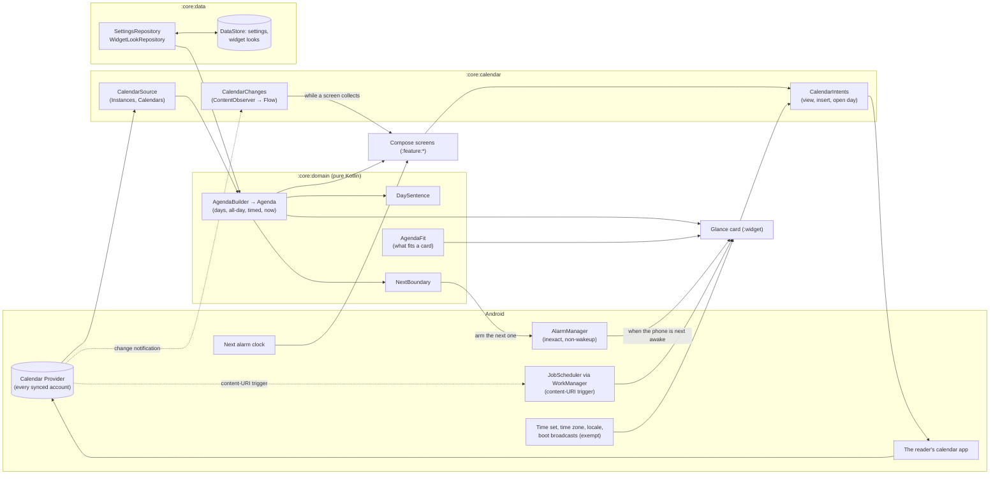

# Tempo — Technical Planning

> Companion to [VISION.md](VISION.md). This document defines the architecture, the design of the calendar engine, the widget, and the delivery phases.
> It is written to be read by humans and by Claude Code.
>
> Keep the phase checklists up to date: tick the boxes as work is merged, and record every decision and deviation with its reason in §15.

---

## 1. Tech stack

The family's stack, as Passo set it up (Passo ADR 0001), minus what Tempo has no use for.

| Concern | Choice |
|---|---|
| Language | Kotlin 2.4, compiled by AGP 9's built-in Kotlin, with the Compose compiler Gradle plugin |
| Build | Gradle 9.8 with Kotlin DSL, AGP 9.4; version catalog (`gradle/libs.versions.toml`); convention plugins in `build-logic/` |
| JDK | Java 21, `jvmTarget` 21, without a Gradle toolchain |
| SDK levels | `minSdk 34`, `targetSdk 37`, `compileSdk 37` (Passo's) |
| UI | Jetpack Compose, Material 3 in Chiaro's design language (its generated schemes, dynamic color on request), edge-to-edge |
| Widget | Jetpack Glance (`glance-appwidget` + `glance-material3`) 1.2.x, `SizeMode.Exact`, the system `TextClock` through `AndroidRemoteViews` |
| Architecture | MVVM with unidirectional data flow; coroutines and `Flow` |
| Dependency injection | Hilt |
| Calendar | The system Calendar Provider (`CalendarContract`) through the `ContentResolver`: no library |
| Persistence | DataStore (Preferences) for the settings and the widgets' looks. **No Room**: Tempo stores no event (§5) |
| Background | WorkManager (already brought by Glance, pinned as in Passo) for the calendar's content-URI trigger; `AlarmManager` inexact non-wakeup alarms for the boundaries (§7) |
| Navigation | Navigation 3, as Passo's shell |
| Time | `java.time`; Android's `DateFormat.getBestDateTimePattern` for the locale's own patterns |
| Testing | JUnit 4, Truth, Turbine, coroutines-test; Robolectric (the provider through a fake `ContentProvider`, receivers, Compose UI tests); Glance's unit test utilities |
| Quality | Android Lint (`checkDependencies`), ktlint through Spotless; Baseline Profiles later |
| CI | GitHub Actions: formatting, the forbidden-permission check on the merged manifest, unit tests and lint before the APKs. A release workflow on version tags builds the signed APK and publishes it to GitHub Releases |
| License | GPL-3.0. Every new dependency must have a GPL-3.0-compatible license (Apache-2.0, MIT, BSD) and the owner's approval |

Always pick the **latest stable** versions at setup time and record them in the version catalog. Avoid alpha versions unless a phase needs them and says why.

---

## 2. Project structure

```
tempo/
├── app/                    # Application, MainActivity, navigation, DI entry points
├── build-logic/            # Convention plugins (android-application, library, compose, feature, hilt, jvm)
├── core/
│   ├── model/              # Pure Kotlin data classes (no Android deps)
│   ├── domain/             # Pure Kotlin: the agenda, the day's sentence, the widget's fit, the next boundary
│   ├── data/               # DataStore: settings, widget looks; repositories exposing Flow
│   ├── calendar/           # The Calendar Provider's Android half: queries, change observer, intents
│   ├── designsystem/       # M3 theme, typography, shared components, icons
│   └── testing/            # test-only: the accessibility checks and the page walk the UI tests share
├── feature/
│   ├── today/              # the clock, the sentence, the agenda, the new-event button
│   ├── settings/           # settings, the calendars, about, credits
│   ├── onboarding/         # welcome, the calendar permission, the widget
│   └── guide/              # the guide, in Chiaro's shape (Phase 5)
├── widget/                 # the Glance card(s), the config screen, the refresh (job, alarm, receivers)
├── tools/                  # the launcher icon script
├── docs/                   # ADRs, screenshots
├── VISION.md
├── PLANNING.md
└── CLAUDE.md
```

Rules:

- `core:model` and `core:domain` are pure Kotlin/JVM modules. All business logic lives there and is unit-tested without Android.
- Feature modules depend on `core:*`, never on each other.
- `app` wires everything together.
- A module joins the build in the phase that brings its first code, not before (`feature:guide` in Phase 5).

---

## 3. Architecture overview



**One way in, one way out.** Events come in from the Calendar Provider only, read by `CalendarSource`. Changes go out through the calendar app only, opened by `CalendarIntents`. Tempo writes nothing but its own settings.

**The read path is computed, not stored.** A screen or a card asks for the instances of a time window and the calendars' metadata, and `:core:domain` turns them into an `Agenda`: days, each with its all-day row and its timed events, where "now" falls, what is under way, the sentence. Nothing is cached in a table; the provider answers a day's query in milliseconds.

**Live while visible.** Today collects `CalendarChanges` (a `ContentObserver` on the provider, registered only while collected) and a minute ticker, both tied to the page's lifecycle. With the page gone, nothing of Tempo runs.

**The widget is pushed, never polled** (§7): the calendar's content-URI trigger, the next boundary's inexact alarm, and the exempt time broadcasts each ask the card to recompose. Its clock is the system's `TextClock` and needs none of it.

---

## 4. The calendar engine (core design)

The riskiest part of the app: wrong days, missing occurrences and stale cards are what make readers drop agenda widgets. Build it first, with its tests, before any screen.

### 4.1 Reading the provider

- **Instances**, not Events: `CalendarContract.Instances.CONTENT_URI` with the window `[start, end)` in epoch millis appended (`Instances.CONTENT_URI.buildUpon()`, `ContentUris.appendId(begin)`, `appendId(end)`). The provider expands recurrences and applies exceptions; Tempo never parses an `RRULE`.
- **Projection** (only what is shown or decided on): `EVENT_ID`, `BEGIN`, `END`, `START_DAY`, `END_DAY`, `START_MINUTE`, `END_MINUTE`, `ALL_DAY`, `TITLE`, `EVENT_LOCATION`, `CALENDAR_ID`, `DISPLAY_COLOR` (the event's colour, or its calendar's), `STATUS`, `SELF_ATTENDEE_STATUS`, `EVENT_TIMEZONE`, `AVAILABILITY`, `IS_ORGANIZER` (so an invitation the reader has not answered is told from a meeting they set up, review of 30 Oct 2026).
- **Calendars**: `Calendars.CONTENT_URI` for `_ID`, `CALENDAR_DISPLAY_NAME`, `ACCOUNT_NAME`, `ACCOUNT_TYPE`, `CALENDAR_COLOR`, `VISIBLE`, `SYNC_EVENTS`, `IS_PRIMARY`. `VISIBLE = 0` (hidden in the calendar app) is hidden by default in Tempo too, and the reader's own choice in Tempo wins over it. `SYNC_EVENTS = 0` (a calendar the account lists but this phone does not sync: a colleague's, a country's holidays ticked off) is not on the phone: no switch in Settings, not counted, its events never shown, as the calendar apps list only the synced ones (`CalendarChoices.onPhone`, review of 30 Oct 2026).
- **The window**: from the start of today to the end of the horizon's last day, in the zone of the phone, widened by a day on each side so that all-day events (stored in UTC, §4.2) are never cut off by the window itself; the domain trims.
- **Selection in the domain, not in SQL**: hidden calendars, declined invitations and cancelled events are filtered by `AgendaBuilder`, in pure Kotlin, where they are tested. The query stays the same for every reader.
- **Threading**: queries run on `Dispatchers.IO`; a `SecurityException` (the permission revoked while the app runs) becomes a state, never a crash.

### 4.2 All-day events and time zones

- An all-day event is stored from **00:00 UTC** of its first day to 00:00 UTC of the day after its last (`END` exclusive). Its days are therefore read in **UTC** (`START_DAY`/`END_DAY` are Julian days computed by the provider; or `BEGIN`/`END` converted with `ZoneOffset.UTC`), never in the phone's zone. In the phone's zone, a one-day event at UTC−5 starts at 19:00 the day before.
- A timed event is placed by its `BEGIN`/`END` in the phone's **current** zone. `EVENT_TIMEZONE` is only shown when it differs from the phone's (a flight "departs 10:00 Lisbon time"), and only if Phase 3 finds a way to say it in one line.
- A time-zone change (travel) re-reads everything: the days move, the provider's own instances table is rebuilt by the provider itself.

### 4.3 Days, overlaps, multi-day events

- A timed event that crosses midnight belongs to every day it touches; on the second day it reads "until 01:30", on the first "from 23:00".
- A multi-day all-day event is in each day's all-day row with "day 2 of 5".
- Overlapping events are listed by start, then by end, then by title; the timeline never draws them side by side (one column, the phone's width).
- The event under way: `BEGIN <= now < END`. Past: `END <= now`. Next: the first with `BEGIN > now`.

### 4.4 What is not shown

- `STATUS = STATUS_CANCELED`: never.
- `SELF_ATTENDEE_STATUS = ATTENDEE_STATUS_DECLINED`: hidden unless the reader shows declined invitations.
- Calendars the reader hid in Tempo, or hidden in the calendar app and not shown in Tempo.
- Events with no title are shown as "(No title)", the calendar app's own convention.

### 4.5 Watching for changes

- **In the app**: `CalendarChanges` is a `callbackFlow` around a `ContentObserver` registered on `CalendarContract.CONTENT_URI` with descendants, unregistered when the collector stops. Changes are debounced (a sync writes many rows at once). Android refuses the observer without `READ_CALENDAR`, so the pages watch through `CalendarChanges.flow(restarts)`, started again at every reread: a permission granted from the page's card or the system's settings makes the page live at once (review of 30 Oct 2026).
- **For the widget**, two ways, the first fast and the second a safety net (9 Oct 2026, §15):
  - the provider's own `PROVIDER_CHANGED` broadcast on `content://com.android.calendar`, received in the manifest (`CalendarChangedReceiver`). It is not on Android 8's exemption list, but the AOSP provider sends it with `FLAG_RECEIVER_INCLUDE_BACKGROUND`, about a second after an app's edit and half a minute after a sync's, so a manifest receiver has it. The waiting trigger is replaced first, so the change is drawn once;
  - a WorkManager `OneTimeWorkRequest` with `Constraints.addContentUriTrigger(CalendarContract.CONTENT_URI, true)` (quiet for 3 s, at most 20 s late), tagged, one waiting at a time; each run arms the next *before* it repaints, so a change during the run is seen (content-URI triggers are one-shot by design). It costs nothing while nothing changes, and catches a maker's provider that does not send the broadcast.
  - Either stays until the cards are drawn (`TempoWidgets.repaintAll`, `WidgetRefresh.awaitDrawn`): Glance composes in a WorkManager worker started inside Tempo's process with no job bound, and a process left cached can be frozen with the card half drawn.

### 4.6 Edge cases (all need unit tests)

- An all-day event, one day and several days, in a phone zone west of UTC, east of UTC, and at UTC.
- A timed event crossing midnight; one crossing two midnights.
- A recurring event with an exception (one occurrence moved) and a deletion (one occurrence cancelled).
- The night daylight saving starts (the 02:00–03:00 hour does not exist) and ends (01:00–02:00 happens twice); an event in the repeated hour.
- The phone's zone changing between two reads (travel).
- A zero-length event (`BEGIN = END`): a moment, shown at its time.
- An event that started yesterday and ends tomorrow (timed): on today it is in the all-day row, "day 2 of 3"; its first date keeps it as "from 21:00", its last as "until 02:00" (decided in Phase 1, §15).
- Declined, tentative, cancelled; an event with no title; a calendar with no colour.
- Today empty, the horizon empty, every calendar hidden, no calendar at all.
- Midnight while the page is open: the day rolls over without a restart.
- The permission revoked while the app is open; granted from the system's settings while the app is in the background.

### 4.7 Handing over to the calendar app

`CalendarIntents` builds every intent, and says whether something can take it (`resolveActivity`, with `<queries>` in the manifest for Android 11+ package visibility):

| What | Intent |
|---|---|
| Open an event (one occurrence) | `ACTION_VIEW`, `ContentUris.withAppendedId(Events.CONTENT_URI, eventId)`, extras `EXTRA_EVENT_BEGIN_TIME` / `EXTRA_EVENT_END_TIME` = the instance's |
| New event | `ACTION_INSERT`, `Events.CONTENT_URI`, `EXTRA_EVENT_BEGIN_TIME` = the next half hour (or the free gap's start), `EXTRA_EVENT_END_TIME` = one hour later |
| Open the calendar at a day | `ACTION_VIEW`, `CalendarContract.CONTENT_URI/time/<millis>` |
| Edit an event | `ACTION_EDIT` on the event URI: only if Phase 1 measures it working on the owner's calendar apps (VISION, From the concept); otherwise `ACTION_VIEW` |

From the widget the same intents travel as `PendingIntent`s (immutable). A "No app can open this" state replaces a button that would do nothing.

---

## 5. Data model

Tempo has no database. The Calendar Provider is the only truth for events; Tempo keeps the reader's choices.

### `:core:model` (pure)

- `CalendarInfo(id, name, accountName, accountType, color, visibleInProvider, isPrimary, syncsEvents)`
- `EventInstance(eventId, calendarId, title, location, begin: Instant, end: Instant, allDay, color, status, selfStatus, availability, timeZone, isOrganizer)`, with `awaitsAnswer` (invited, and not by themselves): as stored; an all-day event's dates are derived in the domain (`allDayDates()`, UTC), never stored beside it
- `EventStatus`, `AttendeeStatus`, `Availability`, `CalendarPermission`
- `Agenda(now, today, days, underWay, next)`, `AgendaDay(date, allDay: List<AllDayEntry>, timed: List<TimedEntry>, free: List<FreeGap>)`, `AllDayEntry(event, dayNumber, dayCount)`, `TimedEntry(event, startsOnDate, endsOnDate, state)`, `FreeGap(start, end)`. The day's sentence is computed from an `AgendaDay` by `DaySentence` (Phase 3), not stored in it
- `UserSettings`, `WidgetLook` (below)

### DataStore (Preferences), file `settings`

| Key | Default | Meaning |
|---|---|---|
| `theme`, `palette`, `font`, `dynamic_color` | system, VIVID, GOOGLE_SANS, false | The family's appearance |
| `clock_format` | SYSTEM | `ClockFormat` |
| `date_style` | LONG | `DateStyle` |
| `horizon_days` | 7 (a week; owner, §15) | Days shown: 1, 2 or 7 |
| `calendar_choices` | empty | The calendars the reader turned on or off in Tempo (a string set, one `CalendarChoice` per line, URL-encoded fields), each kept as `id` **and** `account_type/account_name/display name`, so a restore that renews the ids can still match them (`CalendarChoices`, §15) |
| `show_declined` | false | Declined invitations |
| `show_all_day` | true | All-day events |
| `show_next_alarm` | true | The next alarm line |
| `show_calendar_button` | true | Today's button that opens the calendar app at today (§15, 9 Oct 2026) |
| `onboarding_completed` | false | |
| `asked_calendar_permission` | false | Whether the permission was ever asked: what tells "askable" from "denied for good" (§15) |

### DataStore, file `widgets` (not backed up)

One `WidgetLook` per `appWidgetId`: show clock, clock format, show date, date style, header action, event action, card ground (light, dark, system, one of six colours), opacity, show all-day, show the days ahead. Removed in `onDeleted`.

### Backup

`data_extraction_rules.xml`: `files/datastore/settings.preferences_pb` only (Passo's ADR 0007 rule: an allowlist, decided). The widgets' file stays out: widget ids are renewed by a restore.

---

## 6. Derived views (`core:domain`)

- **`AgendaBuilder`**: instances + calendars + settings + now + zone → `Agenda`. Applies §4.2–§4.4. Pure, the most tested class of the app.
- **`DaySentence`**: the day in one sentence, from the agenda alone: the count of what is left, the next event and when, the free time before it, the end of the day ("Nothing left today; tomorrow starts at 9"). Returns a structure (kind + values), never a string: the words are resources, in both languages, with plurals (`:feature:today` and `:widget` format it).
- **`FreeTime`**: the gaps between a date's busy timed events (overlaps merged; free-availability and declined events do not take the time; all-day ones neither), and on today the time from now to the next busy one. Never the evening after the last event or the morning before the first, which are not "free time" any more than the night is (§15). Every gap feeds the sentence; the first gap of an hour or more still ahead today is also a row of the timeline (owner, §15, 7 and 30 Oct 2026).
- **`NextBoundary`**: the next moment the agenda changes by itself: the nearest `BEGIN` or `END` after now, or the next midnight, whichever is first; with an «In words» card placed, also the moment an event comes onto the dial's face (`DialArcs.comesOnTheFace`, review of 30 Oct 2026). The widget arms its alarm on it.
- **`AgendaSections`**: the agenda's days as Today lays them out: today, tomorrow in full, the days after it compact, and every run of empty days folded into one row (§15, 9 Oct 2026).
- **`AgendaFit`** (pure arithmetic, as Passo's `GlanceLayout`): given a card's granted size in dp, the header's choice and the text sizes measured in the system face, how many event rows fit, which form the card takes, and what the "N more" line says. Pinned by tests at the family's reference grants (one row ≈ 85 dp tall, two ≈ 189; widths 2 cells ≈ 159 dp, 3 ≈ 250, 4 ≈ 340).
- **Calendar colours are data, not roles.** They are chosen in the calendar app with no thought for Tempo's grounds, so they mark an event (a dot, a bar at the start of its row, a quiet arc on Today's dial) and never colour its text or its ground. A mark keeps a 3:1 contrast with its ground by stepping its lightness when it must (`markColor`), and a mark drawn quieter fades only as far as that ratio allows (`markAlpha`): pure functions with their tests.

---

## 7. Widget (Glance)

Two cards in v1, the family's pair (owner, §15): «Agenda» (`AgendaWidget`, the concept's) and «In words» (`WordsWidget`, Chiaro's «In parole», Passo's «In words»). The same size spec, the same settings screen, the same refresh. The family's card (Passo's ADR 0005, from Chiaro): its corner, insets, grounds, Chiaro's six colours, opacity, and Chiaro's ink rule.

### Configuration

- `SizeMode.Exact`: every form is read off the size the launcher really granted. Glance does the work the concept gave to `onAppWidgetOptionsChanged`, and recomposes on every resize.
- Default placement 4×2 (`targetCellWidth` 4, `targetCellHeight` 2), minimum one cell, `resizeMode="horizontal|vertical"`, **no maximum** (Passo's ADR 0005: Launcher3 turns a dp maximum into the smallest cell count across its grids). Each form has a layout for any grant (`AgendaFit`, `WordsFit`, `:core:domain`; ADR 0003).
- `updatePeriodMillis = 0`. `configure` is the per-widget settings screen, `reconfigurable|configuration_optional`.
- `widgetCategory="home_screen"` in v1; `keyguard` is a later idea.

| Form | When | Content |
|---|---|---|
| CLOCK | one cell, or a row too narrow for a list beside the clock (two cells) | The time, as large as the cell holds; the date under it where it still reads (else none) |
| LINE | one row, three cells and up | The time and, under it at 16 sp (Passo's facts, «In words»'s line on top), the date (shortened before it is shrunk) on the leading side; the next events beside them, and "N more" |
| AGENDA | two rows and up | The header (clock and date at 16 sp, each optional), then the events that fit, then "N more today" |
| SIDE | two rows and up, four cells, where a header on top would leave fewer than five rows (the default 4×2) | The clock and the date (over two even lines if need be: "Wednesday, / October 7") in a column on the leading side, the rest of the day in a few words under them ("4 left today", "until 19:30"); the events beside them |

With the clock and the date both hidden, the card is its list alone, on any grant. A date's all-day events share one row ("All day · Design Week, Anna's birthday"), so two holidays never push out what happens next. A row sets its time as a range where the title keeps 120 dp, its start alone where it keeps 72, else over the title. The time column is set by the rows the card shows, the event under way as "→ 11:00" where "Until 11:00" would widen it for every title, and an all-day label more than an em wider than the timed rows' times (Italian's "Tutto il giorno") stands over its titles across the list instead (`AgendaFit.timeColumn`, ADR 0003 decision 13).

**The rest of the day in a few words** (8.2, ADR 0003 decision 12): under the date in «Agenda»'s side column, at the label step in the secondary ink, how many timed events are left today, the one under way among them, and when the last one ends ("4 left today" / "until 19:30", "Ancora 4 oggi" / "fino alle 19:30"; `CardSummary`), each line where it fits whole; nothing once today's timed events are over. Counts and clock times the card is redrawn at anyway, so they never go stale. It stands where the next alarm was planned: the alarm's change did not reach a card in the background reliably on the owner's phone, so the alarm stays on Today alone (§15, 30 Oct 2026, Phase 8.2).

| «In words» form | When | Content |
|---|---|---|
| CELL | one cell wide | The dial, as large as the cell; under it the focus's time ("11:00") where the cell is taller than wide. Without the dial, that time bold in its place, the title under it |
| ROW | one row | Passo's row: the dial (up to 56 dp, Passo's ring); the title (20 sp, Chiaro's sentence) over when ("Until 11:00", "15:00 – 15:45", "Tomorrow · 9:00 – 9:30", 16 sp, Passo's facts); the date at the far edge over two lines ("Wednesday / 7 October") where the words keep 120 dp. A narrow row sets the words at 16 and 14 sp, a long title over two lines |
| TALL | two rows and up | Passo's tall card: the dial in the top trailing corner (48 to 104 dp) with the date beside it; the title (22 sp, down to 18 to stay on one line), when, the day's note hanging from the bottom leading corner; on a card four cells wide with height to spare, the rest of the day as a line of times ("Then 13:00 · 15:00 · 18:30") in place of the note's count |

**The dial** (owner, 8 Oct 2026; `DialArcs`, `WidgetDial.kt`, ADR 0003): a clock face where Passo's card has its ring. The hands are the system's `AnalogClock`, drawn by the launcher and moved by the system like the `TextClock`; the face under them is a bitmap Tempo paints at each redraw: the ring's track, the focus as an arc in the accent from its start to its end, what else is still to come in the face's twelve hours as quieter arcs, four quarter dots. The arcs change only where an event starts or ends, or comes onto the face, the boundaries the card is redrawn at (the last one since the review of 30 Oct 2026, where an «In words» card is placed: an evening's face waited for midnight to show the next morning's meeting its words already named), so the hour hand walks into an arc, through it and out of it with no work by Tempo. A face shows twelve hours: the window opens now (or at the start of the event under way, six hours back at most) and closes eleven and a half hours later, so no arc ever meets the hand from behind; what lies beyond it is left off, never wrapped. The samples paint the hands into the face at their moment.

The focus is the event under way, else the next one today, else (with the days ahead) the first one after today under its day's name, else "Free" (`WordsDay`). The note says times and counts, never minutes from now (§15): "Then 2 more today.", "Free until then; one more after it.", "Nothing left today.", or a free day's all-day events.

### Rendering

- **No scrolling container**: a Glance `Column`, never `LazyColumn` (a `ListView` underneath). Glance drops the eleventh child of a container silently: events go in groups of at most five, the header and the footer counted.
- **The clock and the date are a `TextClock`** in a small XML layout, placed in the card with Glance's `AndroidRemoteViews`; `format12Hour`/`format24Hour` set per widget (`RemoteViews.setCharSequence`), and with both set to the same pattern when the reader forced one. It is drawn by the launcher, updated by the system every minute, and costs the app nothing. Its text size and ink are set like the card's other text.
- Inks resolved against the ground the card really has (`widgetInk`, Chiaro's rule, as in Passo), never left to the launcher's day/night resolution.
- An event row: the calendar's mark, the time ("10:00–11:00", or "All day"), the title on one line, ellipsised; the event under way in the strong ink with "ends 11:00"; past events are not on the card at all (the card is the rest of the day).
- Previews: a static `previewLayout`, and generated previews on Android 15+ (`providePreview`) from a sample day, once per version.

### Taps

- Header (the clock and the date): Tempo's Today (the default), the calendar app at today, or the phone's clock app (owner, §15), per widget.
- Event: the event's occurrence in the calendar app (the default, as on Today), or Tempo's Today, per widget.
- "N more today", the rest of the card: Tempo's Today.
- No permission: Tempo, where Today (or the first run) asks for it.
- A door that is not on the phone (no calendar app, no clock app) falls back to Tempo, and the settings screen does not offer it.

### Update strategy (battery-aware)

- **Calendar changed**: the provider's broadcast, else the content-URI-triggered work (§4.5), updates every card and stays until they are drawn; the work arms the next one as it starts.
- **A boundary**: after every render the card arms one `AlarmManager.set(RTC, NextBoundary)` (inexact, **non-wakeup**): if the phone is asleep it is delivered when the phone next wakes, which is when someone can see the card. No `SCHEDULE_EXACT_ALARM`, no `RTC_WAKEUP`.
- **Clock, zone, language**: `TIME_SET`, `TIMEZONE_CHANGED`, `LOCALE_CHANGED`, exempt from the implicit-broadcast limits, received in the manifest.
- **Boot and update**: the system sends the card its update after a boot and after an app update; the alarm and the work are armed again from it.
- **Settings changed** in the app or the card's own screen: an immediate update.
- Nothing else. No periodic work, no polling, no foreground service.

---

## 8. Notifications and system surfaces

- **No notification channel in v1**, and so no `POST_NOTIFICATIONS` (VISION, System surfaces).
- **Launcher shortcut** (dynamic, `NewEventShortcut`: a static one names its package, and the debug build's is another): "New event", the `ACTION_INSERT` of §4.7 (owner, §15). Published again when its words are not the app's any more (the reader changed the app's language, review of 30 Oct 2026).
- **Pin request**: onboarding and Settings offer "Add the widget to the home screen" through `AppWidgetManager.requestPinAppWidget`, where the launcher supports it.

---

## 9. Battery rules (non-negotiable)

1. No service, foreground or background. Tempo runs only when a screen of it is visible, when a card is being drawn, or when the calendar changed.
2. No wakelocks of the app's own (WorkManager holds its own while its work runs, as in Chiaro and Passo).
3. No exact alarms, no wake-up alarms, no `REQUEST_IGNORE_BATTERY_OPTIMIZATIONS`, no periodic workers.
4. Nothing runs on a timer while the screen is off. The minute ticker lives in the page's lifecycle (`repeatOnLifecycle(STARTED)`), the observer in the collector's.
5. The widget's clock is the system's `TextClock`: never a repaint per minute by the app.
6. A phase that touches the refresh ends with a check: `adb shell dumpsys alarm | grep tempo` (one non-wakeup alarm at most), `adb shell dumpsys jobscheduler | grep tempo` (one content-triggered job), `dumpsys batterystats --charged com.callbackdev.tempo`, Doze (`dumpsys deviceidle force-idle`).

---

## 10. Permissions and manifest

| Permission / element | Type | Why |
|---|---|---|
| `READ_CALENDAR` | Runtime | Read the Calendar Provider (Phase 1, declared by `:core:calendar`) |
| `<queries>` for `ACTION_VIEW`/`ACTION_INSERT` on calendar URIs | Manifest | Lets Android 11+ show Tempo the calendar app, to know whether a button can work. Not a permission |
| `RECEIVE_BOOT_COMPLETED`, `WAKE_LOCK`, `ACCESS_NETWORK_STATE`, `FOREGROUND_SERVICE` | Normal | Brought by WorkManager, which Glance runs its sessions on and the calendar trigger uses, as in Chiaro and Passo. Without `INTERNET` nothing can leave the phone. Tempo's own code uses none of them. Reviewed in Phase 4 against the merged manifest: the same set as Phase 0's, nothing added by the widgets (the boundary alarm is `AlarmManager.set(RTC)`, which needs no permission); kept as WorkManager declares them, as in the sisters |
| `<queries>` for `AlarmClock.ACTION_SHOW_ALARMS` | Manifest | Lets Tempo find the phone's clock app (`ClockApp`, declared by `:core:calendar` since 8.1): Today's alarm line and a card whose time opens it (Phase 4). Not a permission; Tempo opens the app's front door and never sets an alarm |
| `android:allowBackup="true"` + `dataExtractionRules` | Manifest | The settings file only (§5) |

**Forbidden:** `INTERNET`, `ACCESS_*_LOCATION`, `REQUEST_IGNORE_BATTERY_OPTIMIZATIONS`, `SCHEDULE_EXACT_ALARM`, `USE_EXACT_ALARM`, `WRITE_CALENDAR`, `READ_CONTACTS`, `WRITE_CONTACTS`, `HIGH_SAMPLING_RATE_SENSORS`, `BODY_SENSORS*`.

`checkForbiddenPermissions` (build-logic, `ForbiddenPermissionPatterns`) checks every variant's merged manifest, is wired to `check`, and runs in CI and in the release workflow. A library that adds one is removed or patched with `tools:node="remove"`.

---

## 11. Delivery phases

Each phase ends with a merged PR, green CI and its acceptance criteria met. Phases 1 and 4 need **testing on a physical device** with real accounts: an emulator's calendar has no sync and no second calendar app.

### Phase 0 — Foundations

- [x] Create the repo; add `README.md`, `LICENSE` (GPL-3.0 full text), `.gitignore`, `.editorconfig`
- [x] `VISION.md` from the owner's concept, with its corrections and open questions
- [x] Gradle setup: version catalog, `build-logic` convention plugins (Passo's, without Room), module skeleton (§2)
- [x] Hilt, Compose, Material 3 theme in Chiaro's dress (Passo's design system, copied), and `MainActivity` edge to edge with Today's clock
- [x] `strings.xml` for `values/` (English) and `values-it/`; `locales_config.xml` for per-app language
- [x] Launcher icon drawn by `tools/draw_launcher_icon.py` (the family's ring, a clock face at the lower left)
- [x] CI: formatting, forbidden permissions, unit tests, lint, then the APKs; the tag-triggered release workflow
- [x] The shared debug keystore, committed on purpose (`keystore/README.md`)
- [x] Generate the **release keystore** (owner): outside the repo, with an offline backup, in the four GitHub secrets (`KEYSTORE_BASE64`, `KEYSTORE_PASSWORD`, `KEY_ALIAS`, `KEY_PASSWORD`). Its fingerprint goes into `keystore/README.md` and the README's Install section.
  - In the secrets on 10 Oct 2026; read by the release workflow's rehearsal (run by hand, Release #1, green): the APK signed by `CN=callbackdev`, SHA-256 `A9:43:D8:BA:…:58:58:FE`, now in both files and checked by `release.yml` on every run (§15).
- [x] `CLAUDE.md`
- [x] `docs/adr/0001-foundations.md`, `docs/adr/0002-design-language.md`
- [x] The owner's review of VISION.md and answers to its open questions (recorded in §15)

**Acceptance:**
- CI is green.
  - Verified locally on 7 Oct 2026 with CI's own sequence: `spotlessCheck`, `checkForbiddenPermissions`, `test`, `lintDebug`, `assembleDebug`, `assembleRelease -PsignReleaseWithDebugKey`; and on GitHub, Android CI run #1 (Phase 0) and #2 (the owner's review), both green.
- The app launches and shows the time and the date.
  - Built and tested (`TodayScreenTest`: 24-hour, 12-hour, Italian); not yet run on a device.
- Adding `INTERNET` or `WRITE_CALENDAR` to any manifest fails `checkForbiddenPermissions`.
  - Verified: both added to `:core:calendar`'s manifest made the debug and release checks fail, naming both. The merged manifest today holds only WorkManager's `ACCESS_NETWORK_STATE`, `FOREGROUND_SERVICE`, `RECEIVE_BOOT_COMPLETED`, `WAKE_LOCK` and AndroidX's own `DYNAMIC_RECEIVER_NOT_EXPORTED_PERMISSION` (§10).

### Phase 1 — The calendar engine (highest risk)

- [x] `core:model`: `CalendarInfo`, `EventInstance`, `Agenda`, `AgendaDay`, `AllDayEntry`, `TimedEntry`, `FreeGap`, and the provider's codes as enums
- [x] `core:domain`: `AgendaBuilder` test-first, every case of §4.6; `NextBoundary`; `FreeTime`; `AgendaFilter` (the reader's choices); `AgendaWindow` (the query's span); `allDayDates()`; `calendarPermission()`; `nextHalfHour()`
  - 50 JVM tests (`AgendaBuilderTest` 27, `FreeTimeTest` 7, `NextBoundaryTest` 5, the rest 11).
- [x] `core:calendar`: `CalendarSource` (Instances and Calendars queries, §4.1), `CalendarChanges` (§4.5), the permission state (`CalendarAccess`: granted, askable, denied for good, from `calendarPermission()`)
  - *Deviation:* the read returns `CalendarRead` (`Read` or `NoPermission`), so a missing or revoked permission is a value the screens draw, never an exception.
- [x] `core:calendar`: a fake `ContentProvider` for the authority `com.android.calendar` under Robolectric (`FakeCalendarProvider`), so the queries themselves are tested (the URI and its window, the projection, the cursor read by column name, missing columns, a revocation mid-read), not only the domain
  - 16 Robolectric tests. The fake refuses every write: a test would fail if Tempo ever tried one.
- [x] `CalendarIntents` (§4.7) with `<queries>` (VIEW of an event, INSERT, VIEW of a day), and `canOpen()` before a button is drawn
- [x] The intents measured on the owner's phone with the owner's calendar app(s): VIEW of an occurrence, INSERT with a start, VIEW of a day, and whether EDIT is honoured
  - *Deviation:* moved to Phase 3, where Today's buttons send them; for an earlier answer, `docs/device-checks/calendar-intents.md` has the four `adb` commands, with no Tempo build needed.
- [x] `READ_CALENDAR` in `:core:calendar`'s manifest; a debug-only screen is **not** built: the engine is proven by tests and by Phase 3's screen
  - The merged manifest now holds `READ_CALENDAR` beside WorkManager's four and AndroidX's receiver permission; `checkForbiddenPermissions` passes.

**Acceptance:**
- [x] All engine tests pass, every §4.6 case included.
  - Every case of §4.6 has its test, except the two that are about a running app (the permission granted from the system's settings while Tempo is in the background; midnight while a page is open, beyond the agenda's own turnover): they need Phase 3's page and are in its UI tests.
- [x] On the owner's phone, Tempo's instances for a week match the calendar app's, all-day and recurring events included (a written check in §15).
  - *Deviation:* with no screen yet, this check moves to Phase 3's acceptance, where Today shows the week.

### Phase 2 — Settings

- [x] `SettingsRepository` on DataStore (§5); the appearance applied by `MainActivity` (theme, palette, typeface, wallpaper colours), as Passo's
  - Only what differs from a default is stored; an unreadable value reads as its default; a corrupt file is replaced by an empty one. 5 tests on a real DataStore file (a restart is a second store on the same file), 2 for the encoding of the calendar choices.
- [x] Settings screen: clock, date, horizon, the calendars (grouped by account, with colours and switches), declined, all-day, next alarm, appearance (with a live preview), language (the system picker), privacy, about, credits, licence
  - The calendars: `CalendarGroups` (accounts alphabetically, the phone's own last, the primary calendar first), each with its colour as a `CalendarDot` stepped to 3:1 (`markColor`), the count shown, and, with no permission, a card that asks for it (or, refused for good, opens the app's system page). Read again on the provider's changes and on every return to the page.
  - 13 UI tests from states, `assertAccessible()` on each, the page walked at twice the text size and on an open foldable; screenshots looked at.
- [x] The guide's entry, waiting for Phase 5
  - *Deviation:* not drawn at all until the guide exists: a card to a page that does not exist would be the screen lying (CLAUDE.md, Design). It comes first in the list, as in the sisters', with Phase 5.
- *Brought forward from Phase 3:* the shell's first part, so Settings can be reached: Navigation 3 with Today and Settings (`TempoRoot`), Passo's transitions, and a gear on Today. The onboarding joins it in Phase 3.

**Acceptance:**
- [x] Every setting changes what it says, and survives a restart; hiding a calendar hides its events at once.
  - On screen now: the time and date formats (Today and the preview) and the appearance. The agenda's settings (days ahead, all-day, declined, next alarm, the calendars) change the agenda, which Today draws from Phase 3: until then they are proven by `CalendarChoicesTest` ("hiding a calendar takes its events off the agenda at once") and `AgendaBuilderTest`. Every setting surviving a restart: `SettingsRepositoryTest`.

### Phase 3 — Today and onboarding

- [x] The shell (Navigation 3, as Passo's): onboarding, Today, Settings (Today and Settings since Phase 2)
  - The onboarding stands before the pages until it is done (`settings.onboardingCompleted`), not as a page to go back to.
- [x] Today: the clock, the date, the sentence, the next alarm, the all-day row, the timeline with "now", the days ahead, the states of §VISION (no permission, nothing today, no calendars, no calendar app)
  - Domain: `DaySentence` (`TodaySentence`: under way, soon, free until, all done, free day; `Tomorrow`), `DaySummary` for the days ahead, `Timeline` (the past folded, "now", the free rows), `AlarmDay`; 19 more JVM tests (152 in the whole build, all green).
  - The words: `AgendaText` in `:core:designsystem` (resources, plurals, both languages), so the widgets of Phase 4 tell the day in the same words.
  - The page: the hero on the family's glow (the clock, the date the calendar app opens on, the alarm, the sentence), the all-day chips, the timeline (the event under way on its own ground with a progress bar and the time left; past events quieter; declined ones struck through; the calendar's colour as a bar, stepped to 3:1), tomorrow in full, the following days one line an event, and a "no calendar app" note when nothing can open an event.
- [x] Touch an event (VIEW), the new-event button (INSERT), touch the date (VIEW of today); a free row's touch is a new event at its start
- [x] The device check of the intents, moved here from Phase 1 (`docs/device-checks/calendar-intents.md`): the owner's, on the phone
  - Done by the owner on the phone, 10 Oct 2026 (§15).
- [x] Live while visible: the minute ticker and `CalendarChanges`, both lifecycle-bound
  - `TodayViewModel`: one ticker on each minute's start and the observer, shared `WhileSubscribed` (five seconds after the page goes, nothing runs); the provider read again on a new date or zone, a new horizon, a calendar change, and every return to the page (the permission, the calendars or the calendar app may have changed meanwhile); the agenda rebuilt at every tick, so "now" moves without a read. The next alarm is read at each tick (no permission).
- [x] Onboarding: welcome, the permission (with "Not now"), the widget (pin request)
  - *Deviation:* the widget's page joins with the widgets (Phase 4): a page offering a card that does not exist yet would be the screen lying. The permission's page asks, or, refused for good, opens the app's system page; "Not now" is always a way through. *Phase 4:* the widget's page is there, third.
- [x] The launcher shortcut "New event"
  - *Deviation:* dynamic (`NewEventShortcut`), not static XML: a static shortcut names its package, and the debug build's is another. It opens Tempo, which hands the new event to the calendar app at the next half hour, so Back lands on Today.
- [x] UI tests on states, not databases (Robolectric), `assertAccessible()` and `walkPage()` at twice the text size and on an open foldable
  - Today 18, onboarding 6, Settings 13; the pages walked in light, dark, twice the text size and on an open foldable; screenshots looked at.
- [x] README screenshots: Today, onboarding (`ReadmeScreenshots`, sample data, English)
  - Four: Today mid-morning, the evening in the dark theme, Settings' calendars, the first run.
- [x] *Owner, 9 Oct 2026:* Today reviewed (§15): the date and the calendar button on top, the dial beside the clock with the day's arcs, rolling figures, the days ahead on cards, a run of empty days said once.

**Acceptance:**
- [x] On the owner's phone, Tempo's week matches the calendar app's, all-day and recurring events included (moved from Phase 1; a written check in §15).
- [x] A change made in the calendar app is on Today on return, without a gesture.
  - Done by the owner on the phone, 10 Oct 2026 (§15).
  - Built for (`CalendarChanges` while the page collects, a read at every return) and tested in its parts (`CalendarChangesTest`); the gesture-free return is the owner's to see on the phone, with the check above.
- [x] TalkBack reads each event as one sentence ("10:00 to 11:00, Dentist, Via Roma 3, in Personal").
  - `TodayScreenTest` reads that very sentence off the Dentist's row: "15:00 to 15:45, Dentist, Via Roma 3, in Personal".

### Phase 4 — The widget

- [x] `AgendaFit` (pure, §6) with tests at the reference grants; the forms of §7, for both cards
  - `:core:domain`'s `widget/`: `CardAgenda` and `fitLines` (what «Agenda» lists and what fits whole), `AgendaFit`, `WordsDay`, `WordsFit`, the type's arithmetic (`TextMetrics`); 40 JVM tests. `:widget` adds 40 Robolectric tests (the cards drawn, nothing cut, the doors, the alarm, the store, the settings screen) and the README's pictures.
- [x] The card in Glance: the `TextClock` header through `AndroidRemoteViews`, the event groups, "N more", the states
  - The clock and the date are the system's `TextClock` (six small layouts, a frozen `TextView` of each for the samples); the rows in groups of five, so no container passes Glance's ten children; the states (no permission, no calendar, every calendar hidden, unreadable) measured to fit, in words that say what a touch does.
- [x] The refresh: the content-URI work, the boundary alarm, the exempt broadcasts; the battery check of §9.6
  - `WidgetRefreshArming`: the content-triggered job (re-armed by itself, appended), one `RTC` alarm at `NextBoundary`, `WidgetSystemReceiver` (time, zone, language, package replaced), Tempo's settings and the reader leaving the app (`WidgetUpdater`); the last card removed disarms both. Pinned by `WidgetDoorsTest` (one non-wakeup alarm, replaced, cancelled).
  - [x] The battery check of §9.6 on the owner's phone: `docs/device-checks/widget-refresh.md`.
    - Done by the owner on the phone, 10 Oct 2026 (§15).
- [x] The per-widget settings screen, with the live preview (Passo's, from Chiaro)
  - The time and the date (each shown or not, each in the card's own format or Tempo's), the touches (the time: Tempo, the calendar at today, the clock app; an event: the calendar app or Tempo), the ground and its opacity, all-day events and the days ahead. The real card at the reference grants, "as placed" first.
- [x] Previews (static and generated)
  - Static `previewLayout`s of the default 4×2 cards; generated ones on Android 15+ from `WidgetSamples` (the README's week), published once per version by the Application.
- [x] `WidgetGalleryTest` draws every form to `widget/build/screenshots`; a README screenshot of the card
  - Every size, every dress, through the day, the reader's choices, Italian, the states; `WidgetFitTest` finds nothing cut, 5% wider than measured, in English and Italian, at 1, 1.15 and 1.3 the text size. README: `widgets.png`, `widget-settings.png`.
- [x] «In words» (`WordsWidget`): its forms (§7) in the same `AgendaFit` arithmetic, its gallery, its README screenshot; redesigned around the dial after the first cards on the phone (§15)
- [x] *From Phase 3:* the first run's widget page (the pair, Android's pin request where the launcher takes one, the way by hand where it does not), and a widgets group in Settings
- [x] *Owner, 8 Oct 2026:* a touch on the time can open the phone's clock app (§7, Taps; §15)

**Acceptance:**
- [x] On the owner's phone, beside Chiaro's and Passo's cards: the same card, the same colours.
  - Seen by the owner on the home screen, 10 Oct 2026: Chiaro's, Tempo's «In words» and Passo's cards side by side, one set (§15).
  - The card, its colours and inks are Passo's, unchanged (ADR 0003); the side-by-side is the owner's to see (`docs/device-checks/widget-refresh.md`, check 1).
- [x] A calendar change reaches the card within about a minute with the screen on; a finished event leaves it within minutes; with the screen off, `dumpsys alarm` shows no wake-up alarm of Tempo's.
  - Done by the owner on the phone, 10 Oct 2026 (§15).
  - Built for (a content trigger quiet for 3 s and at most 20 s late; an `RTC` alarm at the next boundary) and pinned by tests where a JVM can (one non-wakeup alarm at the right moment); the timing on a real phone is checks 2 to 5 of the same page.

### Phase 5 — The guide, accessibility and polish

- [x] `feature:guide`, in Chiaro's shape: the screen, the widget, what Tempo does not do and who does
  - Six chapters (where the events come from, Today, the calendar app does the writing, the home screen, battery, your data), Passo's prose kit, Today's own dial as the one example with its caption; the card first in Settings, as the sisters'. 8 UI tests: every chapter, the example, the dark theme, Italian, twice the text size on a small phone, an open foldable; a README screenshot (§15).
- [x] The accessibility pass: contrast (`ContrastTest`), labels, targets, twice the text size, foldables
  - The owner's final review of the whole, 10 Oct 2026, over what every screen's tests already pin: `ContrastTest` at 4.5:1, `assertAccessible()` (labels, 48 dp targets) and `walkPage()` at twice the text size and on an open foldable, the guide included (§15).
- [x] The privacy statement and credits in Settings
  - There since Phase 2: Privacy (what Tempo reads, that it sends nothing, Android's backup), About (version, developer, copyright, licence, source code), Credits (the typefaces and their licence), in both languages.
- [ ] Baseline Profile, if start-up measures slow

### Phase 6 — Release on GitHub (v1.0.0)

- [x] The release key in the secrets (Phase 0's open box)
  - 10 Oct 2026, and the workflow's rehearsal (Actions, Release, "Run workflow") builds and checks a signed APK without publishing it.
- [x] `CHANGELOG.md`'s 1.0.0 section; `tempo.versionName=1.0.0`; tag `v1.0.0`
  - The section and the version on 10 Oct 2026; the development record, entry by entry, moves to `docs/CHANGELOG-1.0.0.md`, as Passo's. The tag is the owner's, on `main`, after the release workflow's rehearsal there.
  - Tagged by the owner on 10 Oct 2026 at `77a7c17`; Release #4 green, and the published APK checked: its `.sha256` matches, signed by `CN=callbackdev` (`A9:43:D8:BA:…:58:58:FE`), 1.0.0 / 10000, no crash page, `READ_CALENDAR` and WorkManager's permissions only (§15).
- [x] The README's download link and the release key's fingerprint
  - The fingerprint and the steps since 10 Oct 2026; the download link and the release badge, as Passo's, with the 1.0.0 section.
- [x] The sister apps' READMEs name Tempo in "The family" (Chiaro, Passo, Saldo)
  - All three on 10 Oct 2026: Passo's in fiorenzobrioni/passo#37 (its README, CLAUDE.md and VISION.md), Chiaro's in fiorenzobrioni/chiaro#60 and Saldo's in fiorenzobrioni/saldo#93 (their READMEs; the same PRs take the sister apps out of their code and guides, as Passo's #38 and this repository do).

### After 1.0

- [x] 1.0.1: the empty days' card in words (§15, 10 Oct 2026); `CHANGELOG.md`'s 1.0.1 section, `tempo.versionName=1.0.1` (versionCode 10001). The tag `v1.0.1` is the owner's, on `main` after the merge.

### Phase 7 — Google Play (optional, later)

- [ ] As Passo's Phase 9: the same key, the store listing, the data safety form ("no data collected, no data shared").

### Phase 8 — 1.1: the review of 30 Oct 2026

The owner asked for a review of the whole app (30 Oct 2026): its UI/UX and graphics, the widgets', what would make it more complete without noise, and any error in how it reads the calendar or keeps itself up to date, with Passo and Chiaro beside it for the family's coherence. The review found five defects and a few smaller ones, fixed in 8.0; the rest the owner asked to plan here, "in detail, so the implementations can start in other sessions" (owner). Its findings and their reasons are in §15 (30 Oct 2026).

**How to run a step.** One step is one session. Start from the step: read CLAUDE.md, the step, and the files it names; build it with its tests (the domain's first, for anything that decides a day, a boundary or a fit); run `spotlessApply`, `test`, `:app:lintDebug` and `:app:checkForbiddenPermissions`; look at the screenshots the step changes (`build/screenshots`), regenerate the README's where they changed (`-PupdateScreenshots`) and look at them; tick the step, record its decisions in §15, and add its line to `CHANGELOG.md`'s Unreleased section in the reader's words. A step that changes a decision already recorded says so: the owner confirms it at the step's start, before anything is built. The steps are independent.

**Coherence with the family** (owner, 30 Oct 2026): Tempo follows Passo, with which it shares almost all its code. Chiaro diverged slightly between 14 and 18 Oct (rows as separate segments, its `SegmentedGroup`; a larger hero; the sentence in `bodyLarge`); Tempo does not take that alone: if the family adopts it, Tempo and Passo move together, as one decision. Where the review found Tempo apart from Passo, the step that touches the place brings it back (8.1).

- [x] **8.0 — The review's fixes** (PR #14, branch `review-30-oct-fixes`; §15, 30 Oct 2026)
  - The calendars the phone does not sync (`SYNC_EVENTS = 0`) are not on the phone: not in Settings, not counted, not on the agenda (`CalendarInfo.syncsEvents`, `CalendarChoices.onPhone` and `standing`, one rule for Today and the cards).
  - The pages watch the calendar again at every reread (`CalendarChanges.flow(restarts)`): granting the permission from Today's card or Settings keeps the page live without leaving it.
  - A free gap's new event: the gap open now starts its event at the next half hour, and every gap's event ends with the gap if that comes first (`newEventIn`); that row has no time of its own (it hangs from "now").
  - An end on a later date says its day: the sentence ("until tomorrow at 6:30"), the row's note ("Ends Saturday", "Started Monday", where "the next day" was wrong three days out), the cards ("Until tomorrow at 06:30", "→ Tomorrow · 06:30", "→ Tomorrow").
  - The launcher's "New event" is published again when the app's language changes.
  - Today's columns of times and "40 min left" are tabular; the sentence breaks in balanced lines (`LineBreak.Heading`); a time is one word (`DateTimeText.time` keeps its figures and its marker together, as CLDR 42 does on the phones).
  - «In words»: an event coming onto the dial is a boundary where such a card is placed; on one cell the dial stays when a message stands in for the day.
  - Today: an invitation not answered says "Not answered" ("Da rispondere"), guarded by `IS_ORGANIZER`; the progress bar of the event under way follows reduced motion.
  - Dead code gone (`CardText.hero`, `cellHero`, `label` and their two strings); the docs that described the past brought up to date (§8's shortcut, `Type.kt` and ADR 0002 on the clock's size).
  - Tests: `CalendarSourceTest`, `CalendarChangesTest`, `CalendarGroupsTest`, `CalendarChoicesTest`, `AgendaBuilderTest`, `ClockTest`, `NextBoundaryTest`, `TodayScreenTest`, `CardTextTest`, `WidgetFitTest` (a night train under way until tomorrow, both languages, three text sizes), `NewEventShortcutTest`. README: `today.png`, `today-evening-dark.png`.
  - Merged; the APK checked by the owner on the phone, 30 Oct 2026: all fine.

- [x] **8.1 — Today: density, doors, and the family's shapes** (PR #15, branch `today-density-doors-shapes`; §15, 30 Oct 2026, Phase 8.1)
  - **One free row** (changes the owner's answer 4 of 7 Oct in part; confirmed by the owner, 30 Oct 2026, §15). On today only the first free gap of an hour or more is a row: the gap open now, else the next one. The others stay in the sentence ("Free until 15:00") and in the days' summaries. In the README's sample three free rows of seven took about 170 dp of the first screen, the dispersion the owner dislikes. `Timeline.of` (`:core:domain/today/Timeline.kt`) takes `day.freeRows.take(1)` on today; `TimelineTest`, `TodayScreenTest` (the free gap's touch still finds its row). VISION (Today, "Free time") and §15 record it, with what the first screen holds before and after at 393 × 852 dp.
  - **The alarm line opens the clock app.** Move `ClockApp` from `widget/.../WidgetIntents.kt` to `:core:calendar` (`ClockApp.kt`), and its `<queries>` for `AlarmClock.ACTION_SHOW_ALARMS` from `widget/src/main/AndroidManifest.xml` to `core/calendar/src/main/AndroidManifest.xml` (§10's row says so); `:widget` imports it from there. `CalendarDoors` gains `clockPackage: String?`, filled by `TodayViewModel.doors()`; `TodayActions.openClock`; the alarm row in `Hero` is a button (`Role.Button`, `onClickLabel` "Open the clock app" / "Apri l'orologio", 48 dp high) only where there is a clock app. `TodayScreenTest`: the touch, no button without a clock app, `assertAccessible()`. §15 of 9 Oct said "It is not a button … a later step if the owner wants it": this is that step.
  - **The dial's quiet arcs in the calendars' colours**, on Today only (the cards keep their inks on the six grounds). `DialArc` gains `color: Int?` (the event's `DISPLAY_COLOR`, else its calendar's); `DayDial` draws a quiet arc in `markColor(color, ground)` (`MarkColor.kt`: 3:1 against the page's surface, the hue kept), at the quiet arcs' alpha; the focus keeps the accent and is drawn last. The dial then says which calendar each arc is, as the list's bars do under it. `WordsTest` (the colour carried; the card's arcs unchanged), the light and dark screenshots looked at; ADR 0002 decision 3 gains the dial ("the arcs are marks").
  - **The family's shapes, as Passo.** The all-day chips are fully round, as `Shape.kt` itself says ("Chips and buttons are fully round at the call site"; Chiaro's chips are pills): `TodayScreen.AllDayChip` uses `shapes.medium` (12 dp). The first run's widget cards (`OnboardingScreen.WidgetChoice`: `surfaceContainer`, `shapes.large` 16 dp) take the family's card: `surfaceContainerLow` with `GroupShape` (24 dp), as Passo's first-run cards and Tempo's own day cards.
  - Pictures: `today.png`, `today-evening-dark.png` regenerated and looked at; the first run's third page in `build/screenshots`.
  - **Done** (§15, 30 Oct 2026, Phase 8.1). The free row confirmed by the owner at the step's start, with the README's picture before and after; at 393 × 852 dp about 110 dp come back to the first screen. Three deviations, each recorded: the alarm line keeps its height and has the 48 dp touch Compose gives it (owner); the dial's quiet arcs fade only as far as 3:1 allows (`markAlpha`), since at the quiet arcs' alpha a calendar's mark read at 1.7 to 2.2:1; `assertAccessible()` skips the nodes a list keeps composed but not placed. The guide's Free time, dial and alarm paragraphs follow (both languages). Tests: `TimelineTest`, `WordsTest`, `MarkColorTest`, `ClockAppTest` (new, `:core:calendar`), `WidgetDoorsTest`, `TodayScreenTest` (one free row; the alarm's door, in English and Italian; no door without a clock app).
  - The branch's APK checked by the owner on the phone, 30 Oct 2026: "it works".

- [x] **8.2 — The cards I: the next alarm, «Agenda»'s list, the states, the settings' sizes** (PR #16, branch `cards-alarm-list-states-sizes`; §15, 30 Oct 2026, Phase 8.2)
  - **The next alarm on the cards** (the review's second feature; it fills the leading column of the 4×2, empty under the date for about 40% of the card). The owner's choices (30 Oct 2026, §15): shown only when it rings within the next 24 hours; a per-widget switch, on by default; and the card never shows an alarm it cannot keep true, so the device check below decides whether the alarm is on the cards at all. Tempo only shows the alarm: it never sets, rings or changes one (the Clock app does, §10).
    - Domain (`:core:domain/widget`): `CardAlarm.of(next: Instant?, now, zone)`: the alarm within the next 24 hours (`AlarmDay.Today` or `Tomorrow`, `AlarmDay.kt`), else none. A card says clock times, so "07:00" or "Tomorrow 07:00", never "in 9 hours".
    - Read: `AlarmManager.nextAlarmClock` in `WidgetModelLoader.load` (no permission), into `WidgetModel.alarm`.
    - Refresh: `AlarmManager.ACTION_NEXT_ALARM_CLOCK_CHANGED` joins `WidgetSystemReceiver`'s actions and its manifest filter; the alarm's own time joins `NextBoundary`'s candidates (a rung alarm leaves the card). **Device check first**, before the rest is built (a new check in `docs/device-checks/widget-refresh.md`): wire the receiver alone, place a card, go to the home screen with Tempo in the background, set, move and cancel an alarm in the Clock app, and read `adb logcat -s TempoWidget` for the repaint each change asks for. If it arrives, build the alarm as below; CLAUDE.md's battery invariant and §7's "Update strategy" name the new trigger (a system broadcast, no polling).
    - **If it does not arrive** (owner, 30 Oct 2026): no alarm on the cards, since a card redrawn only at its other moments would show a moved alarm for hours (an alarm moved at 15:00 with nothing left that day would read wrong until midnight). The leading column of SIDE carries the day in a few words instead, made of clock times and counts the card already redraws at: "3 more today · until 19:30" ("Ancora 3 oggi · fino alle 19:30"), the last event's end; "Nothing left today" when that is so (`CardSummary` in `:core:domain/widget`, at the label step, secondary ink, measured by `AgendaFit.sideHeader`); the receiver is removed, `WidgetLook.showAlarm` not built, and 8.3 drops its alarm bullet. §15 records which way it went, with the log.
    - Where: «Agenda» SIDE, under the date in the leading column (a small bell drawn as a vector, the time at the label step, 13 sp, `WidgetType.LABEL`, secondary ink); AGENDA (header on top), at the far edge of the date's line where it fits, else not; LINE and CLOCK, not. `AgendaFit.sideHeader` and `topHeader` measure it. A per-widget switch, `WidgetLook.showAlarm` (on by default), in the content group of the widget settings. Its touch opens the clock app (`ClockApp`), else Tempo.
    - Tests: `AgendaFitTest` at the reference grants, `WidgetFitTest` (a model with an alarm; both languages; three text sizes), `WidgetGalleryTest` (a row "with the alarm"), `WidgetDoorsTest` (the receiver's action; the boundary), `WidgetLookStoreTest` (the key), `WidgetConfigScreenTest`.
  - **«Agenda»'s time column.** On inline rows the event under way says "→ 11:00" where "Until 11:00" would be the widest time of the list and widen the column for every title (the 4×2 cut "Lunch with Gi…" and "Swimming les…" with two lines free under them); "Until 11:00" stays where the column is as wide anyway, and on stacked rows. `CardText.start`/`range` offer the short variant; `AgendaWidget` measures `rangeEm`/`startEm` over the variants it chooses. In Italian the all-day label widens the column as much ("Tutto il giorno", as wide as "Fino alle 11:00"), so today's Italian 4×2 stacks every row and lists three events (`widget-italian.png`): the all-day line spans the list's width, its label over its titles as now, and is left out of the time column's measure, so the timed rows can stand inline (owner, 30 Oct 2026). The aim, measured in the gallery in both languages: four or five events on the 4×2 where it showed three. `WidgetGalleryTest`: the 4×2 sample shows "Lunch with Giulia" whole, in English and Italian; `AgendaFitTest`; `WidgetFitTest`.
  - **The states, centred.** On «Agenda» AGENDA and SIDE and on «In words» TALL the message (no permission, every calendar hidden, unreadable) is centred in the room beside or under the header, its hint the line that says what a touch does; today it hangs from the top with the card empty under it (`widget-states.png`).
  - **The widget settings' sizes.** The chip row of `WidgetPreview.kt` (`horizontalScroll(rememberScrollState())`) brings the chosen chip into view when the screen opens and when the size changes (`ScrollState.animateScrollTo`, a jump under reduced motion): on the default 4×2 the seventh chip was off screen (`widget-settings.png` shows none chosen).
  - Docs and pictures: §7's forms table, ADR 0003 (a decision for the alarm line), the guide's home-screen chapter (one line); README `widgets.png` and `widget-settings.png` regenerated.
  - **Done** (§15, 30 Oct 2026, Phase 8.2), **the other way**: no alarm on the cards, the rest of the day in a few words in the side column (`CardSummary`, "4 left today" / "until 19:30"), and `WidgetLook.showAlarm`, the receiver's action and the alarm's boundaries not kept. The alarm was first built before the device check (the owner, with no phone at hand at the step's start, asked whether it could go on without it; AOSP's source shows the broadcast sent with `FLAG_RECEIVER_INCLUDE_BACKGROUND`); on the owner's phone the card followed a change once in about 5 seconds and once not within 30 seconds, and the owner chose to take the alarm off the cards and keep it on Today, which reads it every minute while the page is open. Three things decided while building, each recorded: the time column is measured over the lines the card shows (a second layout; a "Day 3 of 4" never drawn had widened it); an all-day label goes over its titles when it is more than an em wider than the timed rows' times (`ALL_DAY_SLACK`); a line under the date fills the column (one that only wrapped its words squeezed a 12-hour clock). And one fix found on the phone: Today shows only an alarm a clock app set (`ClockApp.nextAlarm`), not a calendar's reminder kept as an alarm clock. On the README's 4×2 at 10:20 (24-hour): English shows its five events with their titles whole (were "Lunch with Gi…", "Swimming les…"), Italian five where it showed three. Tests: `CardSummaryTest` (new), `AgendaFitTest`, `CardTextTest`, `ClockAppTest`, `WidgetFitTest` (the 4×2 whole in both languages), `WidgetConfigScreenTest` (the chosen size in view at 360 dp), `WidgetGalleryTest` (`widget-summary.png`, the states on top and under the dial).
  - Checked on the phone by the owner, 30 Oct 2026: Today's alarm leaves out a Google Calendar reminder and shows an alarm set before it (§15, item 9).

- [ ] **8.3 — The cards II: «In words» uses its room**
  - **The dial grows with the card.** On TALL the face is held at `TALL_DIAL_MAX` (104 dp), so a 4×3 has a band of about 35% empty between the date and the title (README `widgets.png`, the gallery's «In words» sizes). It grows to a share of the card: up to 45% of the inner height and of the inner width, the words keeping their room. `WordsFit.tallPlan`; `WordsFit` tests pinning the dial's side at the reference grants (1×2, 2×2, 3×2, 4×2, 4×3).
  - **The next events in the band.** On TALL forms where two more lines fit, the one or two events after the focus as rows ("13:00  Lunch with Giulia": the time in the secondary ink, the title in the primary, both at 13 sp, `WidgetType.LABEL`), in place of "Then 13:00 · 15:00 · 18:30"; the line of times stays where only it fits, and the note's count where neither does. `WordsDay.then` already lists them; `WordsFit` budgets the rows; `WordsWidget.TallContent` draws them in a `Column` (count the children: Glance drops the eleventh).
  - Tests: `WordsTest`, the `WordsFit` tests, `WidgetFitTest`, `WidgetGalleryTest`; README `widgets.png`. The owner's home screen has a 2×2 «In words»: look at the 2×2 and the 4×2 on the phone.

- [ ] **8.4 — Video calls: «Join»**
  - **What.** On Today, the event under way, or the next one from 10 minutes before it starts, shows a "Join" button ("Partecipa") when its location or its description holds a video call's link (Google Meet, Zoom, Microsoft Teams, Webex, Jitsi Meet, Whereby, GoTo Meeting). The touch opens the link (`ACTION_VIEW`), which Android hands to the call's app or the browser. Tempo still sends nothing: no `INTERNET` permission, nothing stored (§10). The review's first feature: a door to the app that does the job, as the calendar's are.
  - **Read.** `Instances.DESCRIPTION` joins the projection (§4.1). The description is parsed at read time and dropped: `EventInstance.meetingLink: String?` keeps the link alone (`CalendarSource.instanceOf`); at most the first 16 KB of a description are parsed.
  - **Domain** (`:core:domain/calendar/MeetingLinks.kt`, pure): `MeetingLinks.find(location: String?, description: String?): String?`. `https` only; the hosts above, exactly (`meet.google.com`; `zoom.us` and `*.zoom.us`, `*.zoomgov.com`; `teams.microsoft.com/l/meetup-join/…`, `teams.live.com/meet/…`; `*.webex.com`; `meet.jit.si`; `whereby.com`; `meet.goto.com`, `global.gotomeeting.com`); Google's redirect `https://www.google.com/url?q=…` unwrapped; trailing punctuation and `>` trimmed; a link in the location wins over the description's. `MeetingLinksTest` with real-shaped samples: Google's "Join with Google Meet" block, Outlook's Teams block, a Zoom invite with its passcode line, `http` refused, a look-alike host refused (`meet.google.com.example.org`).
  - **Today.** `EventRow` shows a `FilledTonalButton` "Join" with a video icon (`TempoIcons.Video`, drawn in code like the others) for the event under way (under its progress bar) and for the next one from `JOIN_EARLY` (10 min, in the domain) before its start; 48 dp target. TalkBack: the row's sentence adds "video call"; the button reads "Join the video call, Design review". The page's minute ticker brings it at the right minute. `CalendarDoors.canOpenLinks`, from `<queries>` for `ACTION_VIEW` on `https` (§10): no button where nothing takes it.
  - **«In words»** (the step's second half; its own session if the first runs long): on TALL forms, from `JOIN_EARLY` before the focus to its end, a "Join" chip under the when-line, its own touch (a `PendingIntent` on the link); `begin − JOIN_EARLY` joins `NextBoundary`'s candidates for a focus with a link.
  - Tests: `MeetingLinksTest`, `CalendarSourceTest` (the description read, only the link kept), `TodayScreenTest` (shown 10 minutes before, not 11; under way; absent without a link or without an app for it), `NextBoundaryTest`, `WidgetFitTest` and the gallery for the chip.
  - Docs: VISION (Today; the widgets), §4.1, §4.7 (a row: open a call's link), §10 (the `<queries>`), the guide's Today chapter (one line), README (a line in the features; the sample's "Call with Lisbon" already says Google Meet).

- [ ] **8.5 — Time zones: the event's own, and a second clock**
  - **The event's own zone** (the review's third feature; §4.2 left it "only if Phase 3 finds a way to say it in one line"). A timed event whose `EVENT_TIMEZONE` has another offset than the phone's zone at its start gets one more note on its row: "09:00 in Lisbon" ("09:00 a Lisbona"): its start in its own zone, the zone's city as `android.icu.text.TimeZoneNames.getExemplarLocationName` writes it in the app's language. Never for all-day events, `UTC`/`GMT`/`Etc/*` zones, or zones with the same offset at that moment (Rome and Paris). Today's rows and TalkBack only; the cards have no room. Pure part in `:core:domain` (`EventZone.differs(event, phoneZone): ZoneId?`), the words in `AgendaText`. Tests: domain (Lisbon against Rome; Paris against Rome, none; London against Lisbon, none all year; a zone whose offset matches Rome's in one season only), `TodayScreenTest` (the row's sentence).
  - **A second clock** (the review's fourth feature; VISION's post-1.0 idea "A second time zone, as one line under the clock"). Settings › Clock gains "Second time zone": Off (the default) or a city, chosen on a full-screen list of cities, searchable, from `android.icu.util.TimeZone.getAvailableIDs(SystemTimeZoneType.CANONICAL_LOCATION, null, null)`, each written "City, Country · UTC+1"; the phone's own zone is not offered. Stored as a zone id (`UserSettings.secondZone: String?`, key `second_zone`, in the backed-up file; an id this phone does not know reads as Off).
    - Today: a line under the alarm, "New York 04:20" ("· tomorrow" / "· yesterday" when its date differs), `bodyMedium`, tabular, moved by the page's minute ticker.
    - The cards: a per-widget switch "Second time zone" (off by default) in the content group; drawn as a second `TextClock` with `setTimeZone`, so it costs nothing, as the first; on «Agenda» SIDE (under the date) and AGENDA (the header), and «In words» TALL (under the date); `AgendaFit` and `WordsFit` measure it. If the session runs long, the cards are the split point (8.5b).
  - Tests: `SettingsRepositoryTest` (the key, the default, an unknown id), `SettingsScreenTest` (the picker, its search, `assertAccessible()`, twice the text size), `TodayScreenTest`, the widgets' fit, gallery and config tests, `ClockPatternsTest`.
  - Docs: VISION (the idea moves into the scope), §5 (the key), §7 (the forms), the guide (one line), README settings picture if it changes.

- [ ] **8.6 — Smaller additions: two weeks, the first day's tip, the new event brought into view**
  - **Two weeks ahead** (the review's fifth feature): `UserSettings.HORIZON_CHOICES` gains 14 ("Two weeks" / "Due settimane"). `AgendaWindow` and `AgendaBuilder` already take any count, and a run of empty days folds into one card (`AgendaSections`), so a sparse calendar costs a card or two. Tests: `SettingsScreenTest`, `AgendaSectionsTest` at 14 days, the cards' "N more in the days ahead" (`CardAgendaTest`).
  - **The first day's tip** (the review's seventh feature, as Passo's Today: `feature/today/TodayScreen.kt:253`, a NOTE `StatusCard` that opens the guide). After the first run, under the hero: "How to read the dial" with "Open the guide" and "Got it"; shown until dismissed or the guide opened (`UserSettings.todayTipSeen`, key `today_tip_seen`), never beside the permission's card. `TodayRoute` gets `onOpenGuide` (the shell's `GuideKey`). Tests: `TodayScreenTest` (shown; dismissed; opens the guide), `SettingsRepositoryTest`.
  - **The new event brought into view** (as Passo's `core/designsystem/components/RevealItem.kt`): back from the calendar app's new-event page, when the agenda holds an event it did not hold before (compared in memory in `TodayViewModel`, by event id and start; nothing stored), the list scrolls to it and its row glows once (the accent at a low alpha for about a second; a plain highlight under reduced motion). Tests: `TodayScreenTest` from two states.
  - Docs: §5 (the keys), VISION (Today), the guide's first chapter if the tip says something it does not.

- [ ] **8.7 — Today on a large screen: two panes** (reverses VISION's non-goal "a tablet layout" and CLAUDE.md's "No tablet layout"; confirmed by the owner, 30 Oct 2026, §15)
  - **Why.** On the owner's Galaxy Tab S8+ in landscape, Today is the phone's column centred (`pageGutter()`) between two wide empty margins.
  - **What.** At an expanded width (840 dp and up), Today in two panes: the leading one (about 40%) the hero (the date's row, the clock, a larger dial, up to 200 dp, the alarm, the sentence, the all-day chips), the trailing one the agenda (today's timeline and the days ahead), each scrolling on its own, the new-event button over the trailing pane. Settings and the guide keep the centred column; a phone, upright or on its side, and an open foldable under 840 dp keep today's page.
  - **Build.** The width from the window, as `pageGutter()` reads it (no new dependency; `material3-adaptive` would need the owner's approval, CLAUDE.md). `TodayScreen` splits `Hero` and the agenda's `LazyListScope` into the two panes; the minute ticker and the reveal (8.6) unchanged.
  - Tests: `TodayScreenTest` at `w1280dp-h800dp` and `w900dp-h1200dp` (`walkPage()`, `assertAccessible()`), screenshots looked at.
  - Docs: VISION (the non-goal moves into the scope), CLAUDE.md (Accessibility and foldables), an ADR (0004, Today on a large screen), a README picture of the tablet.

- [ ] **8.8 — 1.1.0**
  - `CHANGELOG.md`'s 1.1.0 section from Unreleased; `tempo.versionName=1.1.0` (versionCode 10100); the README's features and pictures (replace rather than add: the set stays small).
  - On the owner's phone: "Join" with a Meet and a Teams invite (8.4), the second clock on a card across midnight (8.5), and §9.6's battery check (`dumpsys alarm`: still one non-wakeup alarm of Tempo's; with «In words» placed, about two boundaries an event a day, plus the moments events come onto the dial).
  - The release workflow's rehearsal on `main`, then the owner's tag `v1.1.0`.

**For the sisters** (not Tempo's work; written here so their sessions find it): Passo takes Tempo's filled `StatusCard` button (§15, 7 Oct 2026), its first-run and Settings "Add to the home screen" (`requestPinAppWidget`), the picker's generated previews and a Widgets group in Settings; Passo's `FilterChip`s (8 dp) against its own "chips are fully round" rule is its call; Chiaro takes the generated previews. The family decides together whether to adopt Chiaro's segmented groups, and makes the Material 3 Expressive pass when `material3` 1.5 is stable.

---

## 12. Testing strategy

- **Pure Kotlin first.** `AgendaBuilder`, `DaySentence`, `FreeTime`, `NextBoundary`, `AgendaFit` and the colour mark are tested on the JVM with fixed instants and zones, every §4.6 case named in a test.
- **The provider under Robolectric.** A fake provider registered for `com.android.calendar` returns cursors built from fixtures, so `CalendarSource` is tested with the real `ContentResolver` path.
- **Screens from states.** Compose UI tests draw a screen from a state, never from a database, with `assertAccessible()` and `walkPage()` (`:core:testing`), at twice the text size and on an open foldable; their screenshots land in each module's `build/screenshots` and are looked at.
- **The widget's forms.** Glance's test utilities for content; a gallery test that draws every form at the reference grants.
- **On a device**, for what only a device can say: real accounts and sync, the calendar apps' handling of the intents, the launcher's grants, the alarm's delivery.

---

## 13. Working with Claude Code

`CLAUDE.md` holds the operating rules (commands, modules, invariants, design, signing). The workflow, as in the family:

- Work one phase at a time, from its section in §11.
- Write the domain test first for anything that decides a day, a boundary or a fit.
- Tick the boxes as work lands; record every decision and deviation, with its reason, in §15 (and as an ADR in `docs/adr/` when it is architectural).
- Run `spotlessApply`, `test`, `:app:lintDebug` and `:app:checkForbiddenPermissions` before pushing.

---

## 14. Risks and mitigations

| Risk | Mitigation |
|---|---|
| All-day events on the wrong day | Read in UTC (§4.2); tests in zones west, east and at UTC |
| A calendar app that ignores an intent | `resolveActivity` before drawing a button; VIEW over EDIT (§4.7); measured in Phase 1 |
| A card that is stale after a change | The content-URI trigger re-enqueued after each run; on return to the app, the observer; measured in Phase 4 |
| A finished event lingering on the card | The non-wakeup alarm at the boundary; the card says times, so a minute's delay never misleads |
| Launchers that grant odd sizes | `SizeMode.Exact` and a form for every grant, no maximum (Passo's ADR 0005) |
| Glance's eleventh-child limit | Events in groups of five, a test that counts children |
| Work-profile calendars invisible | Said in the guide: install Tempo in the work profile too |
| Calendar colours unreadable on a card | Marks only, never text; lightness stepped to 3:1 (§6) |
| OEM calendar providers with gaps (no `DISPLAY_COLOR`, odd `VISIBLE`) | Defensive reading with defaults; tested with columns missing |
| WorkManager's permissions in the merged manifest | Reviewed in Phase 4; the forbidden list guards what matters |

---

## 15. Decisions log and open questions

### Decided

- **7 Oct 2026, Phase 0.** The repository is `fiorenzobrioni/tempo`; package and applicationId `com.callbackdev.tempo` (debug `.debug`), as the family. License GPL-3.0. (ADR 0001)
- **7 Oct 2026, Phase 0.** Passo's build, copied: Gradle 9.8.0, AGP 9.4.1, Kotlin 2.4.20, KSP 2.3.12, Compose BOM 2026.09.00, Hilt 2.60.1, Glance 1.2.0, WorkManager 2.10.5 (pinned), Navigation 3 1.2.0, DataStore 1.2.1; convention plugins; ktlint through Spotless; JUnit 4 + Truth + Turbine + Robolectric. (ADR 0001)
- **7 Oct 2026, Phase 0.** `minSdk 34`, Passo's (owner). 33, as Chiaro and Saldo, was proposed because Tempo needs nothing from 34 and would reach Android 13 phones too; the owner chose one platform floor for the two apps built from one build-logic. (ADR 0001)
- **7 Oct 2026, Phase 0.** **No Room.** Tempo stores no event; the provider is the truth. The `passo.android.room` convention was not carried over; it returns with the first table. (ADR 0001)
- **7 Oct 2026, Phase 0.** The forbidden list is Passo's, plus `WRITE_CALENDAR`, `READ_CONTACTS`, `WRITE_CONTACTS`: the read-only promise is checked by the build. (ADR 0001)
- **7 Oct 2026, Phase 0.** Tempo's own debug key (`tempo-debug` / `android`, committed), not a sister's. (ADR 0001)
- **7 Oct 2026, Phase 0.** The design system is Passo's (itself Chiaro's): the two generated dresses, the type, the shapes, the motion, the page gutter, the widget colours, the icons; the semantic colours reduced to `attention` until a phase needs another. (ADR 0002)
- **7 Oct 2026, Phase 0.** The launcher mark: the family's ring, an amber clock face at the lower left (140°), the quadrant none of the sisters uses. The ring shades through a day, dawn's peach to the rose of the day to dusk's deep berry (owner: more shading, and not violet, which sat too close to the indigo end of Chiaro's ring). (ADR 0002)
- **7 Oct 2026, Phase 0.** The concept's corrections (VISION, From the concept to this vision): all-day events in UTC; VIEW over EDIT; a content-URI trigger instead of `PROVIDER_CHANGED`; Glance with `SizeMode.Exact` instead of a hand-written `onAppWidgetOptionsChanged`; `TextClock` kept through `AndroidRemoteViews`; digital clock in v1; no notifications in v1.

- **7 Oct 2026, owner's review of VISION.md.** Every suggestion of the vision accepted, and its open questions answered:
  1. **Widgets**: the pair, «Agenda» and «In words», both in v1 (§7, Phase 4).
  2. **Default horizon**: a week (`horizon_days = 7`). The owner was torn between a week and today-and-tomorrow; a week holds because Today keeps today on top and whole, draws the days after tomorrow compact, and the widgets give the days ahead only the room today leaves. The setting offers 1, 2 and 7.
  3. **The next alarm** on Today: yes, on by default, with a switch.
  4. **Free time**: in the sentence, and as a timeline row for a gap of an hour or more.
  5. **minSdk 34**, Passo's (above).
  6. **Name**: "Tempo", plain; GitHub Releases is the only channel. A store subtitle is Phase 7's question, if Google Play comes.
  7. **The launcher shortcut "New event"**: in v1 (Phase 3).

- **7 Oct 2026, Phase 1.** A timed event that covers a whole date (a conference from Monday 9:00 to Wednesday 17:00) is in that date's **all-day row**, "day 2 of 3"; its first and last dates keep it with its time ("from 9:00", "until 17:00"). It is not one of the calendars' all-day events: the reader's "all-day events" switch does not hide it, and it does not take the free time of the dates it covers whole.
- **7 Oct 2026, Phase 1.** **Free time** is the time between two busy events, plus, today, from now to the next one. The evening after the last event and the morning before the first are not counted ("waking hours", in the first draft of §6, would have needed a setting nobody asked for). Free-availability and declined events, and all-day ones, do not take the time; overlapping events merge.
- **7 Oct 2026, Phase 1.** An instance whose calendar is not in the calendar list (a sync landing between the two queries) is **shown**: hiding an event is worse than showing one a moment early. A calendar whose provider does not say whether it is visible is visible.
- **7 Oct 2026, Phase 1.** The provider's codes read defensively: an unknown or missing status is "confirmed", an unknown answer "none", an unknown availability "busy"; a row with no begin, no event id or no calendar id is skipped; an end before the begin is read as a moment. A maker's sync adapter must never lose an event to a value Tempo did not expect.
- **7 Oct 2026, Phase 1.** `ACTION_EDIT` is not built: `CalendarIntents` has view, insert and open-a-day. It joins if the device check (Phase 3, or `docs/device-checks/calendar-intents.md` sooner) shows the owner's calendar apps honouring it.
- **7 Oct 2026, Phase 1.** "Denied for good" needs to know whether the permission was ever asked, which Android does not say: `calendarPermission(granted, askedBefore, showRationale)` takes it from the settings (an `asked_calendar_permission` key, Phase 2).
- **7 Oct 2026, Phase 1.** The query window is today's start minus a day to the horizon's end plus a day (`AgendaWindow`), so an all-day event, stored in UTC, is never cut by the window west or east of Greenwich; the builder trims to the dates.

- **7 Oct 2026, Phase 2.** A calendar choice finds its calendar by id within the same account first (a calendar renamed in its app keeps the reader's choice), then by account and name (a restored phone, new ids). A choice whose calendar is gone is kept, in case the account comes back. A calendar with no choice follows the calendar app's `VISIBLE` (`CalendarChoices`).
- **7 Oct 2026, Phase 2.** The calendar's colour is a dot (`CalendarDot`), stepped in lightness by `markColor` until it reads at 3:1 on its ground (WCAG's ratio for a meaningful graphic); its hue is never changed. Measured: Google's "Banana" yellow is darkened on the light card, kept on the dark one.
- **7 Oct 2026, Phase 2.** The guide's card is not drawn until the guide exists (Phase 5), and the agenda's settings are on the page before the agenda (Phase 3): on a development branch, with no release between the two phases, the second is accepted; a release never ships one without the other.
- **7 Oct 2026, Phase 2.** The permission card's button is a filled one: the tonal one wore the card's own ground (secondary container) and read as plain text in the screenshots.

- **7 Oct 2026, Phase 3.** The day's sentence names what the reader acts on next: the event under way and when it ends (of two at once, the one that ends first), the next one in minutes when it is within the hour, "free until" when it is further, and with today done, tomorrow's first event. Minutes round up, never to "in 0 minutes".
- **7 Oct 2026, Phase 3.** Free rows on today only: on tomorrow's timeline five rows of "free" read as noise (the screenshots); free time is something to act on now, and a touch on its row starts a new event there. The sentence and the summaries still count every gap.
- **7 Oct 2026, Phase 3.** Today's past events fold into one "earlier" row from two of them up, so the morning never pushes what is ahead below the fold; the row opens and folds them back.
- **7 Oct 2026, Phase 3.** The clock is the hero at 80sp, grown with the reader's text size through the density (Android 14's non-linear scaling, the same curve as the rest of the page) and capped at 104dp, so "09:41" never breaks over two lines. The times' column grows with the text size and widens for the 12-hour clock (at twice the size a fixed 56dp broke "10:00" in two).
- **7 Oct 2026, Phase 3.** The new-event button floats, as the owner's concept asked: labelled, and its icon alone once the list scrolls. `assertAccessible()` learned (`:core:testing`) that a control drawn over another takes the whole overlap and leaves the one under it its larger free side, instead of halving the overlap like two neighbours' touch areas: halving read a 48dp row under the button as 26dp.
- **7 Oct 2026, Phase 3.** A row's words are cleared from the semantics and said once, as one sentence, by its description: TalkBack never reads a title twice, and the tests look for the sentence, not the pieces.
- **7 Oct 2026, after Phase 3.** The launcher ring turns slate, a pale grey-blue to a deep slate (owner: the peach, rose and berry day did not please). Brighter blues met Chiaro's night, copper melted into the amber face, a plain graphite read as a disabled icon; slate is no sister's colour and leaves the amber face the mark's one warm note. The new-event shortcut's line and the README's badges follow it (#4A5E7A, 6.3:1 on the warm white). (ADR 0002)
- **7 Oct 2026, after Phase 3.** The welcome page shows the launcher icon itself, cropped round as a launcher shows it, in place of the clock glyph on a tinted disc (owner). The icon script writes it (`ic_app_mark.xml`, `:core:designsystem`), because a feature module cannot reach the app's adaptive icon.
- **7 Oct 2026, after Phase 3.** Signing until the release key exists (owner: a temporary key, so the app is never reinstalled): already the case, with no new key. Every APK, from CI or any machine, debug or the minified testing build, is signed with the committed `keystore/debug.keystore`, so each one updates the last in place. A second, temporary key would only add one more reinstall. The one reinstall left is the first release signed with the real key over a debug-signed testing build of the same id; the debug build (`.debug`) is the one to keep installed for testing, and it never meets the release key.
- **7 Oct 2026, after Phase 3.** A crash at launch on a Galaxy Tab S8+ (owner), not reproduced here: `AppLaunchTest` (`:app`) starts the whole app (the real Application, Hilt's graph, the activity) through the first run into Today, on a phone and on a tablet, upright and on its side, Android 14 and 15, with and without the calendar's permission, and passes; the minified release shows no R8 warning and keeps its resources and fonts. With no emulator in the sandbox, debug builds now carry a crash page (`app/src/debug`: `CrashCatcher`, a provider installed before the Application; `CrashReportActivity`, in its own process, plain views): an uncaught exception shows its stack trace with Copy and Share, so a test device reports without adb. Nothing is sent; the release build has none of it.
- **7 Oct 2026, after Phase 3.** The tablet's crash is the release build's only (owner: the debug build starts), so R8's: the Hilt view-model keys, the Navigation 3 keys' serializers, the DataStore proto and WorkManager's database all survive the shrinking on inspection, so the cause is still to be read from a trace. The crash page moves to `app/src/crashpage` and joins the debug-signed release built for testing (`-PsignReleaseWithDebugKey`, CI's "testing only" APK), never a release signed with the release key: the trace comes back obfuscated and is retraced with the run's `mapping.txt`.
- **7 Oct 2026, after Phase 3.** The tablet's trace named it: `NoSuchMethodException: WorkDatabase_Impl.<init>`, in the startup provider, before any screen. WorkManager (Glance's) builds its Room database by reflection through the no-argument constructor, and the rule that should keep it, Room 2.6.1's `-keep class * extends androidx.room.RoomDatabase`, names no constructor: R8's full mode, the default, then keeps none. Passo never met it because its own Room (2.7+) ships the rule with `<init>()`. Fixed in `widget/consumer-rules.pro`, the module that brings Glance: the same rule with the constructor, and likewise Glance's `ActionCallback` rule, the same trap for the widgets' touches (Phase 4). Checked in the dex: the constructor was missing and is there now. Any phone was affected, not only the tablet; the debug build was not, since it is not shrunk.

- **8 Oct 2026, Phase 4.** **A touch on the time can open the phone's clock app** (owner: "the tap on the time can be set to open the default clock too"). Weighed before building: it is the door every clock widget has (Android's own, the Pixel's, Samsung's), and the one a reader reaches for from a clock; it matches the vision's own split (alarms are the Clock app's job, VISION non-goals) and Tempo's way of handing every action to the app that owns it. Not noise, so built: a third choice of «Touching the time and the date», beside Tempo and the calendar at today; Tempo stays the default. The clock app is the one that answers `ACTION_SHOW_ALARMS` (the reader's default, else the phone's own), opened by its launcher entry rather than by that action, which a clock app may guard with `SET_ALARM`, a permission Tempo would gain for this alone. Found through `<queries>`, offered only when there is one, and a card whose clock app was uninstalled opens Tempo. (ADR 0003)
- **8 Oct 2026, Phase 4.** The cards say clock times and counts, never minutes from now: a card is redrawn at the agenda's boundaries, not each minute, so "Dentist in 40 minutes" would be wrong a minute later. «In words» puts the focus's time large ("15:00", "Until 11:00") and says "Free until then; one more after it."; Today keeps its minutes.
- **8 Oct 2026, Phase 4.** On a card, a date's all-day events share one row ("All day · Design Week, Anna's birthday", counted as each of them in "N more"): on a card of five rows, two holidays first pushed out the meeting under way. On Today they keep their chips.
- **8 Oct 2026, Phase 4.** The default 4×2 «Agenda» is the side form (the clock and the date in a column, five events beside them) rather than the clock over two rows: the side form is chosen wherever a header on top would leave fewer than five rows. A one-row card shortens a long date ("Wed, 7 Oct") to leave the events beside the clock their times and titles; the side column writes the reader's own date over two lines first. A date that would read under 11 sp is not drawn: the clock stands alone.
- **8 Oct 2026, Phase 4.** The date on a card is a `TextClock`, so it turns at midnight exactly whatever the alarm's delivery; it is therefore written in the locale's own case ("mercoledì 7 ottobre", as Android's lock screen writes it), where Today capitalises it. A static date would read "Mercoledì" but could be a day late on a phone asleep through midnight.
- **8 Oct 2026, Phase 4.** An event's touch opens its occurrence in the calendar app by default (Tempo's Today is the other choice): it is what a touch on an event does on Today. Two occurrences of one repeating event are two pending intents (`Intent.setIdentifier`), else the second's times would ride on the first.
- **8 Oct 2026, Phase 4.** The widgets' refresh also runs when Tempo's settings change and when the reader leaves the app (where they may have granted the permission or hidden a calendar): both are the reader's own acts, never a timer. The Application listens to the settings, which costs nothing until one changes.
- **8 Oct 2026, Phase 4.** The first run's last button is now «Next» on the calendar's page and «Done» on the widgets' page; "Not now" leads to the widgets, which are offered, never required. The feature modules reach the widgets through `HomeScreenWidgets` (`:core:data`), bound by `:widget`.

- **8 Oct 2026, after Phase 4.** «In words» takes Passo's «At a glance» row sizes (owner, from the phone: beside Passo's card the one-row card showed wide empty bands above and below). The insets were already the family's (6 dp on a row); the content was small for the row (the line on top at 13 sp, the time at most 30 sp), so the air went into the bands. Now the line on top is at Passo's facts' 16 sp ("of 8,000 steps") and the focus's time grows to Passo's count's 34 sp ("86"), with the title at 18 sp on the time's baseline: a 4×1 card holds 19 dp + 45 dp of its 73, as Passo's does. On a narrow card a dated line steps down to 14, then 13 sp, before it loses the date; the tall forms take the same line on top. The line on top is budgeted as the `TextClock` it is (1.2 em, no font padding), not as a Glance text. `WidgetFitTest` still finds nothing cut, in both languages, at 1 to 1.3 the text size.
- **8 Oct 2026, after Phase 4.** «Agenda»'s one-row date follows (owner): 16 sp under the clock, where it was 13. The clock keeps its 36 sp; the long date gives way to the short one ("Wed, 7 Oct") a little more often, and at twice the text size the date goes, as before, before the clock shrinks.
- **8 Oct 2026, after Phase 4.** One set of sizes across the family's cards (owner: "where you see other points to make uniform, do"). The date under «Agenda»'s clock is 16 sp in every form (it was 14 on a tall card), as «In words»'s line on top and Passo's facts; the one-row clock is at most 34 sp (it was 36), as «In words»'s time and Passo's count on their rows. Left as they are, because they are already one with the sisters or have another role: the list's rows (13 and 14 sp), the notes (14 sp), the messages (14 and 12 sp, Passo's), the one-cell forms. A two-line date in the side column takes a balanced width, so its lines are even and no word stands alone ("Wednesday, October / 7" before). To keep two events on a 2×2 under the larger date, its clock goes down to 28 sp (from 30) and the gap under the header to 6 dp (from 8).
- **8 Oct 2026, after Phase 4.** A line of Glance text is budgeted with the pixel its font metrics are rounded up to (+1 dp): without it a list of four rows came out 2 dp taller than its budget and the "N more" line under it was squeezed, its descenders cut (a 2×2, seen in the gallery). `WidgetFitTest` now also fails on a squeezed line and on one past a container's padded area, which it did not see before; a clock line, a `TextClock` without font padding, keeps its own measure. Lists may show a row fewer where they were at the edge.

- **8 Oct 2026, after Phase 4.** «In words» is redesigned around a dial (owner, from the phone: on a 4×1 the time in words at 34 sp, "Until 18:30", left the title three words and an ellipsis, and the band under it was wide; "propose a new layout, beautiful and new, clean, in tune with the sisters"). What the other calendar widgets do: a list, or a line ("Meeting in 15 min", which a card redrawn at boundaries cannot keep true). What none does: show where an event sits in the hours, live, without a repaint. The dial does: the system's `AnalogClock` hands over a face Tempo paints with the focus's arc, so the hour hand walks through the meeting by itself, and the face changes only at the boundaries the card already redraws at (§7, ADR 0003). It stands where Passo's ring stands (the same 56 dp on a row, the same corner on a tall card, the same 0.2 track and accent), so the three cards read as one set. No number is large any more: the title is the words' first rank (20 sp, Chiaro's sentence), when is said under it in clock times (16 sp, Passo's facts), the date goes to the far edge of a row over two lines, like Passo's sentence. The digital time leaves the card: the dial is the clock, and the reader who hides it gets the words alone. The forms are three (CELL, ROW, TALL), from four.
- **8 Oct 2026, after Phase 4.** A crash on the owner's Galaxy S24 Ultra, retraced with the run's mapping: `TempoWidgetReceiver.onDeleted` called `goAsync()` after Glance's own `onDeleted`, which had already taken the broadcast's pending result (Android hands it out once), and finished the `null` it got. The cleanup now finishes only a result it was given, inside the time Glance's work keeps the broadcast open; `WidgetReceiverTest` delivers a removal as the system does and fails on the crash. Passo's `PassoWidgetReceiver` has the same lines.

- **9 Oct 2026, review of the widgets.** **The calendar's broadcast, and a repaint that stays until it is drawn** (owner: after a deletion in the calendar «In words» was late to change; after an edit a card "fell asleep", deaf even to a resize, and woke half a minute later). Both cards share one refresh, so both were late. Three causes, three changes. (1) The only way in after an edit made outside Tempo was the content-triggered job, which runs when the job scheduler gets to it; the provider's `PROVIDER_CHANGED` is now received in the manifest (`CalendarChangedReceiver`, exported: the provider is another process; a stranger's broadcast can only ask for a repaint), and the job stays as the safety net, replaced by the broadcast so a change is drawn once (a sync's changes may be drawn twice, by the job at 3 s and the broadcast at 30 s: two reads of the provider). This corrects §4.5's "cannot be received": the AOSP provider adds `FLAG_RECEIVER_INCLUDE_BACKGROUND`; whether a maker's provider does is read in the log on the phone. (2) The job was re-armed by appending, so the next trigger only existed once the run had ended, and a change during the run waited for the next boundary; it is now tagged work, one waiting at a time, armed as a run starts. (3) Glance's `SessionWorker` is plain WorkManager work, run at once inside the process with no job bound: when the job or receiver that asked had ended, the cached process could be frozen mid-session until the system bound that worker's job. Whatever asks for a repaint now waits for every card to report the revision it drew (at most 20 s for the job, 8 s for a receiver), and a new session draws the card's last model at once and reads after it, so a resize never waits on the calendar. No new permission, no new wake-up: the process is held for the repaint's own time. `adb logcat -s TempoWidget` gives the timeline (what asked, how long the read and the drawing took, a resize).
- **9 Oct 2026, review of the widgets.** The cards' words and layout, from the gallery (owner: "all of them"). «Agenda»'s rows go stacked, the time over a title with the whole column, where inline rows would cut a title and stacking costs no line (`AgendaFit.stackingHelps`); a date over two lines breaks after its first word, so a day's number stays with its month ("Wednesday / 7 October", both cards; `ClockPatterns.brokenAfterFirstWord`, balanced as before where the two lines do not fit); a date's several all-day events are "Design Week +1" where their names do not all fit, the count drawn apart so an ellipsis never takes it; on a one-row card today's timed events come before its all-day line (`CardAgenda.timedFirst`), which is counted when it does not fit; a row's time is capitalised as its column's other words ("Until 11:00" beside "All day"); `fitLines` counts what passes the forty lines a card can draw. «In words» never says an end as a bare time, which reads as a start: on a narrow row "Until 11:00" steps down to 12 sp, then "→ 11:00" (the owner's "Fino alle 11:00" does not fit a 2×1 in Italian). Italian: "Un altro" for "Ancora uno", "Impossibile leggere il calendario, per ora".

- **9 Oct 2026, review of Today.** **The hero, redrawn** (owner: "beautiful and clean, maybe too much, but basic; make it more attractive, add something that says wow and is useful, not noise; and a way to open the default calendar from this screen"). Four changes. (1) The date goes up into the page's top row, with the page's two doors beside it: a **calendar button** (new; `show_calendar_button`, on by default, one switch in Settings' Agenda group hides it; a touch on the date keeps opening the calendar at today as VISION says) and the gear, so the row that held the gear alone now says the day, and the hero is about 80 dp shorter. (2) **The «In words» card's dial comes into the app**, beside the clock (`DayDial`, `:core:designsystem`, on the card's own `DialGeometry`, moved to `:core:domain` so the two are one drawing): the next twelve hours' events on its ring, the focus in the accent, the hands moved by the page's minute ticker on a spring, so the hour hand walks through a meeting as it does on the home screen. On opening the hands wind forward from twelve to now and the arcs draw themselves, together, in 700 ms; a plain jump under reduced motion. It costs nothing the page did not already pay (the ticker). It is not a button: the clock app's door would need `ClockApp` and its `<queries>` to move from `:widget` to `:core:calendar`, a later step if the owner wants it. (3) **The clock's figures roll** to their next value as the minute changes (one spring a minute, while visible; a fade under reduced motion), each figure in its own place so only the one that changed moves. (4) On the 12-hour clock the **day marker is set small** beside the figures (`DateTimeText.timeParts`, the locale's own pattern split at its `a` field): "10:20 AM" at 80 sp broke over two lines, in the README's own picture. The figures are measured and shrunk to fit beside the dial (never under 36 sp), so "9:10 PM" and twice the text size stay on one line.
- **9 Oct 2026, review of Today.** **The agenda's layout** (owner: "with five events I already scroll; with five empty days the headings make me scroll to see the first event"). The days ahead go on **cards** (Chiaro's group ground, as Passo's Today), each with its name and its summary on one line ("Tomorrow · 3 events, 09:00 to 18:00.") and a touch on the heading that opens the calendar app on that day; a **run of empty days is one card** ("Monday 12 October – Tuesday 13 October · Nothing planned.", "Tomorrow – Friday 9 October" when it starts tomorrow; worded "From … to …" on 10 Oct, below): `AgendaSections` in `:core:domain`, tested. The rows' vertical padding goes from 12 to 8 dp (48 dp targets kept, `assertAccessible()`). Today's timeline stays flat under the hero: the "now" line is the page's, not a card's. Measured on the sample week at 393 × 852 dp: the first event of the day is on screen at opening (it was at 63 % of the height, under the fold with the button over it).

- **9 Oct 2026, review of Today.** **No second view of Today** (owner, asked whether "a completely new visualisation with a wow effect, animations on opening and on touch, as an optional choice in Settings" was a good idea). Weighed: two views are two things to keep right on every state, every language, twice the text size, for a second way of saying the same thing, against the vision's one calm view; the features most asked of this kind of app are either the calendar app's (a day grid, a week overview, writing) or already here (the countdown, the free time). The one worth building would have been the hero's dial expanding on touch (full width, the arcs in the calendars' colours, a title in the centre on a touch), a gesture rather than a page and no setting; the owner chose not to: "the page is already very beautiful and clear as it is". Today stays one page, with the dial as its glance.

- **10 Oct 2026, before 1.0.** **The release key, checked before a tag** (owner: the key created and put in the four secrets). The release workflow can now be run by hand as a rehearsal: the same gates, the same build signed with the release key, and nothing published (the tag's checks, the checksum, the notes and the GitHub Release run on a tag only). Its first run read the four secrets and signed the APK; `apksigner` named the signer, `CN=callbackdev`, SHA-256 `A9:43:D8:BA:63:0F:C9:2A:7C:A0:89:A0:7B:71:97:15:0E:C9:9F:51:0A:2A:6D:3E:6E:21:0B:E5:65:58:58:FE`, Tempo's own (neither the debug key nor Passo's). The workflow now fails any APK, rehearsal or release, not signed with that certificate: a secret replaced by mistake would make a release no install could update to.
- **10 Oct 2026, before 1.0.** **The welcome page, from the phone** (owner: no bar saying where the run stands, a little scrolling, the icon on a ground of its own). The progress bar is on every page, the welcome's included ("Step 1 of 3"). The mark stands on the page's own ground: the warm white disc it was cropped on read as a sticker; without it the drawing is cut close (60 units, the face's edge at 29.2), so the ring is as large at 96 dp as it was at 112 dp. The spaces are tighter (the mark's top 40 to 8 dp, under the tagline 36 to 24 dp, between the promises 20 to 16 dp): in Italian, at 384 × 770 dp (a Galaxy S24 upright, less its bars), the page needed 25 dp more than the screen, and has 23 dp to spare now, with the bar; `OnboardingScreenTest` pins it. A smaller phone still scrolls, as before: the words are not cut to fit. On the dark page the ring's deep end is quieter than on the light one (the screenshot), a point for the ring's colour.
- **10 Oct 2026, before 1.0.** The first run's and Settings' line for «In words» still said what the card was before its dial ("What comes next, large, and the day in one line"); they now say what the widget picker says: a clock face with what comes next on its ring, and the day in a few words.
- **10 Oct 2026, before 1.0.** **The launcher ring, azure to cobalt** (owner: the sisters' rings are livelier; "perhaps an electric blue, shaded"). Drawn side by side with Passo's ring, on the launcher's warm white, the light page and the dark one: the slate, an electric blue (`8DB8FF` → `2F6BFF` → `1838B8`), azure to cobalt (`7FE0FF` → `1E90FF` → `2140C8`) and cobalt to indigo. Azure to cobalt, proposed and chosen: blue is the complement of the amber face, this one is the most vivid against it, it holds on the dark page where the slate's deep end sank, and it is bright where Chiaro's night blue is deep; cobalt to indigo came too close to Chiaro's violet. The new-event shortcut's line and the README's badges take the ring's deep end, `#2140C8` (7.6:1 on the warm white). (ADR 0002)
- **10 Oct 2026, before 1.0.** **The checks on the phone, done** (owner: "I did all the tests on the device"): the intents with the owner's calendar app (`docs/device-checks/calendar-intents.md`), Tempo's week against the calendar app's, all-day and recurring events included, a change made in the calendar app on Today at return without a gesture, and the widgets' refresh and battery (`docs/device-checks/widget-refresh.md`). The owner's home screen shows Chiaro's, Tempo's «In words» (2×2, the dial and a two-line date beside it, the next event, "Oggi niente in calendario.") and Passo's cards side by side, one set; Saldo's to join. `ACTION_EDIT` stays unbuilt, as decided in Phase 1: VIEW opens the event, and the calendar app offers its own edit there.
- **10 Oct 2026, before 1.0.** The widgets' settings screen opens only for one of Tempo's own cards (`configTarget`, `WidgetConfigTargetTest`): it is exported, because the launcher opens it, so another app could open it with any id, and it drew a preview from the reader's calendar and wrote a look for a card that did not exist, as an «Agenda». Android names a card's provider only to its provider and its host, so an id that is not a Tempo card on a home screen now closes the screen at once. Found in the review before 1.0; no data left the phone either way.
- **10 Oct 2026, Phase 5.** **The guide** (owner: "go on with the guide"), in Chiaro's shape as Passo's: re-openable from a card first in Settings, never shown on its own. Six chapters: where the events come from (every synced account, the reader's choice of calendars, all-day events keeping their date, declined and cancelled events, the work profile, §14's risk "said in the guide"), Today (the sentence, the dial, the timeline, free time, the days ahead, the alarm, live while visible), "your calendar app does the writing" (VISION asks for "what Tempo does not do and who does it instead": written as a hand-over, never as an excuse, so Chiaro's rule against justifying an absence still holds), the home screen (the pair, never a list to scroll, clock times rather than countdowns), battery, and your data. One example, drawn by Today's own `DayDial`, with its caption: a guide that showed a timeline would need Today's rows, which live in `:feature:today`, and a feature never depends on another. Nothing in it depends on the reader's settings (no figure is formatted: the example's times are in words), so it has no view model. The dial grows with the text size as Passo's ring does.
- **10 Oct 2026, Phase 5.** The accessibility pass is marked done by the owner after the final review of the whole: every screen, the guide included, is held by its tests (contrast, labels, targets, twice the text size, the open foldable). The Baseline Profile stays unbuilt: it was "if start-up measures slow", and nothing on the phones has said so.
- **10 Oct 2026, Phase 6.** **1.0.0, ready to tag** (owner: "prepare Phase 6's PR"). `CHANGELOG.md` gets the release's notes in the reader's terms (what is in it, private and light), Passo's shape, and the development record entry by entry moves to `docs/CHANGELOG-1.0.0.md`; `tempo.versionName=1.0.0` (versionCode 10000); the README trades "In development" for the download link and the release badge. The order from here: merge, the release workflow's rehearsal on `main`, then the tag `v1.0.0` on `main`.
- **10 Oct 2026, Phase 6.** **Tempo 1.0.0 released** on GitHub (`v1.0.0`, tagged by the owner: this sandbox's git proxy refuses a tag push). Before the tag, the owner asked that nothing of the debugging be left in it: a release built and signed as the workflow does was inspected, and the crash page (`app/src/crashpage`) is in neither its manifest, its code nor its resources, where the debug-signed testing build has all three; the app is not debuggable; the only logs are the widgets' refresh timings and failures (`TempoWidget`: card ids, milliseconds, the exception), never an event, and kept, as the way to read a late card with `adb`. The published APK, downloaded, matches its checksum and the release key's fingerprint.
- **10 Oct 2026, after 1.0.** **The sister apps stay out of the app and the code** (owner: "no reference to the family's apps in the code", the same day as Chiaro, Passo and Saldo). Chiaro, Passo and Saldo are named in the README's «The family» and in the project's documents (VISION, PLANNING, the ADRs, CLAUDE.md), never in a string the app shows or in the code. The onboarding's widget page loses "the same card as Chiaro's and Passo's" and the palette note "The same two as Chiaro and Passo", in English and Italian; about 140 comments that said where a value came from («Passo's row», «Chiaro's 34 sp», «the family's glow») keep only their reason, or point at `docs/adr/0002-design-language.md` and `docs/adr/0003-widgets.md`; three test names lose the name. `theme/Scheme.kt`'s provenance (Chiaro's `tools/gen_scheme.py`, `chiaro@309c0e3e`, `passo@f8d7aa9`) moves to ADR 0002's first decision, and the launcher ring's story stays in the entries above. The icon's drawing does not change: `tools/draw_launcher_icon.py` rewrites only its note.
- **10 Oct 2026, after 1.0.** **A run of empty days says it is a run** (owner, on "Domani – Mercoledì 14 Ottobre" from a Saturday: "it reads as if tomorrow were Wednesday"). Two names around a dash read as one day named twice, the dash as "that is"; the same dash also joins two times on the rows below. The card's title now says the span in words, "From tomorrow to Wednesday 14 October" / "Da domani a mercoledì 14 ottobre" ("From Monday 12 October to Tuesday 13 October" when it starts later; the dates inside the sentence keep the locale's own case), and its summary counts the days, "4 days with nothing planned." / "4 giorni senza impegni." (plurals). One empty day keeps "Tomorrow" or its date and "Nothing planned.". `AgendaText.span`, `AgendaSection.Nothing.days`; `date_range` is gone. Italian with the numeric date style reads "Da 16/10/2026 a 18/10/2026", no article: "dal"/"dall'" would need the number's sound.
- **10 Oct 2026, after 1.0.** **1.0.1, ready to tag** (owner: "prepare the 1.0.1 release"). One change for the reader since `v1.0.0`, the empty days' card; the sister apps' names leaving two lines of the first run and Settings ride along, too small for the notes. A patch version: no new feature, no setting, nothing stored differently.

- **13 Oct 2026, after 1.0.** **The widgets' type scale** (owner, the family's widget review: "keep in mind that some changes may be needed in the other apps too"). The family's cards print their fixed sizes in one scale of six steps, each a role (`WidgetType`, in `:core:domain`: caption 11, label 13, body 16, title 22, display 30, hero 34), so a list's row, a note or a card's message is one size on every card of every app; `WidgetTypeTest` holds every fixed size to a step. On «Agenda» every line of the list is the label step now: the title 14 to 13 (Medium, over its 13 sp time, sorted by weight and ink as before), the section heading and the footer 12 to 13, the note 14 to 13. «In words»'s note goes 14 to 13; a card's message and hint 14 and 12 to 16 and 13. The clocks and «In words»'s title are sized to the grant and step down to fit, so their ladders are not steps; a ladder's first choice is one wherever it exists (the dates and the time in words at 16, the tall title at 22). `WidgetFitTest` still passes at every form, both languages and three text sizes; no reference grant shows a row fewer. The README's widgets and widget settings pictures are drawn again. (ADR 0003, decision 10)

- **13 Oct 2026, after 1.0.** **The launcher's corner** (owner, the family's widget review). A card's corner is the one the launcher gives its widgets (`system_app_widget_background_radius`), in the card, the settings screen's preview and the picker's preview, where it was a fixed 24 dp: on stock Android 16 that is the same 24 dp, so nothing moves there, and on a phone whose launcher sets its own the card now matches the widgets beside it. (ADR 0003, decision 11)

- **16 Oct 2026, after 1.0.** **The widget settings, in the family's one order** (owner, the family's review of the widget settings screens: "layout and style must be uniform", each app keeping its own settings). The groups now run as on every widget's settings of the family: where the card's data comes from first (Tempo has no such choice per card), then the background, then what the card carries (the time and the date, then the all-day events and the days ahead), then the touches, which change nothing the preview can show. They ran clock and date, touches, background, content. «Reset this widget», outlined in the error colour over «Done», puts the card back as it was placed (`WidgetLook()`), as on the others' settings. The resize hint reads «Sulla schermata Home tieni premuto…», word for word the others'. The choices that open a dialog (the time's format, the date's, the two touches) stay dialogs, as in Tempo's own Settings; the curly apostrophe stays too, Tempo's typography everywhere, where the other apps write a straight one. The README's widget settings picture is drawn again.

- **18 Oct 2026, after 1.0.** **The family's icons, made one suite** (owner: a review of the four apps' icons, "they must look like one suite", then "go on with everything"). The review found the shared grammar sound (the warm white ground, the ring of radius 21 and stroke 10, the amber emblem cutting it, the four emblems on the four diagonals) and the departures in the sisters: Chiaro's shaded sun, Passo's print smaller than the others' emblems, Saldo's paler ring and its coin reading as a button, and status-bar icons that were the ring in two apps and generic footprints in the third. Tempo's part is small: **the clock's hands have round ends** and both start at the centre, where the round ends make the hub (`tools/draw_launcher_icon.py`: minute hand 5.6 at twelve, hour hand 4.0 towards four, both 2.0 wide); the square ends read as a cut. Tried and set aside: tick marks on the face (they vanish at 48 px) and a face drawn as a rim (a ring inside the ring, thin, and confused with the mark). The clock stays a solid face because a clock is round, not because the emblems are discs. Tempo posts no notification, so it has no status-bar icon to redraw. The launcher layers and `ic_app_mark.xml` are regenerated, and the README's `onboarding.png` with them (ADR 0002, decision 6). Checked on the device by the owner (18 Oct 2026).

- **18 Oct 2026, after 1.0.** **The family's onboarding frame** (owner: "make the onboardings uniform, in style and type; no app icon on the first page", Chiaro's first run as the model; then "buttons at the bottom, the promises lightened, Saldo at four pages: go"). The four first runs are one frame now: no picture; the first page is the name (`displaySmall`) and its sentence (`titleMedium`); a page is a title (`headlineMedium`, was `headlineSmall`) and its words (`bodyLarge`), centered in the room above the buttons (they were left-aligned at the top); the buttons are at the bottom (the wide one at least 52 dp, the line under it in `bodySmall`, the quiet way past as text). In Tempo: **the mark is gone from the welcome**, and with it `ic_app_mark.xml` (`tools/draw_launcher_icon.py` no longer writes it); **the progress bar is gone** (this reverses the owner's 10 Oct choice of a bar on every page: the run is three pages, advanced only by its buttons, and a screen reader still hears "Step 1 of 3", now on each page's heading); **the "Back" button is gone** (the system's back still steps back a page); the three promises are words only (a title and a line, centered, no badges); the widget cards lose their badges too; the calendar page's "without it" line moves under the button it is about, and once the permission is granted the run moves on by itself, as after any answer. Tests: the mark's test is the dark page's; the step's test reads the heading's state, and asserts there is no bar and no back button. `onboarding.png` regenerated. Checked on the device by the owner (18 Oct 2026).

- **18 Oct 2026, after 1.0.** **Time zones and clock changes, reviewed** (owner: "a targeted review of time zones and DST, with the defects fixed", a week before the clocks go back on 25 October). The calendar engine holds: it places events by their instants and finds a date's start with `atStartOfDay(zone)`, so a 23- or 25-hour day, the repeated 02:30 and a trip are already its tests (§4.6); all-day events stay in UTC; the next boundary, the agenda's window, the next half hour, the alarm's day and the free time are instants or local dates, never "+24 hours"; the zone is read at every tick and every render (`ZonedDateTime.now()`), and the cards are redrawn on `TIME_SET` and `TIMEZONE_CHANGED`. **One defect, fixed: the dial measured a wall-clock face in elapsed time.** `DialArcs` placed an arc's start on the face by the clock (right) and its length and the twelve-hour window by elapsed time. The night the clocks go forward (Europe/Rome, 28 March 2027), from 20:00 the evening before, an event at 08:00 next morning is eleven real hours away, inside the 11 h 30 window, and was drawn under the hand, reading as now; the night they go back (25 October 2026), an event from 01:00 to 04:00 drew an arc to 05:00 on the face, and from 20:00 the evening before (New York, 1 November 2026) an event at 07:00 was left off the face. The window and the arcs are now measured in wall-clock minutes (`faceMinutesBetween`), which is what the hands show; tests at Rome's two nights, New York's and Lord Howe's half-hour change (`WordsTest`). Same on Today's face and the «In words» card, which share `DialArcs`.

- **30 Oct 2026, after 1.0.** **A review of the whole app** (owner: "a review of the app to find improvements in its UI/UX and graphics and its widgets'; without adding noise, what else would add value, as a premium app would, within its philosophy; and any error, general or in detail, in the use of the default calendar or of the events watched to keep the app up to date", with Passo and Chiaro beside it). The engine held where agenda apps usually fail: all-day events in UTC with the window widened by a day, the clock changes (and the dial's fix of 18 Oct), recurring events' exceptions and cancellations, declined invitations, one pending intent per occurrence, the provider's broadcast with the content trigger as its net and a non-wakeup alarm at the boundary. What it found, fixed in Phase 8's 8.0, each with its test:
  1. **The calendars the phone does not sync were on the phone.** `SYNC_EVENTS` was in §4.1's projection but not in the code: an account lists every calendar it has (a colleague's, a country's holidays ticked off in the account's sync settings) with `SYNC_EVENTS = 0`, and Settings gave each a switch that did nothing, counted it as shown, and let the agenda's "every calendar is hidden" never be said. Such a calendar is now not on the phone: no switch, no count, and its events never shown, whatever was chosen for it while it was synced (`CalendarChoices.onPhone`, `standing`; one rule for Today and the cards). The calendar apps list only the synced ones; a provider that does not say keeps the calendar.
  2. **A page lost its watch when it started without the permission.** Android refuses an observer on the calendar without `READ_CALENDAR`; `CalendarChanges` ended its flow, and nothing started it again: a reader who said "Not now" in the first run and then allowed it from Today's card saw the agenda, but not a change made while the page stayed open, until the app had been in the background five seconds. The pages watch through `CalendarChanges.flow(restarts)`, started again at every reread (Today's return, a permission answered; Settings the same); the observer checks the permission first, so the tests see what the phone does.
  3. **The new event of the gap open now started at now's seconds** ("8:07:41"), and lasted an hour whatever the gap. `newEventIn` (`:core:domain`): a gap's event starts with the gap where the gap starts at an event's end, at the next half hour in the gap open now (as the new-event button's does), and ends with the gap if that comes first. That row shows no time of its own: it hangs from the "now" line, and its time changed every minute.
  4. **An end on a later date was said as a bare time.** "Night train until 06:30" at 23:00, "Until 06:30" on a card, and the row's "Ends the next day" for a trip ending in three days. An end now says its day where it is not today's: "until tomorrow at 06:30", "until Saturday at 17:00", a weekday within the week and the date beyond it (`AgendaText.until(moment, today)`, `otherDay`); the row's notes say "Ends Saturday" and "Started Monday" where "the next day" and "the day before" would be wrong; the cards try "Until tomorrow at 06:30", then "→ Tomorrow · 06:30", then "→ Tomorrow". The sentence's resource takes the whole "until …" phrase (`sentence_under_way`, "%1$s %2$s"). `WidgetFitTest` gained a night train under way until tomorrow: nothing cut, in both languages and three text sizes.
  5. **The launcher's "New event" kept its first language.** It was published once; the launcher keeps a dynamic shortcut's words. It is published again when they are not the app's any more (`NewEventShortcutTest`).
  6. **Smaller.** Today's columns of times, the free rows' and the compact rows' times, and "40 min left" are tabular (`tabular()` existed, unused): the times stand under each other and the countdown does not shift. The sentence breaks in balanced lines (`LineBreak.Heading`, as Passo's): the evening's "…with Call with / Lisbon." left a word alone. A time is one word: `DateTimeText.time` keeps its figures and its day marker together with a narrow no-break space, as CLDR 42 writes it on the phones; the tests' runtime wrote a plain space, and the balanced sentence broke "11:00 / AM" in the README's picture. «In words»: the moment an event comes onto the dial (11 h 30 min before it, on the wall clock, and a minute) is a boundary where such a card is placed (`NextBoundary.after(…, dial)`, `DialArcs.comesOnTheFace`), so the evening's face no longer waits for midnight to show the morning's meeting its words name; on one cell the dial stays when a message stands in for the day, as «Agenda»'s clock does (the time works without the calendar, VISION). An invitation not answered says "Not answered" ("Da rispondere") on Today, as "Maybe" did: `SELF_ATTENDEE_STATUS = INVITED`, unless `IS_ORGANIZER` says the reader set it up (a provider that marks the organiser's own events as invited must not flag every meeting). The progress bar of the event under way animated with the default spring under reduced motion; it follows `TempoMotion` now. Dead since the dial's redesign: `CardText.hero`, `cellHero`, `label` and the strings `widget_label_until`, `widget_label_next`, removed. The docs that told the past: §8's static shortcut, `Type.kt`'s and ADR 0002's "64sp, Phase 3's to measure".
- **30 Oct 2026, after 1.0.** **Coherence with the family: Tempo follows Passo** (owner). Chiaro diverged between 14 and 18 Oct (its rows as separate segments, `SegmentedGroup`, 20 and 4 dp corners 2 dp apart; "nothing stands bare on the paper but a section's title"; the hero at 88 sp; the sentence in `bodyLarge`) and writes itself that adopting it is the sisters' decision. Tempo shares almost all its code with Passo, so it stays with Passo, and moves to the segments only with Passo, as one decision of the family. The colours, the cards' palette and type steps, the springs and the transitions are one across the three, checked file by file. Where Tempo was apart from Passo or from its own written rule (the all-day chips at 12 dp where `Shape.kt` says chips are fully round; the first run's widget cards at 16 dp on `surfaceContainer` where the family's cards are 24 dp on `surfaceContainerLow`), Phase 8's 8.1 brings it back. Where Tempo is ahead (the pin request, the picker's generated previews, the Widgets group in Settings, the filled button of the status card), Phase 8 lists it for the sisters.
- **30 Oct 2026, after 1.0.** **The review's proposals, planned** (owner: "put in the planning, in detail, so I can start the implementations in other sessions: every problem and suggestion of the UI/UX and graphics, the seven premium features, and the coherence"): Phase 8, steps 8.1 to 8.8, one session each. The UI/UX findings: three free rows of seven on the first screen; the alarm line not a door; the dial's quiet arcs all grey; «Agenda»'s 4×2 with its leading column empty under the date and its titles cut by a time column sized for "Until 11:00"; «In words»' tall forms with a band of 25 to 35% empty and a dial held at 104 dp; the cards' messages hanging from the top; the widget settings' chosen size off screen; Today on a tablet, a column between two empty margins. The seven features, each weighed as useful and not noise: "Join" a video call (the door to the app that does the job, as the calendar's), the next alarm on the cards (an empty column filled with something true, at no cost: a system broadcast), the event's own time zone (said only where it differs), a second clock (a `TextClock` on the cards, free), two weeks ahead (empty days fold), "Not answered" (built in 8.0), and the first day's tip to the guide. Weighed and set aside as noise or against the vision: a morning summary notification (the calendar app's job, and a permission more), a Quick Settings tile (a `Service`, against §9), weather, tasks, a week or month grid, editing in Tempo, a countdown to a chosen event (Tempo would store a reference to it; the bar of the event under way already counts down).

- **30 Oct 2026, after 1.0.** **The owner's answers on Phase 8** (after 8.0 was merged and its APK checked on the phone: "it works"). **8.1**: one free row on today, as proposed; this replaces the "a row for every gap of an hour or more" of the owner's answer 4 of 7 Oct, the sentence and the summaries still counting every gap. **8.7**: Today in two panes on a large screen, as proposed; VISION's non-goal "a tablet layout" and CLAUDE.md's "No tablet layout" change in that step. **8.2**, as recommended: the next alarm on the cards only when it rings within 24 hours (an alarm on Monday seen on Friday is noise), a per-widget switch on by default, and only if the device check shows the "next alarm changed" broadcast reaching Tempo in the background; if it does not, no alarm on the cards (a card must not show an alarm it cannot keep true) and the day in a few words in its place. Also for 8.2: in Italian "Tutto il giorno" widens «Agenda»'s time column as "Fino alle 11:00" does, so the all-day line spans the list and leaves the column to the timed rows. And, asked plainly: Tempo only shows the next alarm, read from the system (`AlarmManager.getNextAlarmClock`, no permission); it never sets, rings, snoozes or changes one, and cannot (`SCHEDULE_EXACT_ALARM` and `USE_EXACT_ALARM` are on the forbidden list, §10; `SET_ALARM` is not asked for): the Clock app does, and a touch on the alarm opens it.
- **30 Oct 2026, Phase 8.1.** **Today: one free row, the alarm's door, the dial in the calendars' colours, the family's shapes.** At the step's start the owner confirmed the one free row again, with the README's picture before and after. Measured on the README's sample at 393 × 852 dp (10:20): each free row is about 55 dp. The first screen held the hero, the all-day chips, the fold, "now", the meeting under way, three free rows among seven, half of «Swimming lesson» and tomorrow's heading cut by the edge; it now holds one free row ("Free for 2 h" at 11:00), «Swimming lesson» whole, and tomorrow's card with its heading, its all-day chip and its first row beginning: about 110 dp more of the day. `Timeline.of` takes `freeRows.take(FREE_ROWS)` on today; the sentence and the summaries are unchanged. The rest as planned: `ClockApp` and its `<queries>` moved to `:core:calendar` (the widget imports it), `CalendarDoors.clockPackage`, `TodayActions.openClock`, the alarm line a button only where there is a clock app ("Open the clock app" / "Apri l’orologio"); `DialArc.color` (the event's own colour, else its calendar's, from `DialArcs.of(…, calendars)`), drawn by `DayDial` and not by the cards; the all-day chips fully round (`CircleShape`); the first run's widget cards on `surfaceContainerLow` with `GroupShape`. Decided while building:
  1. **The alarm line keeps its height** (owner, asked at the step's start). The step said "48 dp high": a 48 dp row made the hero about 20 dp taller and pushed the list down, against the step's own aim. Compose widens a smaller control's touch area to 48 dp and reports it to TalkBack and the Scanner; `assertAccessible()` checks that area. The line is clipped to a small rounded shape so its ripple is not a bare rectangle.
  2. **A quiet arc fades only as far as 3:1 allows** (`markAlpha`, `:core:domain/calendar/MarkColor.kt`). Drawn at the quiet arcs' alpha (0.45), a calendar's mark read at 1.7 to 2.2:1 on either page (green, orange and blue, worked out on `surface`), and the dark page's greens were barely there in the screenshot: a mark that carries meaning keeps 3:1 (§6). The lowest alpha from 0.45 that keeps the ratio is used: 0.65 to 0.95 for those three. The focus keeps the accent at full strength and is still the loudest arc. The ratio is taken on the page's surface, as the step said, although the dial stands on the glow; the grey arcs were measured the same way.
  3. **`assertAccessible()` skips a node that is not placed.** A `LazyColumn` keeps an item it has scrolled past composed but not placed, with the bounds it last had: at twice the text size, the last row of tomorrow's card read as overlapping Friday's first row, and the check found 43 dp for a finger where nothing stood. TalkBack and the Scanner skip such nodes too.
  4. **The guide follows**: its Free time paragraph said every gap was a row; it and the dial's and the alarm's paragraphs and the dial's caption are brought up to date in both languages, and the guide's example dial draws its two quiet arcs in two calendars' colours, the focus last.
- **30 Oct 2026, Phase 8.2.** **The cards I: the rest of the day where the alarm was planned, «Agenda»'s list, the states, the settings' sizes.** With these decisions and deviations:
  1. **No alarm on the cards** (owner, after the device check). The step put the check first: see on the phone that `NEXT_ALARM_CLOCK_CHANGED` reaches Tempo in the background, then build. No phone was connected; the owner asked whether the step could go on without it. Read, not guessed: `AlarmManager`'s javadoc says the broadcast "is only sent to registered receivers", the exempt-broadcast page lists it beside `TIME_SET` and `TIMEZONE_CHANGED`, and AOSP's `AlarmManagerService` (main) builds it with `FLAG_RECEIVER_REPLACE_PENDING | FLAG_RECEIVER_INCLUDE_BACKGROUND`; AOSP's broadcast queue does not hold a broadcast to a manifest receiver while the app is cached (`BroadcastProcessQueue`: `REASON_CONTAINS_MANIFEST` before the 120-second cached delay). So the alarm was built, with the check moved to the branch's APK. On the owner's Galaxy S24 Ultra the card followed a moved and a turned-off alarm in about 5 seconds; a second try, later, did not within about 30 seconds with Tempo in the background, and the card changed only about 10 seconds after Tempo was opened and left. Without a log it is not known whether One UI held the broadcast or froze the redraw. The owner chose the step's other way: "better to take it off the widgets; keep it only in the app", where Today reads it every minute while the page is open. `CardAlarm`, `WidgetLook.showAlarm`, the receiver's action, the alarm's boundaries and the bell were removed; 8.3 drops its alarm bullet.
  2. **The rest of the day in the side column** (`CardSummary`, the step's other way): "4 left today" / "until 19:30" ("Ancora 4 oggi" / "fino alle 19:30"), two lines at the label step in the secondary ink, measured by `AgendaFit.sideHeader` (each line where it fits whole, the count first; never a wider column). The event under way is among those left; the end is the latest end, and says its day when it is after midnight ("until tomorrow at 06:30"). The step said "3 more today · until 19:30" on one line: in the 4×2's column (about 110 dp) one line does not fit, and "more today" is the footer's words for what the list leaves out, which would stand on the same card with another number. With nothing timed left, nothing: the list shows it with its note or tomorrow's heading, and "Nothing left today" is wider than the column. No switch: it is the card's own words, as the footer is.
  3. **No new trigger.** The summary changes only where an event starts or ends or the calendar changes, the moments the card is redrawn at already; the refresh is as it was (§7).
  4. **The time column is measured over the lines the card shows.** With "→ 11:00" alone, English kept "Lunch with Giul…": the column was set by "Day 3 of 4", tomorrow's all-day line, which the 4×2 never draws. The card is now laid out twice: every line sets the column the first time, the lines that fitted the second, and the second shows no more of them (a line past them was not measured). Stacked rows keep the first layout.
  5. **Which all-day labels go across the list**: those more than an em wider (`AgendaFit.ALL_DAY_SLACK`) than the timed rows' times at their shortest. English's "All day" beside "→ 11:00" stays in the column; Italian's "Tutto il giorno" and "Giorno 3 di 4" go over their titles. The weighing of stacked against inline rows counts such a line at its stacked height where it stands among the lines (`AgendaSpec.spanning`, positions): counted for the whole week, Italian's later all-day lines tipped today's list back to stacked rows.
  6. **A line under the date fills the column.** In a vertical `LinearLayout` whose lines all fill it, the column takes its widest line's width; one line that only wrapped its words set the column to its own width, and a 12-hour "10:20 am" was cut (`WidgetFitTest`; found with the alarm's line, kept for the summary's).
  7. **The chosen size is brought into view only when it is not**: a touch on a chip already on screen leaves the row where it is (`chipInView`); the default 4×2 is brought in with the row's 16 dp margin, animated, or at once under reduced motion.
  8. **The states**: the message is centred in its room on «Agenda» SIDE, AGENDA and LINE, and on «In words» TALL in the room under the dial (it hung from the bottom there, not from the top as the step said).
  9. **Only an alarm a clock app set** (owner, on the phone with the branch's APK: "Sveglia domani alle 10:00" on Today and on the card, as it then was, with no alarm in the Clock app, on a Friday, for an event on Monday with a reminder two days before). `AlarmManager.getNextAlarmClock` is the next alarm clock *any* app set, and a calendar app may set its reminders as alarm clocks so that they ring on time in Doze. `ClockApp.nextAlarm` (`:core:calendar`, for Today) keeps it only where its show intent was created by an app that shows the alarms (`ACTION_SHOW_ALARMS`, the default or another), and drops one with no show intent. The system says only the next one: a reader's alarm behind a reminder is said once the reminder has rung, and none is better than a wrong one. This was Today's since 1.0, unseen until a phone had such a reminder; VISION and the guide say it. `ClockAppTest`: a clock app's alarm, a calendar's reminder, none, a second clock app's. Checked by the owner on the phone with the branch's APK (Google Calendar's reminder): an alarm before the reminder shows, one after it does not. Asked whether one after it could be shown: no public way. The system gives the next alarm clock alone; the clock apps keep their alarms to themselves; and remembering the last one seen would keep showing an alarm moved or turned off while the reminder stands first, since the broadcast tells only of a change to the next one. The owner keeps it as it is.
  On the README's sample at 10:20, 24-hour clock, 4×2: English lists the all-day line and four events with every title whole (were "Lunch with Gi…" and "Swimming les…"); Italian lists the all-day line across the list and four events inline, five where it listed three. American English (`widgets.png`) keeps stacked rows: its 12-hour clock takes 140 dp of the card's width and leaves the titles under 72 dp beside a time.

### Open

None. A question that comes up during a phase is written here, with its options, before it is built.

