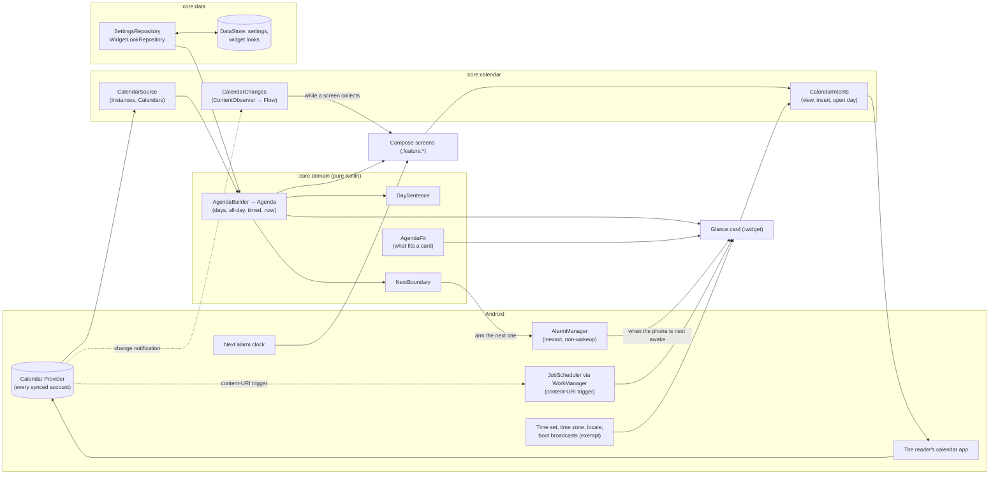

# Tempo — Technical Planning

> Companion to [VISION.md](VISION.md). This document defines the architecture, the design of the calendar engine, the widget, and the delivery phases.
> It is written to be read by humans and by Claude Code.
>
> Keep the phase checklists up to date: tick the boxes as work is merged, and record every decision and deviation with its reason in §15's log. How the log is written and archived is in How it is made, below.

---

## How it is made (2 Nov 2026)

- **This file** is the living plan: the architecture and the rules the code keeps (§1 to §10, §12 to §14: living, changed in place with the code, never archived), the phases still open (§11), what is open (§15, Open), and the log of the current period (§15, after Open). New decisions are written **at the end of the log**, one `###` section per intervention, with who asked and the date (and the step, where there is one), as always.
- **`docs/planning/NN-<period>.md`** are the closed periods of the log, from Phase 0 on, with the phases they closed, **frozen**: they are not edited. A decision that changes an old one is written here, naming the one it changes (the file, and the title or the entry's date).
- **`docs/planning/README.md`** is the index of every `##` and `###` heading of the archive, and of every dated entry of the log kept as a list until archive 01, with its line: a reference by name or by date in the code ("PLANNING.md §11 Phase 3", "§15, 9 Oct 2026") that is not in this file is found there. It is written by `python3 tools/planning_index.py`, never by hand, and changes only when archiving.
- **Archive** when the log passes ~80 KB (`sed -n '/^### Log since/,$p' PLANNING.md | wc -c`), or at a release, whichever first. A size and not a count of lines: this file writes a paragraph to a line. The log becomes the next archive file (the same header as the previous ones), and the phases of §11 that closed go with it (a closed phase's open box carried to Open); here an empty log stays with its start date, «Open» is reread, and the index script is run again.

## State

- **Released**: 1.1.0 (2 Nov 2026, `v1.1.0`). What came in after is in `CHANGELOG.md`'s `[Unreleased]` section.
- **Closed**: Phases 0 to 6 (the 1.0.0, 10 Oct 2026) and the 1.0.1 after them: their steps, their acceptance and their log are in `docs/planning/01-phases-0-8.md`. Phase 8, the 1.1.0 (30 Oct to 2 Nov 2026): its plan, its steps and the log from 2 Nov 2026 are in `docs/planning/02-phase-8.md`, the entries of its steps 8.0 to 8.7 in archive 01.
- **In progress**: nothing. Open, in §15: 8.4 («Join», on hold), 1.1's battery check on the phone, and two boxes carried from before.
- **Later, and optional**: Phase 7, Google Play (§11).

---

## 1. Tech stack

The family's stack, as Passo set it up (Passo ADR 0001), minus what Tempo has no use for.

| Concern | Choice |
|---|---|
| Language | Kotlin 2.4, compiled by AGP 9's built-in Kotlin, with the Compose compiler Gradle plugin |
| Build | Gradle 9.8 with Kotlin DSL, AGP 9.4; version catalog (`gradle/libs.versions.toml`); convention plugins in `build-logic/` |
| JDK | Java 21, `jvmTarget` 21, without a Gradle toolchain |
| SDK levels | `minSdk 34`, `targetSdk 37`, `compileSdk 37` (Passo's) |
| UI | Jetpack Compose, Material 3 in Chiaro's design language (its generated schemes, dynamic color on request), edge-to-edge |
| Widget | Jetpack Glance (`glance-appwidget` + `glance-material3`) 1.2.x, `SizeMode.Exact`, the system `TextClock` through `AndroidRemoteViews` |
| Architecture | MVVM with unidirectional data flow; coroutines and `Flow` |
| Dependency injection | Hilt |
| Calendar | The system Calendar Provider (`CalendarContract`) through the `ContentResolver`: no library |
| Persistence | DataStore (Preferences) for the settings and the widgets' looks. **No Room**: Tempo stores no event (§5) |
| Background | WorkManager (already brought by Glance, pinned as in Passo) for the calendar's content-URI trigger; `AlarmManager` inexact non-wakeup alarms for the boundaries (§7) |
| Navigation | Navigation 3, as Passo's shell |
| Time | `java.time`; Android's `DateFormat.getBestDateTimePattern` for the locale's own patterns |
| Testing | JUnit 4, Truth, Turbine, coroutines-test; Robolectric (the provider through a fake `ContentProvider`, receivers, Compose UI tests); Glance's unit test utilities |
| Quality | Android Lint (`checkDependencies`), ktlint through Spotless; Baseline Profiles later |
| CI | GitHub Actions: formatting, the forbidden-permission check on the merged manifest, unit tests and lint before the APKs. A release workflow on version tags builds the signed APK and publishes it to GitHub Releases |
| License | GPL-3.0. Every new dependency must have a GPL-3.0-compatible license (Apache-2.0, MIT, BSD) and the owner's approval |

Always pick the **latest stable** versions at setup time and record them in the version catalog. Avoid alpha versions unless a phase needs them and says why.

---

## 2. Project structure

```
tempo/
├── app/                    # Application, MainActivity, navigation, DI entry points
├── build-logic/            # Convention plugins (android-application, library, compose, feature, hilt, jvm)
├── core/
│   ├── model/              # Pure Kotlin data classes (no Android deps)
│   ├── domain/             # Pure Kotlin: the agenda, the day's sentence, the widget's fit, the next boundary
│   ├── data/               # DataStore: settings, widget looks; repositories exposing Flow
│   ├── calendar/           # The Calendar Provider's Android half: queries, change observer, intents
│   ├── designsystem/       # M3 theme, typography, shared components, icons
│   └── testing/            # test-only: the accessibility checks and the page walk the UI tests share
├── feature/
│   ├── today/              # the clock, the sentence, the agenda, the new-event button
│   ├── settings/           # settings, the calendars, about, credits
│   ├── onboarding/         # welcome, the calendar permission, the widget
│   └── guide/              # the guide, in Chiaro's shape (Phase 5)
├── widget/                 # the Glance card(s), the config screen, the refresh (job, alarm, receivers)
├── tools/                  # the launcher icon script
├── docs/                   # ADRs, screenshots
├── VISION.md
├── PLANNING.md
└── CLAUDE.md
```

Rules:

- `core:model` and `core:domain` are pure Kotlin/JVM modules. All business logic lives there and is unit-tested without Android.
- Feature modules depend on `core:*`, never on each other.
- `app` wires everything together.
- A module joins the build in the phase that brings its first code, not before (`feature:guide` in Phase 5).

---

## 3. Architecture overview



**One way in, one way out.** Events come in from the Calendar Provider only, read by `CalendarSource`. Changes go out through the calendar app only, opened by `CalendarIntents`. Tempo writes nothing but its own settings.

**The read path is computed, not stored.** A screen or a card asks for the instances of a time window and the calendars' metadata, and `:core:domain` turns them into an `Agenda`: days, each with its all-day row and its timed events, where "now" falls, what is under way, the sentence. Nothing is cached in a table; the provider answers a day's query in milliseconds.

**Live while visible.** Today collects `CalendarChanges` (a `ContentObserver` on the provider, registered only while collected) and a minute ticker, both tied to the page's lifecycle. With the page gone, nothing of Tempo runs.

**The widget is pushed, never polled** (§7): the calendar's content-URI trigger, the next boundary's inexact alarm, and the exempt time broadcasts each ask the card to recompose. Its clock is the system's `TextClock` and needs none of it.

---

## 4. The calendar engine (core design)

The riskiest part of the app: wrong days, missing occurrences and stale cards are what make readers drop agenda widgets. Build it first, with its tests, before any screen.

### 4.1 Reading the provider

- **Instances**, not Events: `CalendarContract.Instances.CONTENT_URI` with the window `[start, end)` in epoch millis appended (`Instances.CONTENT_URI.buildUpon()`, `ContentUris.appendId(begin)`, `appendId(end)`). The provider expands recurrences and applies exceptions; Tempo never parses an `RRULE`.
- **Projection** (only what is shown or decided on): `EVENT_ID`, `BEGIN`, `END`, `START_DAY`, `END_DAY`, `START_MINUTE`, `END_MINUTE`, `ALL_DAY`, `TITLE`, `EVENT_LOCATION`, `CALENDAR_ID`, `DISPLAY_COLOR` (the event's colour, or its calendar's), `STATUS`, `SELF_ATTENDEE_STATUS`, `EVENT_TIMEZONE`, `AVAILABILITY`, `IS_ORGANIZER` (so an invitation the reader has not answered is told from a meeting they set up, review of 30 Oct 2026).
- **Calendars**: `Calendars.CONTENT_URI` for `_ID`, `CALENDAR_DISPLAY_NAME`, `ACCOUNT_NAME`, `ACCOUNT_TYPE`, `CALENDAR_COLOR`, `VISIBLE`, `SYNC_EVENTS`, `IS_PRIMARY`. `VISIBLE = 0` (hidden in the calendar app) is hidden by default in Tempo too, and the reader's own choice in Tempo wins over it. `SYNC_EVENTS = 0` (a calendar the account lists but this phone does not sync: a colleague's, a country's holidays ticked off) is not on the phone: no switch in Settings, not counted, its events never shown, as the calendar apps list only the synced ones (`CalendarChoices.onPhone`, review of 30 Oct 2026).
- **The window**: from the start of today to the end of the horizon's last day, in the zone of the phone, widened by a day on each side so that all-day events (stored in UTC, §4.2) are never cut off by the window itself; the domain trims.
- **Selection in the domain, not in SQL**: hidden calendars, declined invitations and cancelled events are filtered by `AgendaBuilder`, in pure Kotlin, where they are tested. The query stays the same for every reader.
- **Threading**: queries run on `Dispatchers.IO`; a `SecurityException` (the permission revoked while the app runs) becomes a state, never a crash.

### 4.2 All-day events and time zones

- An all-day event is stored from **00:00 UTC** of its first day to 00:00 UTC of the day after its last (`END` exclusive). Its days are therefore read in **UTC** (`START_DAY`/`END_DAY` are Julian days computed by the provider; or `BEGIN`/`END` converted with `ZoneOffset.UTC`), never in the phone's zone. In the phone's zone, a one-day event at UTC−5 starts at 19:00 the day before.
- A timed event is placed by its `BEGIN`/`END` in the phone's **current** zone. `EVENT_TIMEZONE` is never used to place it; since step 8.5 it is said, as one note on Today's row, where it names a place and its offset at the event's start is not the phone's: "09:00 in Lisbon" ("09:00 ora di Lisbona"), the city as the locale's CLDR data writes it (`EventZone.differs`, `AgendaText.ownZone`). Never for an all-day event, for `UTC`, `GMT`, a bare offset or an `Etc/` zone, nor for a zone on the phone's clock at that moment (Paris beside Rome; London beside Lisbon, all year). The cards have no room for it.
- A time-zone change (travel) re-reads everything: the days move, the provider's own instances table is rebuilt by the provider itself.

### 4.3 Days, overlaps, multi-day events

- A timed event that crosses midnight belongs to every day it touches; on the second day it reads "until 01:30", on the first "from 23:00".
- A multi-day all-day event is in each day's all-day row with "day 2 of 5".
- Overlapping events are listed by start, then by end, then by title; the timeline never draws them side by side (one column, the phone's width).
- The event under way: `BEGIN <= now < END`. Past: `END <= now`. Next: the first with `BEGIN > now`.

### 4.4 What is not shown

- `STATUS = STATUS_CANCELED`: never.
- `SELF_ATTENDEE_STATUS = ATTENDEE_STATUS_DECLINED`: hidden unless the reader shows declined invitations.
- Calendars the reader hid in Tempo, or hidden in the calendar app and not shown in Tempo.
- Events with no title are shown as "(No title)", the calendar app's own convention.

### 4.5 Watching for changes

- **In the app**: `CalendarChanges` is a `callbackFlow` around a `ContentObserver` registered on `CalendarContract.CONTENT_URI` with descendants, unregistered when the collector stops. Changes are debounced (a sync writes many rows at once). Android refuses the observer without `READ_CALENDAR`, so the pages watch through `CalendarChanges.flow(restarts)`, started again at every reread: a permission granted from the page's card or the system's settings makes the page live at once (review of 30 Oct 2026).
- **For the widget**, two ways, the first fast and the second a safety net (9 Oct 2026, §15):
  - the provider's own `PROVIDER_CHANGED` broadcast on `content://com.android.calendar`, received in the manifest (`CalendarChangedReceiver`). It is not on Android 8's exemption list, but the AOSP provider sends it with `FLAG_RECEIVER_INCLUDE_BACKGROUND`, about a second after an app's edit and half a minute after a sync's, so a manifest receiver has it. The waiting trigger is replaced first, so the change is drawn once;
  - a WorkManager `OneTimeWorkRequest` with `Constraints.addContentUriTrigger(CalendarContract.CONTENT_URI, true)` (quiet for 3 s, at most 20 s late), tagged, one waiting at a time; each run arms the next *before* it repaints, so a change during the run is seen (content-URI triggers are one-shot by design). It costs nothing while nothing changes, and catches a maker's provider that does not send the broadcast.
  - Either stays until the cards are drawn (`TempoWidgets.repaintAll`, `WidgetRefresh.awaitDrawn`): Glance composes in a WorkManager worker started inside Tempo's process with no job bound, and a process left cached can be frozen with the card half drawn.

### 4.6 Edge cases (all need unit tests)

- An all-day event, one day and several days, in a phone zone west of UTC, east of UTC, and at UTC.
- A timed event crossing midnight; one crossing two midnights.
- A recurring event with an exception (one occurrence moved) and a deletion (one occurrence cancelled).
- The night daylight saving starts (the 02:00–03:00 hour does not exist) and ends (01:00–02:00 happens twice); an event in the repeated hour.
- The phone's zone changing between two reads (travel).
- A zero-length event (`BEGIN = END`): a moment, shown at its time.
- An event that started yesterday and ends tomorrow (timed): on today it is in the all-day row, "day 2 of 3"; its first date keeps it as "from 21:00", its last as "until 02:00" (decided in Phase 1, §15).
- Declined, tentative, cancelled; an event with no title; a calendar with no colour.
- Today empty, the horizon empty, every calendar hidden, no calendar at all.
- Midnight while the page is open: the day rolls over without a restart.
- The permission revoked while the app is open; granted from the system's settings while the app is in the background.

### 4.7 Handing over to the calendar app

`CalendarIntents` builds every intent, and says whether something can take it (`resolveActivity`, with `<queries>` in the manifest for Android 11+ package visibility):

| What | Intent |
|---|---|
| Open an event (one occurrence) | `ACTION_VIEW`, `ContentUris.withAppendedId(Events.CONTENT_URI, eventId)`, extras `EXTRA_EVENT_BEGIN_TIME` / `EXTRA_EVENT_END_TIME` = the instance's |
| New event | `ACTION_INSERT`, `Events.CONTENT_URI`, `EXTRA_EVENT_BEGIN_TIME` = the next half hour (or the free gap's start), `EXTRA_EVENT_END_TIME` = one hour later |
| Open the calendar at a day | `ACTION_VIEW`, `CalendarContract.CONTENT_URI/time/<millis>` |
| Edit an event | `ACTION_EDIT` on the event URI: only if Phase 1 measures it working on the owner's calendar apps (VISION, From the concept); otherwise `ACTION_VIEW` |

From the widget the same intents travel as `PendingIntent`s (immutable). A "No app can open this" state replaces a button that would do nothing.

---

## 5. Data model

Tempo has no database. The Calendar Provider is the only truth for events; Tempo keeps the reader's choices.

### `:core:model` (pure)

- `CalendarInfo(id, name, accountName, accountType, color, visibleInProvider, isPrimary, syncsEvents)`
- `EventInstance(eventId, calendarId, title, location, begin: Instant, end: Instant, allDay, color, status, selfStatus, availability, timeZone, isOrganizer)`, with `awaitsAnswer` (invited, and not by themselves): as stored; an all-day event's dates are derived in the domain (`allDayDates()`, UTC), never stored beside it
- `EventStatus`, `AttendeeStatus`, `Availability`, `CalendarPermission`
- `Agenda(now, today, days, underWay, next)`, `AgendaDay(date, allDay: List<AllDayEntry>, timed: List<TimedEntry>, free: List<FreeGap>)`, `AllDayEntry(event, dayNumber, dayCount)`, `TimedEntry(event, startsOnDate, endsOnDate, state)`, `FreeGap(start, end)`. The day's sentence is computed from an `AgendaDay` by `DaySentence` (Phase 3), not stored in it
- `UserSettings`, `WidgetLook` (below)

### DataStore (Preferences), file `settings`

| Key | Default | Meaning |
|---|---|---|
| `theme`, `palette`, `font`, `dynamic_color` | system, VIVID, GOOGLE_SANS, false | The family's appearance |
| `clock_format` | SYSTEM | `ClockFormat` |
| `date_style` | LONG | `DateStyle` |
| `horizon_days` | 7 (a week; owner, §15) | Days shown: 1, 2, 7 or 14 (two weeks, step 8.6) |
| `calendar_choices` | empty | The calendars the reader turned on or off in Tempo (a string set, one `CalendarChoice` per line, URL-encoded fields), each kept as `id` **and** `account_type/account_name/display name`, so a restore that renews the ids can still match them (`CalendarChoices`, §15) |
| `show_declined` | false | Declined invitations |
| `show_all_day` | true | All-day events |
| `show_next_alarm` | true | The next alarm line |
| `show_calendar_button` | true | Today's button that opens the calendar app at today (§15, 9 Oct 2026) |
| `second_zone` | none | The second clock's city, as a time-zone id ("America/New_York"; ICU's canonical name, "Asia/Calcutta", which `java.time` knows too). An id this phone's time-zone data does not know reads as none (step 8.5) |
| `onboarding_completed` | false | |
| `today_tip_seen` | false | Today's first tip ("How to read the dial") dismissed or followed to the guide (step 8.6) |
| `asked_calendar_permission` | false | Whether the permission was ever asked: what tells "askable" from "denied for good" (§15) |

### DataStore, file `widgets` (not backed up)

One `WidgetLook` per `appWidgetId`: show clock, clock format, show date, date style, header action, event action, card ground (light, dark, system, one of six colours), opacity, show all-day, show the days ahead, show the second clock (off by default, step 8.5). Removed in `onDeleted`.

### Backup

`data_extraction_rules.xml`: `files/datastore/settings.preferences_pb` only (Passo's ADR 0007 rule: an allowlist, decided). The widgets' file stays out: widget ids are renewed by a restore.

---

## 6. Derived views (`core:domain`)

- **`AgendaBuilder`**: instances + calendars + settings + now + zone → `Agenda`. Applies §4.2–§4.4. Pure, the most tested class of the app.
- **`DaySentence`**: the day in one sentence, from the agenda alone: the count of what is left, the next event and when, the free time before it, the end of the day ("Nothing left today; tomorrow starts at 9"). Returns a structure (kind + values), never a string: the words are resources, in both languages, with plurals (`:feature:today` and `:widget` format it).
- **`FreeTime`**: the gaps between a date's busy timed events (overlaps merged; free-availability and declined events do not take the time; all-day ones neither), and on today the time from now to the next busy one. Never the evening after the last event or the morning before the first, which are not "free time" any more than the night is (§15). Every gap feeds the sentence; the first gap of an hour or more still ahead today is also a row of the timeline (owner, §15, 7 and 30 Oct 2026).
- **`NextBoundary`**: the next moment the agenda changes by itself: the nearest `BEGIN` or `END` after now, or the next midnight, whichever is first; with an «In words» card placed, also the moment an event comes onto the dial's face (`DialArcs.comesOnTheFace`, review of 30 Oct 2026). The widget arms its alarm on it.
- **`EventZone`** and **`SecondZone`** (step 8.5): whether an event's own zone reads another clock than the phone's at its start, and which zone the second clock shows (none where it would repeat the phone's own) and on which day there. The cities' names are the presentation's (`ZoneCities`, `:core:designsystem`, from ICU).
- **`AgendaSections`**: the agenda's days as Today lays them out: today, tomorrow in full, the days after it compact, and every run of empty days folded into one row (§15, 9 Oct 2026).
- **`AgendaFit`** (pure arithmetic, as Passo's `GlanceLayout`): given a card's granted size in dp, the header's choice and the text sizes measured in the system face, how many event rows fit, which form the card takes, and what the "N more" line says. Pinned by tests at the family's reference grants (one row ≈ 85 dp tall, two ≈ 189; widths 2 cells ≈ 159 dp, 3 ≈ 250, 4 ≈ 340).
- **Calendar colours are data, not roles.** They are chosen in the calendar app with no thought for Tempo's grounds, so they mark an event (a dot, a bar at the start of its row, a quiet arc on Today's dial) and never colour its text or its ground. A mark keeps a 3:1 contrast with its ground by stepping its lightness when it must (`markColor`), and a mark drawn quieter fades only as far as that ratio allows (`markAlpha`): pure functions with their tests.

---

## 7. Widget (Glance)

Two cards in v1, the family's pair (owner, §15): «Agenda» (`AgendaWidget`, the concept's) and «In words» (`WordsWidget`, Chiaro's «In parole», Passo's «In words»). The same size spec, the same settings screen, the same refresh. The family's card (Passo's ADR 0005, from Chiaro): its corner, insets, grounds, Chiaro's six colours, opacity, and Chiaro's ink rule.

### Configuration

- `SizeMode.Exact`: every form is read off the size the launcher really granted. Glance does the work the concept gave to `onAppWidgetOptionsChanged`, and recomposes on every resize.
- Default placement 4×2 (`targetCellWidth` 4, `targetCellHeight` 2), minimum one cell, `resizeMode="horizontal|vertical"`, **no maximum** (Passo's ADR 0005: Launcher3 turns a dp maximum into the smallest cell count across its grids). Each form has a layout for any grant (`AgendaFit`, `WordsFit`, `:core:domain`; ADR 0003).
- `updatePeriodMillis = 0`. `configure` is the per-widget settings screen, `reconfigurable|configuration_optional`.
- `widgetCategory="home_screen"` in v1; `keyguard` is a later idea.

| Form | When | Content |
|---|---|---|
| CLOCK | one cell, or a row too narrow for a list beside the clock (two cells) | The time, as large as the cell holds; the date under it where it still reads (else none) |
| LINE | one row, three cells and up | The time and, under it at 16 sp (Passo's facts, «In words»'s line on top), the date (shortened before it is shrunk) on the leading side; the next events beside them, and "N more" |
| AGENDA | two rows and up | The header (clock and date at 16 sp, each optional; the second clock at the far edge of the date's line where both fit whole, or in the date's place under a clock without one), then the events that fit, then "N more today" |
| SIDE | two rows and up, four cells, where a header on top would leave fewer than five rows (the default 4×2) | The clock and the date (over two even lines if need be: "Wednesday, / October 7") in a column on the leading side, the second clock under the date where it is on and fits ("New York 04:20"), the rest of the day in a few words under them ("4 left today", "until 19:30"); the events beside them |

With the clock and the date both hidden, the card is its list alone, on any grant. A date's all-day events share one row ("All day · Design Week, Anna's birthday"), so two holidays never push out what happens next. A row sets its time as a range where the title keeps 120 dp, its start alone where it keeps 72, else over the title. The time column is set by the rows the card shows, the event under way as "→ 11:00" where "Until 11:00" would widen it for every title, and an all-day label more than an em wider than the timed rows' times (Italian's "Tutto il giorno") stands over its titles across the list instead (`AgendaFit.timeColumn`, ADR 0003 decision 13).

**The rest of the day in a few words** (8.2, ADR 0003 decision 12): under the date in «Agenda»'s side column, at the label step in the secondary ink, how many timed events are left today, the one under way among them, and when the last one ends ("4 left today" / "until 19:30", "Ancora 4 oggi" / "fino alle 19:30"; `CardSummary`), each line where it fits whole; nothing once today's timed events are over. Counts and clock times the card is redrawn at anyway, so they never go stale. It stands where the next alarm was planned: the alarm's change did not reach a card in the background reliably on the owner's phone, so the alarm stays on Today alone (§15, 30 Oct 2026, Phase 8.2).

| «In words» form | When | Content |
|---|---|---|
| CELL | one cell wide | The dial, as large as the cell; under it the focus's time ("11:00") where the cell is taller than wide. Without the dial, that time bold in its place, the title under it |
| ROW | one row | Passo's row: the dial (up to 56 dp, Passo's ring); the title (20 sp, Chiaro's sentence) over when ("Until 11:00", "15:00 – 15:45", "Tomorrow · 9:00 – 9:30", 16 sp, Passo's facts); the date at the far edge over two lines ("Wednesday / 7 October") where the words keep 120 dp. A narrow row sets the words at 16 and 14 sp, a long title over two lines |
| TALL | two rows and up | Passo's tall card: the dial in the top trailing corner (from 48 dp, up to 45% of the card's inner height and width, never held under 104 dp; under three cells wide, the family's tall circle, Passo's ring at the same size: §15, 4 Nov 2026) with the date beside it, and the second clock under the date where the band beside the dial holds it (without the dial, on top under the date); the title (22 sp, down to 18 to stay on one line), when, the day's note hanging from the bottom leading corner. Under them, where two more lines fit once the dial has its comfort (72 dp), the next one or two events as rows ("13:00  Lunch with Giulia", 13 sp, the time quiet and the title strong; 8.3), the note keeping its count only where they leave some out; else, on a card four cells wide with a line to spare, the rest of the day as a line of times ("Then 13:00 · 15:00 · 18:30") in place of the note's count |

**The dial** (owner, 8 Oct 2026; `DialArcs`, `WidgetDial.kt`, ADR 0003): a clock face where Passo's card has its ring. The hands are the system's `AnalogClock`, drawn by the launcher and moved by the system like the `TextClock`; the face under them is a bitmap Tempo paints at each redraw: the ring's track, the focus as an arc in the accent from its start to its end, what else is still to come in the face's twelve hours as quieter arcs, four quarter dots. The arcs change only where an event starts or ends, or comes onto the face, the boundaries the card is redrawn at (the last one since the review of 30 Oct 2026, where an «In words» card is placed: an evening's face waited for midnight to show the next morning's meeting its words already named), so the hour hand walks into an arc, through it and out of it with no work by Tempo. A face shows twelve hours: the window opens now (or at the start of the event under way, six hours back at most) and closes eleven and a half hours later, so no arc ever meets the hand from behind; what lies beyond it is left off, never wrapped. The samples paint the hands into the face at their moment.

The focus is the event under way, else the next one today, else (with the days ahead) the first one after today under its day's name, else "Free" (`WordsDay`). The note says times and counts, never minutes from now (§15): "Then 2 more today.", "Free until then; one more after it.", "Nothing left today.", or a free day's all-day events.

### Rendering

- **No scrolling container**: a Glance `Column`, never `LazyColumn` (a `ListView` underneath). Glance drops the eleventh child of a container silently: events go in groups of at most five, the header and the footer counted.
- **The second clock** (step 8.5) is one more `TextClock`, its pattern the city as a quoted literal before the card's time pattern ("'New York' HH:mm"), its zone set with `setTimeZone`: the system moves it as the first, at no cost, across both midnights. It says no day ("· tomorrow" is Today's): a `TextClock` cannot tell the phone's date from the city's, and a word written in would be wrong between the two midnights. At the label step (13 sp), in the secondary ink, in the face of the card's date; its touch is the header's. Measured by `AgendaFit` and `WordsFit` (`secondEm`), drawn where it fits whole, else not at all; never on a row or a cell.
- **The clock and the date are a `TextClock`** in a small XML layout, placed in the card with Glance's `AndroidRemoteViews`; `format12Hour`/`format24Hour` set per widget (`RemoteViews.setCharSequence`), and with both set to the same pattern when the reader forced one. It is drawn by the launcher, updated by the system every minute, and costs the app nothing. Its text size and ink are set like the card's other text.
- Inks resolved against the ground the card really has (`widgetInk`, Chiaro's rule, as in Passo), never left to the launcher's day/night resolution.
- An event row: the calendar's mark, the time ("10:00–11:00", or "All day"), the title on one line, ellipsised; the event under way in the strong ink with "ends 11:00"; past events are not on the card at all (the card is the rest of the day).
- Previews: a static `previewLayout`, and generated previews on Android 15+ (`providePreview`) from a sample day, once per version.

### Taps

- Header (the clock and the date): Tempo's Today (the default), the calendar app at today, or the phone's clock app (owner, §15), per widget.
- Event: the event's occurrence in the calendar app (the default, as on Today), or Tempo's Today, per widget.
- "N more today", the rest of the card: Tempo's Today.
- No permission: Tempo, where Today (or the first run) asks for it.
- A door that is not on the phone (no calendar app, no clock app) falls back to Tempo, and the settings screen does not offer it.

### Update strategy (battery-aware)

- **Calendar changed**: the provider's broadcast, else the content-URI-triggered work (§4.5), updates every card and stays until they are drawn; the work arms the next one as it starts.
- **A boundary**: after every render the card arms one `AlarmManager.set(RTC, NextBoundary)` (inexact, **non-wakeup**): if the phone is asleep it is delivered when the phone next wakes, which is when someone can see the card. No `SCHEDULE_EXACT_ALARM`, no `RTC_WAKEUP`.
- **Clock, zone, language**: `TIME_SET`, `TIMEZONE_CHANGED`, `LOCALE_CHANGED`, exempt from the implicit-broadcast limits, received in the manifest.
- **Boot and update**: the system sends the card its update after a boot and after an app update; the alarm and the work are armed again from it.
- **Settings changed** in the app or the card's own screen: an immediate update.
- Nothing else. No periodic work, no polling, no foreground service.

---

## 8. Notifications and system surfaces

- **No notification channel in v1**, and so no `POST_NOTIFICATIONS` (VISION, System surfaces).
- **Launcher shortcut** (dynamic, `NewEventShortcut`: a static one names its package, and the debug build's is another): "New event", the `ACTION_INSERT` of §4.7 (owner, §15). Published again when its words are not the app's any more (the reader changed the app's language, review of 30 Oct 2026).
- **Pin request**: onboarding and Settings offer "Add the widget to the home screen" through `AppWidgetManager.requestPinAppWidget`, where the launcher supports it.

---

## 9. Battery rules (non-negotiable)

1. No service, foreground or background. Tempo runs only when a screen of it is visible, when a card is being drawn, or when the calendar changed.
2. No wakelocks of the app's own (WorkManager holds its own while its work runs, as in Chiaro and Passo).
3. No exact alarms, no wake-up alarms, no `REQUEST_IGNORE_BATTERY_OPTIMIZATIONS`, no periodic workers.
4. Nothing runs on a timer while the screen is off. The minute ticker lives in the page's lifecycle (`repeatOnLifecycle(STARTED)`), the observer in the collector's.
5. The widget's clock is the system's `TextClock`: never a repaint per minute by the app.
6. A phase that touches the refresh ends with a check: `adb shell dumpsys alarm | grep tempo` (one non-wakeup alarm at most), `adb shell dumpsys jobscheduler | grep tempo` (one content-triggered job), `dumpsys batterystats --charged com.callbackdev.tempo`, Doze (`dumpsys deviceidle force-idle`).

---

## 10. Permissions and manifest

| Permission / element | Type | Why |
|---|---|---|
| `READ_CALENDAR` | Runtime | Read the Calendar Provider (Phase 1, declared by `:core:calendar`) |
| `<queries>` for `ACTION_VIEW`/`ACTION_INSERT` on calendar URIs | Manifest | Lets Android 11+ show Tempo the calendar app, to know whether a button can work. Not a permission |
| `RECEIVE_BOOT_COMPLETED`, `WAKE_LOCK`, `ACCESS_NETWORK_STATE`, `FOREGROUND_SERVICE` | Normal | Brought by WorkManager, which Glance runs its sessions on and the calendar trigger uses, as in Chiaro and Passo. Without `INTERNET` nothing can leave the phone. Tempo's own code uses none of them. Reviewed in Phase 4 against the merged manifest: the same set as Phase 0's, nothing added by the widgets (the boundary alarm is `AlarmManager.set(RTC)`, which needs no permission); kept as WorkManager declares them, as in the sisters |
| `<queries>` for `AlarmClock.ACTION_SHOW_ALARMS` | Manifest | Lets Tempo find the phone's clock app (`ClockApp`, declared by `:core:calendar` since 8.1): Today's alarm line and a card whose time opens it (Phase 4). Not a permission; Tempo opens the app's front door and never sets an alarm |
| `android:allowBackup="true"` + `dataExtractionRules` | Manifest | The settings file only (§5) |

**Forbidden:** `INTERNET`, `ACCESS_*_LOCATION`, `REQUEST_IGNORE_BATTERY_OPTIMIZATIONS`, `SCHEDULE_EXACT_ALARM`, `USE_EXACT_ALARM`, `WRITE_CALENDAR`, `READ_CONTACTS`, `WRITE_CONTACTS`, `HIGH_SAMPLING_RATE_SENSORS`, `BODY_SENSORS*`.

`checkForbiddenPermissions` (build-logic, `ForbiddenPermissionPatterns`) checks every variant's merged manifest, is wired to `check`, and runs in CI and in the release workflow. A library that adds one is removed or patched with `tools:node="remove"`.

---

## 11. Delivery phases

Each phase ends with a merged PR, green CI and its acceptance criteria met. Phases 1 and 4 need **testing on a physical device** with real accounts: an emulator's calendar has no sync and no second calendar app.

**Phases 0 to 6, and after 1.0: closed.** The foundations, the calendar engine, Settings, Today and the first run, the widgets, the guide and the accessibility pass, the 1.0.0 and the 1.0.1 (7 to 10 Oct 2026): their steps and acceptance are in `docs/planning/01-phases-0-8.md`, §11, where the index (`docs/planning/README.md`) finds each phase by its title. Phase 5's one open box, the Baseline Profile, is in §15's Open list.

**Phase 8, the 1.1: closed.** The review of 30 Oct 2026 and the 1.1.0 (30 Oct to 2 Nov 2026): its plan and its steps 8.0 to 8.8 are in `docs/planning/02-phase-8.md`, §11. Its step 8.4 («Join», on hold) and 8.8's battery check are boxes in §15's Open.

### Phase 7 — Google Play (optional, later)

- [ ] As Passo's Phase 9: the same key, the store listing, the data safety form ("no data collected, no data shared").

**For the sisters** (not Tempo's work; written here so their sessions find it): Passo takes Tempo's filled `StatusCard` button (§15, 7 Oct 2026), its first-run and Settings "Add to the home screen" (`requestPinAppWidget`), the picker's generated previews and a Widgets group in Settings; Passo's `FilterChip`s (8 dp) against its own "chips are fully round" rule is its call; Chiaro takes the generated previews. The family decides together whether to adopt Chiaro's segmented groups, and makes the Material 3 Expressive pass when `material3` 1.5 is stable.

---

## 12. Testing strategy

- **Pure Kotlin first.** `AgendaBuilder`, `DaySentence`, `FreeTime`, `NextBoundary`, `AgendaFit` and the colour mark are tested on the JVM with fixed instants and zones, every §4.6 case named in a test.
- **The provider under Robolectric.** A fake provider registered for `com.android.calendar` returns cursors built from fixtures, so `CalendarSource` is tested with the real `ContentResolver` path.
- **Screens from states.** Compose UI tests draw a screen from a state, never from a database, with `assertAccessible()` and `walkPage()` (`:core:testing`), at twice the text size and on an open foldable; their screenshots land in each module's `build/screenshots` and are looked at.
- **The widget's forms.** Glance's test utilities for content; a gallery test that draws every form at the reference grants.
- **On a device**, for what only a device can say: real accounts and sync, the calendar apps' handling of the intents, the launcher's grants, the alarm's delivery.

---

## 13. Working with Claude Code

`CLAUDE.md` holds the operating rules (commands, modules, invariants, design, signing). The workflow, as in the family:

- Work one phase at a time, from its section in §11.
- Write the domain test first for anything that decides a day, a boundary or a fit.
- Tick the boxes as work lands; record every decision and deviation, with its reason, in §15, as a `###` section at the end of its log (and as an ADR in `docs/adr/` when it is architectural). The closed periods of the log are archived, frozen, in `docs/planning/` (How it is made, at the top).
- Run `spotlessApply`, `test`, `:app:lintDebug` and `:app:checkForbiddenPermissions` before pushing.

---

## 14. Risks and mitigations

| Risk | Mitigation |
|---|---|
| All-day events on the wrong day | Read in UTC (§4.2); tests in zones west, east and at UTC |
| A calendar app that ignores an intent | `resolveActivity` before drawing a button; VIEW over EDIT (§4.7); measured in Phase 1 |
| A card that is stale after a change | The content-URI trigger re-enqueued after each run; on return to the app, the observer; measured in Phase 4 |
| A finished event lingering on the card | The non-wakeup alarm at the boundary; the card says times, so a minute's delay never misleads |
| Launchers that grant odd sizes | `SizeMode.Exact` and a form for every grant, no maximum (Passo's ADR 0005) |
| Glance's eleventh-child limit | Events in groups of five, a test that counts children |
| Work-profile calendars invisible | Said in the guide: install Tempo in the work profile too |
| Calendar colours unreadable on a card | Marks only, never text; lightness stepped to 3:1 (§6) |
| OEM calendar providers with gaps (no `DISPLAY_COLOR`, odd `VISIBLE`) | Defensive reading with defaults; tested with columns missing |
| WorkManager's permissions in the merged manifest | Reviewed in Phase 4; the forbidden list guards what matters |

---

## 15. Decisions log and open questions

### Open

What is still to decide or to do, in one place, besides the steps of the phases in §11 (which keep their boxes there): a box opens here, with the reference to the log entry it comes from, and closes here, with the one that closes it. A new question is written here and asked before it is built.

- [ ] **«In words» two rows high: may the words rise beside the dial?** (30 Oct 2026, step 8.3.) The tall card budgets its height as if the dial took the card's whole width, so on the three- and four-by-two the leading side under the date, beside the dial, stays empty (about 65 dp of 161 on the four-by-two at 10:20), and the next events do not fit under the words. The words hang from the bottom; they could rise beside the dial wherever each line beside it is narrower than the room the dial leaves (on the four-by-two at 10:20 about 215 dp: the title and its time beside the dial, the note and the next two events under it, the dial kept at its 83 dp). Options: (a) as now, the rows on three rows and up; (b) the words rise beside the dial, the two-row cards listing the next events where their lines fit beside it. The two-by-two gains nothing either way: beside its 52.75 dp dial (the tall circle since 4 Nov 2026; it was 63) the room is 66 dp, the date's. Asked of the owner; not built.
- [ ] **Baseline Profile, if start-up measures slow** (Phase 5's one open box, carried from archive 01, §11, Phase 5; §1's "Baseline Profiles later"). The log records no measure of start-up; the work opens when one finds it slow.
- [ ] **«Join», on hold** (step 8.4; owner, 30 Oct 2026: "not a priority; I want to weigh it again in the future"). A video call's link on Today's event under way or about to start, opened by a button; nothing of it is built. Its plan, to start from: `docs/planning/02-phase-8.md`, §11, Phase 8, step 8.4.
- [ ] **1.1's battery check on the phone** (step 8.8's open box; §15, 2 Nov 2026, "1.1.0 released", in archive 02). §9.6's check with «In words» placed: still one non-wakeup alarm of Tempo's at most, about two boundaries an event a day plus the moments events come onto the dial; written in `docs/device-checks/widget-refresh.md`.

Reread on 2 Nov 2026, at archive 02: four boxes open, the question on the two-row «In words» (asked of the owner on 30 Oct 2026), Phase 5's Baseline Profile (carried from archive 01), 8.4's «Join» (on hold) and 1.1's battery check (both carried from archive 02); the phases' open steps are in §11 (Phase 7, optional). No proposal undecided.

---

### Log since 2 Nov 2026, after archive 02

### «In words» and Passo's «At a glance»: one circle at one size (owner, 4 Nov 2026)

**Where it comes from.** The owner, with Tempo's «In words» and Passo's «At a glance» side by side on the phone, two by two: "make the circles of the two cards uniform, so that at the same size of card and the same content they are the same size; leave the circles' resizing as it is, but at the same size and text the circles must match. Now with no events the clock is larger than with events to show. If the two circles are the same it is very nice to look at. Two by two, as in the screenshots." (The owner's screenshots did not reach the session; the gallery's were drawn and measured instead.)

**What was measured** (the reference two-by-two, 159 × 189 dp, the default text size). Passo's ring took the height its words left (the number, the sentence over two lines, the goal: 108.24 dp of 161), 52.75 dp, and grew where the sentence was shorter (73.75 dp for one line, 95 for none). «In words»'s dial grew to the date beside it (63 dp) or to what its note left (60.5 dp under a note over two lines); on a wider two-by-two a free day's dial grew to the date's limit while a busy day's stayed where its words held it (at 175 dp wide, 79 dp against 60.5): the jump the owner saw, and never the ring's size.

**What changed.**

1. **The tall circle** (`WordsFit.tallCircle`; in Passo `tallCircle` in `GlanceLayout.kt`, the same arithmetic and constants). Under three cells wide, the circle in a tall card's top trailing corner is the height the card's inside leaves over a budgeted band of words: a 34 sp line and three 16 sp lines at 1.32 em (108.24 dp at the default size, the band Passo's usual words fill), rounded down to a quarter, never under 44 dp (the row's floor, and Passo's). Budgeted, never measured: the day's words do not move it. On the reference two-by-two both cards draw 52.75 dp, a free day and a busy one, a long sentence and a short one; at 115% and 130% the band grows and both stand at 44 dp; resized taller, both grow alike, while neither card's own limit holds them (below).
2. **What stays each card's own.** The dial keeps its limits (the date's 56 dp beside it, the ceiling of step 8.3), Passo's ring its own (104 dp, the card's width): the two match wherever neither binds, which on a card two cells wide is up to about 199 dp tall, the two-by-two on every grid measured. A two-by-three keeps its 63 dp dial, held by the date, and Passo's ring its 104 dp. From three cells wide nothing changes: Passo draws its panel there (the ring at 56 dp in the header's row), and «In words»'s dial grows with the room its words leave (step 8.3, 78.5 dp on the three- and four-by-two).
3. **«In words»'s words are what they were.** The room the circle gives up under the dial's comfort stays empty: the two-by-two keeps its note's count and lists no row ("Free until then; one more after it." at 14:20, not "Free until then." over "18:30  Swimming le…"). The tall dial still starts at 48 dp, or at the circle where that is smaller (a large text size), where it would have been dropped.
4. Passo's side, written in its own PLANNING: the band is its usual words, and where the reader hid the sentence, the number and the goal (95 dp on the two-by-two, as before).

Tests: `WordsTest` (the circle at the reference height and text sizes; one dial through the day at 159, 175 and 200 dp wide; the floor at 130% with the time kept; the words kept; three cells wide unchanged; the two-by-two's pin, 52.75 dp where it was 63, and the two-by-three's, 63). `WidgetFitTest` finds nothing cut at every grant and text size. The README's widget picture redrawn: the two-by-two's dial is smaller, nothing else moves.
