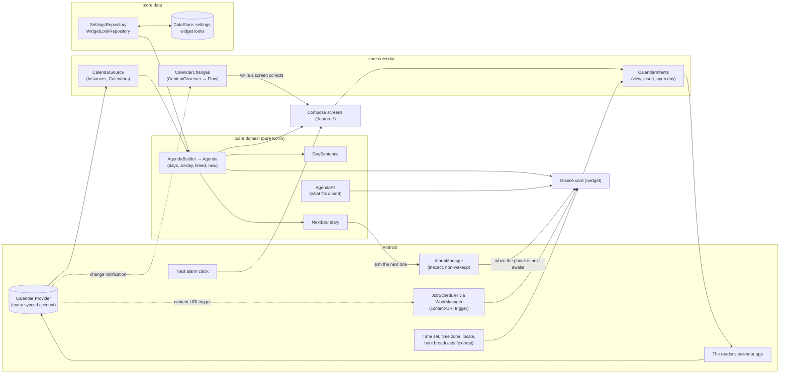

# Tempo — Technical Planning

> Companion to [VISION.md](VISION.md). This document defines the architecture, the design of the calendar engine, the widget, and the delivery phases.
> It is written to be read by humans and by Claude Code.
>
> Keep the phase checklists up to date: tick the boxes as work is merged, and record every decision and deviation with its reason in §15's log. How the log is written and archived is in How it is made, below.

---

## How it is made (2 Nov 2026)

- **This file** is the living plan: the architecture and the rules the code keeps (§1 to §10, §12 to §14: living, changed in place with the code, never archived), the phases still open (§11), what is open (§15, Open), and the log of the current period (§15, after Open). New decisions are written **at the end of the log**, one `###` section per intervention, with who asked and the date (and the step, where there is one), as always.
- **`docs/planning/NN-<period>.md`** are the closed periods of the log, from Phase 0 on, with the phases they closed, **frozen**: they are not edited. A decision that changes an old one is written here, naming the one it changes (the file, and the title or the entry's date).
- **`docs/planning/README.md`** is the index of every `##` and `###` heading of the archive, and of every dated entry of the log kept as a list until archive 01, with its line: a reference by name or by date in the code ("PLANNING.md §11 Phase 3", "§15, 9 Oct 2026") that is not in this file is found there. It is written by `python3 tools/planning_index.py`, never by hand, and changes only when archiving.
- **Archive** when the log passes ~80 KB (`sed -n '/^### Log since/,$p' PLANNING.md | wc -c`), or at a release, whichever first. A size and not a count of lines: this file writes a paragraph to a line. The log becomes the next archive file (the same header as the previous ones), and the phases of §11 that closed go with it (a closed phase's open box carried to Open); here an empty log stays with its start date, «Open» is reread, and the index script is run again.

## State

- **Released**: 1.0.1 (10 Oct 2026, `v1.0.1`). What came in after is in `CHANGELOG.md`'s `[Unreleased]` section.
- **Closed**: Phases 0 to 6 (the 1.0.0, 10 Oct 2026) and the 1.0.1 after them: their steps, their acceptance and their log are in `docs/planning/01-phases-0-8.md`.
- **In progress**: **Phase 8**, 1.1, the review of 30 Oct 2026 (§11): 8.0 to 8.3 and 8.5 to 8.7 done (their entries in archive 01, §15, 30 Oct 2026), 8.4 on hold, 8.8 (the 1.1.0) to do. A step closed from here on writes its entry in §15's log.
- **Later, and optional**: Phase 7, Google Play (§11).

---

## 1. Tech stack

The family's stack, as Passo set it up (Passo ADR 0001), minus what Tempo has no use for.

| Concern | Choice |
|---|---|
| Language | Kotlin 2.4, compiled by AGP 9's built-in Kotlin, with the Compose compiler Gradle plugin |
| Build | Gradle 9.8 with Kotlin DSL, AGP 9.4; version catalog (`gradle/libs.versions.toml`); convention plugins in `build-logic/` |
| JDK | Java 21, `jvmTarget` 21, without a Gradle toolchain |
| SDK levels | `minSdk 34`, `targetSdk 37`, `compileSdk 37` (Passo's) |
| UI | Jetpack Compose, Material 3 in Chiaro's design language (its generated schemes, dynamic color on request), edge-to-edge |
| Widget | Jetpack Glance (`glance-appwidget` + `glance-material3`) 1.2.x, `SizeMode.Exact`, the system `TextClock` through `AndroidRemoteViews` |
| Architecture | MVVM with unidirectional data flow; coroutines and `Flow` |
| Dependency injection | Hilt |
| Calendar | The system Calendar Provider (`CalendarContract`) through the `ContentResolver`: no library |
| Persistence | DataStore (Preferences) for the settings and the widgets' looks. **No Room**: Tempo stores no event (§5) |
| Background | WorkManager (already brought by Glance, pinned as in Passo) for the calendar's content-URI trigger; `AlarmManager` inexact non-wakeup alarms for the boundaries (§7) |
| Navigation | Navigation 3, as Passo's shell |
| Time | `java.time`; Android's `DateFormat.getBestDateTimePattern` for the locale's own patterns |
| Testing | JUnit 4, Truth, Turbine, coroutines-test; Robolectric (the provider through a fake `ContentProvider`, receivers, Compose UI tests); Glance's unit test utilities |
| Quality | Android Lint (`checkDependencies`), ktlint through Spotless; Baseline Profiles later |
| CI | GitHub Actions: formatting, the forbidden-permission check on the merged manifest, unit tests and lint before the APKs. A release workflow on version tags builds the signed APK and publishes it to GitHub Releases |
| License | GPL-3.0. Every new dependency must have a GPL-3.0-compatible license (Apache-2.0, MIT, BSD) and the owner's approval |

Always pick the **latest stable** versions at setup time and record them in the version catalog. Avoid alpha versions unless a phase needs them and says why.

---

## 2. Project structure

```
tempo/
├── app/                    # Application, MainActivity, navigation, DI entry points
├── build-logic/            # Convention plugins (android-application, library, compose, feature, hilt, jvm)
├── core/
│   ├── model/              # Pure Kotlin data classes (no Android deps)
│   ├── domain/             # Pure Kotlin: the agenda, the day's sentence, the widget's fit, the next boundary
│   ├── data/               # DataStore: settings, widget looks; repositories exposing Flow
│   ├── calendar/           # The Calendar Provider's Android half: queries, change observer, intents
│   ├── designsystem/       # M3 theme, typography, shared components, icons
│   └── testing/            # test-only: the accessibility checks and the page walk the UI tests share
├── feature/
│   ├── today/              # the clock, the sentence, the agenda, the new-event button
│   ├── settings/           # settings, the calendars, about, credits
│   ├── onboarding/         # welcome, the calendar permission, the widget
│   └── guide/              # the guide, in Chiaro's shape (Phase 5)
├── widget/                 # the Glance card(s), the config screen, the refresh (job, alarm, receivers)
├── tools/                  # the launcher icon script
├── docs/                   # ADRs, screenshots
├── VISION.md
├── PLANNING.md
└── CLAUDE.md
```

Rules:

- `core:model` and `core:domain` are pure Kotlin/JVM modules. All business logic lives there and is unit-tested without Android.
- Feature modules depend on `core:*`, never on each other.
- `app` wires everything together.
- A module joins the build in the phase that brings its first code, not before (`feature:guide` in Phase 5).

---

## 3. Architecture overview



**One way in, one way out.** Events come in from the Calendar Provider only, read by `CalendarSource`. Changes go out through the calendar app only, opened by `CalendarIntents`. Tempo writes nothing but its own settings.

**The read path is computed, not stored.** A screen or a card asks for the instances of a time window and the calendars' metadata, and `:core:domain` turns them into an `Agenda`: days, each with its all-day row and its timed events, where "now" falls, what is under way, the sentence. Nothing is cached in a table; the provider answers a day's query in milliseconds.

**Live while visible.** Today collects `CalendarChanges` (a `ContentObserver` on the provider, registered only while collected) and a minute ticker, both tied to the page's lifecycle. With the page gone, nothing of Tempo runs.

**The widget is pushed, never polled** (§7): the calendar's content-URI trigger, the next boundary's inexact alarm, and the exempt time broadcasts each ask the card to recompose. Its clock is the system's `TextClock` and needs none of it.

---

## 4. The calendar engine (core design)

The riskiest part of the app: wrong days, missing occurrences and stale cards are what make readers drop agenda widgets. Build it first, with its tests, before any screen.

### 4.1 Reading the provider

- **Instances**, not Events: `CalendarContract.Instances.CONTENT_URI` with the window `[start, end)` in epoch millis appended (`Instances.CONTENT_URI.buildUpon()`, `ContentUris.appendId(begin)`, `appendId(end)`). The provider expands recurrences and applies exceptions; Tempo never parses an `RRULE`.
- **Projection** (only what is shown or decided on): `EVENT_ID`, `BEGIN`, `END`, `START_DAY`, `END_DAY`, `START_MINUTE`, `END_MINUTE`, `ALL_DAY`, `TITLE`, `EVENT_LOCATION`, `CALENDAR_ID`, `DISPLAY_COLOR` (the event's colour, or its calendar's), `STATUS`, `SELF_ATTENDEE_STATUS`, `EVENT_TIMEZONE`, `AVAILABILITY`, `IS_ORGANIZER` (so an invitation the reader has not answered is told from a meeting they set up, review of 30 Oct 2026).
- **Calendars**: `Calendars.CONTENT_URI` for `_ID`, `CALENDAR_DISPLAY_NAME`, `ACCOUNT_NAME`, `ACCOUNT_TYPE`, `CALENDAR_COLOR`, `VISIBLE`, `SYNC_EVENTS`, `IS_PRIMARY`. `VISIBLE = 0` (hidden in the calendar app) is hidden by default in Tempo too, and the reader's own choice in Tempo wins over it. `SYNC_EVENTS = 0` (a calendar the account lists but this phone does not sync: a colleague's, a country's holidays ticked off) is not on the phone: no switch in Settings, not counted, its events never shown, as the calendar apps list only the synced ones (`CalendarChoices.onPhone`, review of 30 Oct 2026).
- **The window**: from the start of today to the end of the horizon's last day, in the zone of the phone, widened by a day on each side so that all-day events (stored in UTC, §4.2) are never cut off by the window itself; the domain trims.
- **Selection in the domain, not in SQL**: hidden calendars, declined invitations and cancelled events are filtered by `AgendaBuilder`, in pure Kotlin, where they are tested. The query stays the same for every reader.
- **Threading**: queries run on `Dispatchers.IO`; a `SecurityException` (the permission revoked while the app runs) becomes a state, never a crash.

### 4.2 All-day events and time zones

- An all-day event is stored from **00:00 UTC** of its first day to 00:00 UTC of the day after its last (`END` exclusive). Its days are therefore read in **UTC** (`START_DAY`/`END_DAY` are Julian days computed by the provider; or `BEGIN`/`END` converted with `ZoneOffset.UTC`), never in the phone's zone. In the phone's zone, a one-day event at UTC−5 starts at 19:00 the day before.
- A timed event is placed by its `BEGIN`/`END` in the phone's **current** zone. `EVENT_TIMEZONE` is never used to place it; since step 8.5 it is said, as one note on Today's row, where it names a place and its offset at the event's start is not the phone's: "09:00 in Lisbon" ("09:00 ora di Lisbona"), the city as the locale's CLDR data writes it (`EventZone.differs`, `AgendaText.ownZone`). Never for an all-day event, for `UTC`, `GMT`, a bare offset or an `Etc/` zone, nor for a zone on the phone's clock at that moment (Paris beside Rome; London beside Lisbon, all year). The cards have no room for it.
- A time-zone change (travel) re-reads everything: the days move, the provider's own instances table is rebuilt by the provider itself.

### 4.3 Days, overlaps, multi-day events

- A timed event that crosses midnight belongs to every day it touches; on the second day it reads "until 01:30", on the first "from 23:00".
- A multi-day all-day event is in each day's all-day row with "day 2 of 5".
- Overlapping events are listed by start, then by end, then by title; the timeline never draws them side by side (one column, the phone's width).
- The event under way: `BEGIN <= now < END`. Past: `END <= now`. Next: the first with `BEGIN > now`.

### 4.4 What is not shown

- `STATUS = STATUS_CANCELED`: never.
- `SELF_ATTENDEE_STATUS = ATTENDEE_STATUS_DECLINED`: hidden unless the reader shows declined invitations.
- Calendars the reader hid in Tempo, or hidden in the calendar app and not shown in Tempo.
- Events with no title are shown as "(No title)", the calendar app's own convention.

### 4.5 Watching for changes

- **In the app**: `CalendarChanges` is a `callbackFlow` around a `ContentObserver` registered on `CalendarContract.CONTENT_URI` with descendants, unregistered when the collector stops. Changes are debounced (a sync writes many rows at once). Android refuses the observer without `READ_CALENDAR`, so the pages watch through `CalendarChanges.flow(restarts)`, started again at every reread: a permission granted from the page's card or the system's settings makes the page live at once (review of 30 Oct 2026).
- **For the widget**, two ways, the first fast and the second a safety net (9 Oct 2026, §15):
  - the provider's own `PROVIDER_CHANGED` broadcast on `content://com.android.calendar`, received in the manifest (`CalendarChangedReceiver`). It is not on Android 8's exemption list, but the AOSP provider sends it with `FLAG_RECEIVER_INCLUDE_BACKGROUND`, about a second after an app's edit and half a minute after a sync's, so a manifest receiver has it. The waiting trigger is replaced first, so the change is drawn once;
  - a WorkManager `OneTimeWorkRequest` with `Constraints.addContentUriTrigger(CalendarContract.CONTENT_URI, true)` (quiet for 3 s, at most 20 s late), tagged, one waiting at a time; each run arms the next *before* it repaints, so a change during the run is seen (content-URI triggers are one-shot by design). It costs nothing while nothing changes, and catches a maker's provider that does not send the broadcast.
  - Either stays until the cards are drawn (`TempoWidgets.repaintAll`, `WidgetRefresh.awaitDrawn`): Glance composes in a WorkManager worker started inside Tempo's process with no job bound, and a process left cached can be frozen with the card half drawn.

### 4.6 Edge cases (all need unit tests)

- An all-day event, one day and several days, in a phone zone west of UTC, east of UTC, and at UTC.
- A timed event crossing midnight; one crossing two midnights.
- A recurring event with an exception (one occurrence moved) and a deletion (one occurrence cancelled).
- The night daylight saving starts (the 02:00–03:00 hour does not exist) and ends (01:00–02:00 happens twice); an event in the repeated hour.
- The phone's zone changing between two reads (travel).
- A zero-length event (`BEGIN = END`): a moment, shown at its time.
- An event that started yesterday and ends tomorrow (timed): on today it is in the all-day row, "day 2 of 3"; its first date keeps it as "from 21:00", its last as "until 02:00" (decided in Phase 1, §15).
- Declined, tentative, cancelled; an event with no title; a calendar with no colour.
- Today empty, the horizon empty, every calendar hidden, no calendar at all.
- Midnight while the page is open: the day rolls over without a restart.
- The permission revoked while the app is open; granted from the system's settings while the app is in the background.

### 4.7 Handing over to the calendar app

`CalendarIntents` builds every intent, and says whether something can take it (`resolveActivity`, with `<queries>` in the manifest for Android 11+ package visibility):

| What | Intent |
|---|---|
| Open an event (one occurrence) | `ACTION_VIEW`, `ContentUris.withAppendedId(Events.CONTENT_URI, eventId)`, extras `EXTRA_EVENT_BEGIN_TIME` / `EXTRA_EVENT_END_TIME` = the instance's |
| New event | `ACTION_INSERT`, `Events.CONTENT_URI`, `EXTRA_EVENT_BEGIN_TIME` = the next half hour (or the free gap's start), `EXTRA_EVENT_END_TIME` = one hour later |
| Open the calendar at a day | `ACTION_VIEW`, `CalendarContract.CONTENT_URI/time/<millis>` |
| Edit an event | `ACTION_EDIT` on the event URI: only if Phase 1 measures it working on the owner's calendar apps (VISION, From the concept); otherwise `ACTION_VIEW` |

From the widget the same intents travel as `PendingIntent`s (immutable). A "No app can open this" state replaces a button that would do nothing.

---

## 5. Data model

Tempo has no database. The Calendar Provider is the only truth for events; Tempo keeps the reader's choices.

### `:core:model` (pure)

- `CalendarInfo(id, name, accountName, accountType, color, visibleInProvider, isPrimary, syncsEvents)`
- `EventInstance(eventId, calendarId, title, location, begin: Instant, end: Instant, allDay, color, status, selfStatus, availability, timeZone, isOrganizer)`, with `awaitsAnswer` (invited, and not by themselves): as stored; an all-day event's dates are derived in the domain (`allDayDates()`, UTC), never stored beside it
- `EventStatus`, `AttendeeStatus`, `Availability`, `CalendarPermission`
- `Agenda(now, today, days, underWay, next)`, `AgendaDay(date, allDay: List<AllDayEntry>, timed: List<TimedEntry>, free: List<FreeGap>)`, `AllDayEntry(event, dayNumber, dayCount)`, `TimedEntry(event, startsOnDate, endsOnDate, state)`, `FreeGap(start, end)`. The day's sentence is computed from an `AgendaDay` by `DaySentence` (Phase 3), not stored in it
- `UserSettings`, `WidgetLook` (below)

### DataStore (Preferences), file `settings`

| Key | Default | Meaning |
|---|---|---|
| `theme`, `palette`, `font`, `dynamic_color` | system, VIVID, GOOGLE_SANS, false | The family's appearance |
| `clock_format` | SYSTEM | `ClockFormat` |
| `date_style` | LONG | `DateStyle` |
| `horizon_days` | 7 (a week; owner, §15) | Days shown: 1, 2, 7 or 14 (two weeks, step 8.6) |
| `calendar_choices` | empty | The calendars the reader turned on or off in Tempo (a string set, one `CalendarChoice` per line, URL-encoded fields), each kept as `id` **and** `account_type/account_name/display name`, so a restore that renews the ids can still match them (`CalendarChoices`, §15) |
| `show_declined` | false | Declined invitations |
| `show_all_day` | true | All-day events |
| `show_next_alarm` | true | The next alarm line |
| `show_calendar_button` | true | Today's button that opens the calendar app at today (§15, 9 Oct 2026) |
| `second_zone` | none | The second clock's city, as a time-zone id ("America/New_York"; ICU's canonical name, "Asia/Calcutta", which `java.time` knows too). An id this phone's time-zone data does not know reads as none (step 8.5) |
| `onboarding_completed` | false | |
| `today_tip_seen` | false | Today's first tip ("How to read the dial") dismissed or followed to the guide (step 8.6) |
| `asked_calendar_permission` | false | Whether the permission was ever asked: what tells "askable" from "denied for good" (§15) |

### DataStore, file `widgets` (not backed up)

One `WidgetLook` per `appWidgetId`: show clock, clock format, show date, date style, header action, event action, card ground (light, dark, system, one of six colours), opacity, show all-day, show the days ahead, show the second clock (off by default, step 8.5). Removed in `onDeleted`.

### Backup

`data_extraction_rules.xml`: `files/datastore/settings.preferences_pb` only (Passo's ADR 0007 rule: an allowlist, decided). The widgets' file stays out: widget ids are renewed by a restore.

---

## 6. Derived views (`core:domain`)

- **`AgendaBuilder`**: instances + calendars + settings + now + zone → `Agenda`. Applies §4.2–§4.4. Pure, the most tested class of the app.
- **`DaySentence`**: the day in one sentence, from the agenda alone: the count of what is left, the next event and when, the free time before it, the end of the day ("Nothing left today; tomorrow starts at 9"). Returns a structure (kind + values), never a string: the words are resources, in both languages, with plurals (`:feature:today` and `:widget` format it).
- **`FreeTime`**: the gaps between a date's busy timed events (overlaps merged; free-availability and declined events do not take the time; all-day ones neither), and on today the time from now to the next busy one. Never the evening after the last event or the morning before the first, which are not "free time" any more than the night is (§15). Every gap feeds the sentence; the first gap of an hour or more still ahead today is also a row of the timeline (owner, §15, 7 and 30 Oct 2026).
- **`NextBoundary`**: the next moment the agenda changes by itself: the nearest `BEGIN` or `END` after now, or the next midnight, whichever is first; with an «In words» card placed, also the moment an event comes onto the dial's face (`DialArcs.comesOnTheFace`, review of 30 Oct 2026). The widget arms its alarm on it.
- **`EventZone`** and **`SecondZone`** (step 8.5): whether an event's own zone reads another clock than the phone's at its start, and which zone the second clock shows (none where it would repeat the phone's own) and on which day there. The cities' names are the presentation's (`ZoneCities`, `:core:designsystem`, from ICU).
- **`AgendaSections`**: the agenda's days as Today lays them out: today, tomorrow in full, the days after it compact, and every run of empty days folded into one row (§15, 9 Oct 2026).
- **`AgendaFit`** (pure arithmetic, as Passo's `GlanceLayout`): given a card's granted size in dp, the header's choice and the text sizes measured in the system face, how many event rows fit, which form the card takes, and what the "N more" line says. Pinned by tests at the family's reference grants (one row ≈ 85 dp tall, two ≈ 189; widths 2 cells ≈ 159 dp, 3 ≈ 250, 4 ≈ 340).
- **Calendar colours are data, not roles.** They are chosen in the calendar app with no thought for Tempo's grounds, so they mark an event (a dot, a bar at the start of its row, a quiet arc on Today's dial) and never colour its text or its ground. A mark keeps a 3:1 contrast with its ground by stepping its lightness when it must (`markColor`), and a mark drawn quieter fades only as far as that ratio allows (`markAlpha`): pure functions with their tests.

---

## 7. Widget (Glance)

Two cards in v1, the family's pair (owner, §15): «Agenda» (`AgendaWidget`, the concept's) and «In words» (`WordsWidget`, Chiaro's «In parole», Passo's «In words»). The same size spec, the same settings screen, the same refresh. The family's card (Passo's ADR 0005, from Chiaro): its corner, insets, grounds, Chiaro's six colours, opacity, and Chiaro's ink rule.

### Configuration

- `SizeMode.Exact`: every form is read off the size the launcher really granted. Glance does the work the concept gave to `onAppWidgetOptionsChanged`, and recomposes on every resize.
- Default placement 4×2 (`targetCellWidth` 4, `targetCellHeight` 2), minimum one cell, `resizeMode="horizontal|vertical"`, **no maximum** (Passo's ADR 0005: Launcher3 turns a dp maximum into the smallest cell count across its grids). Each form has a layout for any grant (`AgendaFit`, `WordsFit`, `:core:domain`; ADR 0003).
- `updatePeriodMillis = 0`. `configure` is the per-widget settings screen, `reconfigurable|configuration_optional`.
- `widgetCategory="home_screen"` in v1; `keyguard` is a later idea.

| Form | When | Content |
|---|---|---|
| CLOCK | one cell, or a row too narrow for a list beside the clock (two cells) | The time, as large as the cell holds; the date under it where it still reads (else none) |
| LINE | one row, three cells and up | The time and, under it at 16 sp (Passo's facts, «In words»'s line on top), the date (shortened before it is shrunk) on the leading side; the next events beside them, and "N more" |
| AGENDA | two rows and up | The header (clock and date at 16 sp, each optional; the second clock at the far edge of the date's line where both fit whole, or in the date's place under a clock without one), then the events that fit, then "N more today" |
| SIDE | two rows and up, four cells, where a header on top would leave fewer than five rows (the default 4×2) | The clock and the date (over two even lines if need be: "Wednesday, / October 7") in a column on the leading side, the second clock under the date where it is on and fits ("New York 04:20"), the rest of the day in a few words under them ("4 left today", "until 19:30"); the events beside them |

With the clock and the date both hidden, the card is its list alone, on any grant. A date's all-day events share one row ("All day · Design Week, Anna's birthday"), so two holidays never push out what happens next. A row sets its time as a range where the title keeps 120 dp, its start alone where it keeps 72, else over the title. The time column is set by the rows the card shows, the event under way as "→ 11:00" where "Until 11:00" would widen it for every title, and an all-day label more than an em wider than the timed rows' times (Italian's "Tutto il giorno") stands over its titles across the list instead (`AgendaFit.timeColumn`, ADR 0003 decision 13).

**The rest of the day in a few words** (8.2, ADR 0003 decision 12): under the date in «Agenda»'s side column, at the label step in the secondary ink, how many timed events are left today, the one under way among them, and when the last one ends ("4 left today" / "until 19:30", "Ancora 4 oggi" / "fino alle 19:30"; `CardSummary`), each line where it fits whole; nothing once today's timed events are over. Counts and clock times the card is redrawn at anyway, so they never go stale. It stands where the next alarm was planned: the alarm's change did not reach a card in the background reliably on the owner's phone, so the alarm stays on Today alone (§15, 30 Oct 2026, Phase 8.2).

| «In words» form | When | Content |
|---|---|---|
| CELL | one cell wide | The dial, as large as the cell; under it the focus's time ("11:00") where the cell is taller than wide. Without the dial, that time bold in its place, the title under it |
| ROW | one row | Passo's row: the dial (up to 56 dp, Passo's ring); the title (20 sp, Chiaro's sentence) over when ("Until 11:00", "15:00 – 15:45", "Tomorrow · 9:00 – 9:30", 16 sp, Passo's facts); the date at the far edge over two lines ("Wednesday / 7 October") where the words keep 120 dp. A narrow row sets the words at 16 and 14 sp, a long title over two lines |
| TALL | two rows and up | Passo's tall card: the dial in the top trailing corner (from 48 dp, up to 45% of the card's inner height and width, never held under 104 dp) with the date beside it, and the second clock under the date where the band beside the dial holds it (without the dial, on top under the date); the title (22 sp, down to 18 to stay on one line), when, the day's note hanging from the bottom leading corner. Under them, where two more lines fit once the dial has its comfort (72 dp), the next one or two events as rows ("13:00  Lunch with Giulia", 13 sp, the time quiet and the title strong; 8.3), the note keeping its count only where they leave some out; else, on a card four cells wide with a line to spare, the rest of the day as a line of times ("Then 13:00 · 15:00 · 18:30") in place of the note's count |

**The dial** (owner, 8 Oct 2026; `DialArcs`, `WidgetDial.kt`, ADR 0003): a clock face where Passo's card has its ring. The hands are the system's `AnalogClock`, drawn by the launcher and moved by the system like the `TextClock`; the face under them is a bitmap Tempo paints at each redraw: the ring's track, the focus as an arc in the accent from its start to its end, what else is still to come in the face's twelve hours as quieter arcs, four quarter dots. The arcs change only where an event starts or ends, or comes onto the face, the boundaries the card is redrawn at (the last one since the review of 30 Oct 2026, where an «In words» card is placed: an evening's face waited for midnight to show the next morning's meeting its words already named), so the hour hand walks into an arc, through it and out of it with no work by Tempo. A face shows twelve hours: the window opens now (or at the start of the event under way, six hours back at most) and closes eleven and a half hours later, so no arc ever meets the hand from behind; what lies beyond it is left off, never wrapped. The samples paint the hands into the face at their moment.

The focus is the event under way, else the next one today, else (with the days ahead) the first one after today under its day's name, else "Free" (`WordsDay`). The note says times and counts, never minutes from now (§15): "Then 2 more today.", "Free until then; one more after it.", "Nothing left today.", or a free day's all-day events.

### Rendering

- **No scrolling container**: a Glance `Column`, never `LazyColumn` (a `ListView` underneath). Glance drops the eleventh child of a container silently: events go in groups of at most five, the header and the footer counted.
- **The second clock** (step 8.5) is one more `TextClock`, its pattern the city as a quoted literal before the card's time pattern ("'New York' HH:mm"), its zone set with `setTimeZone`: the system moves it as the first, at no cost, across both midnights. It says no day ("· tomorrow" is Today's): a `TextClock` cannot tell the phone's date from the city's, and a word written in would be wrong between the two midnights. At the label step (13 sp), in the secondary ink, in the face of the card's date; its touch is the header's. Measured by `AgendaFit` and `WordsFit` (`secondEm`), drawn where it fits whole, else not at all; never on a row or a cell.
- **The clock and the date are a `TextClock`** in a small XML layout, placed in the card with Glance's `AndroidRemoteViews`; `format12Hour`/`format24Hour` set per widget (`RemoteViews.setCharSequence`), and with both set to the same pattern when the reader forced one. It is drawn by the launcher, updated by the system every minute, and costs the app nothing. Its text size and ink are set like the card's other text.
- Inks resolved against the ground the card really has (`widgetInk`, Chiaro's rule, as in Passo), never left to the launcher's day/night resolution.
- An event row: the calendar's mark, the time ("10:00–11:00", or "All day"), the title on one line, ellipsised; the event under way in the strong ink with "ends 11:00"; past events are not on the card at all (the card is the rest of the day).
- Previews: a static `previewLayout`, and generated previews on Android 15+ (`providePreview`) from a sample day, once per version.

### Taps

- Header (the clock and the date): Tempo's Today (the default), the calendar app at today, or the phone's clock app (owner, §15), per widget.
- Event: the event's occurrence in the calendar app (the default, as on Today), or Tempo's Today, per widget.
- "N more today", the rest of the card: Tempo's Today.
- No permission: Tempo, where Today (or the first run) asks for it.
- A door that is not on the phone (no calendar app, no clock app) falls back to Tempo, and the settings screen does not offer it.

### Update strategy (battery-aware)

- **Calendar changed**: the provider's broadcast, else the content-URI-triggered work (§4.5), updates every card and stays until they are drawn; the work arms the next one as it starts.
- **A boundary**: after every render the card arms one `AlarmManager.set(RTC, NextBoundary)` (inexact, **non-wakeup**): if the phone is asleep it is delivered when the phone next wakes, which is when someone can see the card. No `SCHEDULE_EXACT_ALARM`, no `RTC_WAKEUP`.
- **Clock, zone, language**: `TIME_SET`, `TIMEZONE_CHANGED`, `LOCALE_CHANGED`, exempt from the implicit-broadcast limits, received in the manifest.
- **Boot and update**: the system sends the card its update after a boot and after an app update; the alarm and the work are armed again from it.
- **Settings changed** in the app or the card's own screen: an immediate update.
- Nothing else. No periodic work, no polling, no foreground service.

---

## 8. Notifications and system surfaces

- **No notification channel in v1**, and so no `POST_NOTIFICATIONS` (VISION, System surfaces).
- **Launcher shortcut** (dynamic, `NewEventShortcut`: a static one names its package, and the debug build's is another): "New event", the `ACTION_INSERT` of §4.7 (owner, §15). Published again when its words are not the app's any more (the reader changed the app's language, review of 30 Oct 2026).
- **Pin request**: onboarding and Settings offer "Add the widget to the home screen" through `AppWidgetManager.requestPinAppWidget`, where the launcher supports it.

---

## 9. Battery rules (non-negotiable)

1. No service, foreground or background. Tempo runs only when a screen of it is visible, when a card is being drawn, or when the calendar changed.
2. No wakelocks of the app's own (WorkManager holds its own while its work runs, as in Chiaro and Passo).
3. No exact alarms, no wake-up alarms, no `REQUEST_IGNORE_BATTERY_OPTIMIZATIONS`, no periodic workers.
4. Nothing runs on a timer while the screen is off. The minute ticker lives in the page's lifecycle (`repeatOnLifecycle(STARTED)`), the observer in the collector's.
5. The widget's clock is the system's `TextClock`: never a repaint per minute by the app.
6. A phase that touches the refresh ends with a check: `adb shell dumpsys alarm | grep tempo` (one non-wakeup alarm at most), `adb shell dumpsys jobscheduler | grep tempo` (one content-triggered job), `dumpsys batterystats --charged com.callbackdev.tempo`, Doze (`dumpsys deviceidle force-idle`).

---

## 10. Permissions and manifest

| Permission / element | Type | Why |
|---|---|---|
| `READ_CALENDAR` | Runtime | Read the Calendar Provider (Phase 1, declared by `:core:calendar`) |
| `<queries>` for `ACTION_VIEW`/`ACTION_INSERT` on calendar URIs | Manifest | Lets Android 11+ show Tempo the calendar app, to know whether a button can work. Not a permission |
| `RECEIVE_BOOT_COMPLETED`, `WAKE_LOCK`, `ACCESS_NETWORK_STATE`, `FOREGROUND_SERVICE` | Normal | Brought by WorkManager, which Glance runs its sessions on and the calendar trigger uses, as in Chiaro and Passo. Without `INTERNET` nothing can leave the phone. Tempo's own code uses none of them. Reviewed in Phase 4 against the merged manifest: the same set as Phase 0's, nothing added by the widgets (the boundary alarm is `AlarmManager.set(RTC)`, which needs no permission); kept as WorkManager declares them, as in the sisters |
| `<queries>` for `AlarmClock.ACTION_SHOW_ALARMS` | Manifest | Lets Tempo find the phone's clock app (`ClockApp`, declared by `:core:calendar` since 8.1): Today's alarm line and a card whose time opens it (Phase 4). Not a permission; Tempo opens the app's front door and never sets an alarm |
| `android:allowBackup="true"` + `dataExtractionRules` | Manifest | The settings file only (§5) |

**Forbidden:** `INTERNET`, `ACCESS_*_LOCATION`, `REQUEST_IGNORE_BATTERY_OPTIMIZATIONS`, `SCHEDULE_EXACT_ALARM`, `USE_EXACT_ALARM`, `WRITE_CALENDAR`, `READ_CONTACTS`, `WRITE_CONTACTS`, `HIGH_SAMPLING_RATE_SENSORS`, `BODY_SENSORS*`.

`checkForbiddenPermissions` (build-logic, `ForbiddenPermissionPatterns`) checks every variant's merged manifest, is wired to `check`, and runs in CI and in the release workflow. A library that adds one is removed or patched with `tools:node="remove"`.

---

## 11. Delivery phases

Each phase ends with a merged PR, green CI and its acceptance criteria met. Phases 1 and 4 need **testing on a physical device** with real accounts: an emulator's calendar has no sync and no second calendar app.

**Phases 0 to 6, and after 1.0: closed.** The foundations, the calendar engine, Settings, Today and the first run, the widgets, the guide and the accessibility pass, the 1.0.0 and the 1.0.1 (7 to 10 Oct 2026): their steps and acceptance are in `docs/planning/01-phases-0-8.md`, §11, where the index (`docs/planning/README.md`) finds each phase by its title. Phase 5's one open box, the Baseline Profile, is in §15's Open list.

### Phase 7 — Google Play (optional, later)

- [ ] As Passo's Phase 9: the same key, the store listing, the data safety form ("no data collected, no data shared").

### Phase 8 — 1.1: the review of 30 Oct 2026

The owner asked for a review of the whole app (30 Oct 2026): its UI/UX and graphics, the widgets', what would make it more complete without noise, and any error in how it reads the calendar or keeps itself up to date, with Passo and Chiaro beside it for the family's coherence. The review found five defects and a few smaller ones, fixed in 8.0; the rest the owner asked to plan here, "in detail, so the implementations can start in other sessions" (owner). Its findings and their reasons are in §15 (30 Oct 2026).

**How to run a step.** One step is one session. Start from the step: read CLAUDE.md, the step, and the files it names; build it with its tests (the domain's first, for anything that decides a day, a boundary or a fit); run `spotlessApply`, `test`, `:app:lintDebug` and `:app:checkForbiddenPermissions`; look at the screenshots the step changes (`build/screenshots`), regenerate the README's where they changed (`-PupdateScreenshots`) and look at them; tick the step, record its decisions in §15, and add its line to `CHANGELOG.md`'s Unreleased section in the reader's words. A step that changes a decision already recorded says so: the owner confirms it at the step's start, before anything is built. The steps are independent.

**Coherence with the family** (owner, 30 Oct 2026): Tempo follows Passo, with which it shares almost all its code. Chiaro diverged slightly between 14 and 18 Oct (rows as separate segments, its `SegmentedGroup`; a larger hero; the sentence in `bodyLarge`); Tempo does not take that alone: if the family adopts it, Tempo and Passo move together, as one decision. Where the review found Tempo apart from Passo, the step that touches the place brings it back (8.1).

- [x] **8.0 — The review's fixes** (PR #14, branch `review-30-oct-fixes`; §15, 30 Oct 2026)
  - The calendars the phone does not sync (`SYNC_EVENTS = 0`) are not on the phone: not in Settings, not counted, not on the agenda (`CalendarInfo.syncsEvents`, `CalendarChoices.onPhone` and `standing`, one rule for Today and the cards).
  - The pages watch the calendar again at every reread (`CalendarChanges.flow(restarts)`): granting the permission from Today's card or Settings keeps the page live without leaving it.
  - A free gap's new event: the gap open now starts its event at the next half hour, and every gap's event ends with the gap if that comes first (`newEventIn`); that row has no time of its own (it hangs from "now").
  - An end on a later date says its day: the sentence ("until tomorrow at 6:30"), the row's note ("Ends Saturday", "Started Monday", where "the next day" was wrong three days out), the cards ("Until tomorrow at 06:30", "→ Tomorrow · 06:30", "→ Tomorrow").
  - The launcher's "New event" is published again when the app's language changes.
  - Today's columns of times and "40 min left" are tabular; the sentence breaks in balanced lines (`LineBreak.Heading`); a time is one word (`DateTimeText.time` keeps its figures and its marker together, as CLDR 42 does on the phones).
  - «In words»: an event coming onto the dial is a boundary where such a card is placed; on one cell the dial stays when a message stands in for the day.
  - Today: an invitation not answered says "Not answered" ("Da rispondere"), guarded by `IS_ORGANIZER`; the progress bar of the event under way follows reduced motion.
  - Dead code gone (`CardText.hero`, `cellHero`, `label` and their two strings); the docs that described the past brought up to date (§8's shortcut, `Type.kt` and ADR 0002 on the clock's size).
  - Tests: `CalendarSourceTest`, `CalendarChangesTest`, `CalendarGroupsTest`, `CalendarChoicesTest`, `AgendaBuilderTest`, `ClockTest`, `NextBoundaryTest`, `TodayScreenTest`, `CardTextTest`, `WidgetFitTest` (a night train under way until tomorrow, both languages, three text sizes), `NewEventShortcutTest`. README: `today.png`, `today-evening-dark.png`.
  - Merged; the APK checked by the owner on the phone, 30 Oct 2026: all fine.

- [x] **8.1 — Today: density, doors, and the family's shapes** (PR #15, branch `today-density-doors-shapes`; §15, 30 Oct 2026, Phase 8.1)
  - **One free row** (changes the owner's answer 4 of 7 Oct in part; confirmed by the owner, 30 Oct 2026, §15). On today only the first free gap of an hour or more is a row: the gap open now, else the next one. The others stay in the sentence ("Free until 15:00") and in the days' summaries. In the README's sample three free rows of seven took about 170 dp of the first screen, the dispersion the owner dislikes. `Timeline.of` (`:core:domain/today/Timeline.kt`) takes `day.freeRows.take(1)` on today; `TimelineTest`, `TodayScreenTest` (the free gap's touch still finds its row). VISION (Today, "Free time") and §15 record it, with what the first screen holds before and after at 393 × 852 dp.
  - **The alarm line opens the clock app.** Move `ClockApp` from `widget/.../WidgetIntents.kt` to `:core:calendar` (`ClockApp.kt`), and its `<queries>` for `AlarmClock.ACTION_SHOW_ALARMS` from `widget/src/main/AndroidManifest.xml` to `core/calendar/src/main/AndroidManifest.xml` (§10's row says so); `:widget` imports it from there. `CalendarDoors` gains `clockPackage: String?`, filled by `TodayViewModel.doors()`; `TodayActions.openClock`; the alarm row in `Hero` is a button (`Role.Button`, `onClickLabel` "Open the clock app" / "Apri l'orologio", 48 dp high) only where there is a clock app. `TodayScreenTest`: the touch, no button without a clock app, `assertAccessible()`. §15 of 9 Oct said "It is not a button … a later step if the owner wants it": this is that step.
  - **The dial's quiet arcs in the calendars' colours**, on Today only (the cards keep their inks on the six grounds). `DialArc` gains `color: Int?` (the event's `DISPLAY_COLOR`, else its calendar's); `DayDial` draws a quiet arc in `markColor(color, ground)` (`MarkColor.kt`: 3:1 against the page's surface, the hue kept), at the quiet arcs' alpha; the focus keeps the accent and is drawn last. The dial then says which calendar each arc is, as the list's bars do under it. `WordsTest` (the colour carried; the card's arcs unchanged), the light and dark screenshots looked at; ADR 0002 decision 3 gains the dial ("the arcs are marks").
  - **The family's shapes, as Passo.** The all-day chips are fully round, as `Shape.kt` itself says ("Chips and buttons are fully round at the call site"; Chiaro's chips are pills): `TodayScreen.AllDayChip` uses `shapes.medium` (12 dp). The first run's widget cards (`OnboardingScreen.WidgetChoice`: `surfaceContainer`, `shapes.large` 16 dp) take the family's card: `surfaceContainerLow` with `GroupShape` (24 dp), as Passo's first-run cards and Tempo's own day cards.
  - Pictures: `today.png`, `today-evening-dark.png` regenerated and looked at; the first run's third page in `build/screenshots`.
  - **Done** (§15, 30 Oct 2026, Phase 8.1). The free row confirmed by the owner at the step's start, with the README's picture before and after; at 393 × 852 dp about 110 dp come back to the first screen. Three deviations, each recorded: the alarm line keeps its height and has the 48 dp touch Compose gives it (owner); the dial's quiet arcs fade only as far as 3:1 allows (`markAlpha`), since at the quiet arcs' alpha a calendar's mark read at 1.7 to 2.2:1; `assertAccessible()` skips the nodes a list keeps composed but not placed. The guide's Free time, dial and alarm paragraphs follow (both languages). Tests: `TimelineTest`, `WordsTest`, `MarkColorTest`, `ClockAppTest` (new, `:core:calendar`), `WidgetDoorsTest`, `TodayScreenTest` (one free row; the alarm's door, in English and Italian; no door without a clock app).
  - The branch's APK checked by the owner on the phone, 30 Oct 2026: "it works".

- [x] **8.2 — The cards I: the next alarm, «Agenda»'s list, the states, the settings' sizes** (PR #16, branch `cards-alarm-list-states-sizes`; §15, 30 Oct 2026, Phase 8.2)
  - **The next alarm on the cards** (the review's second feature; it fills the leading column of the 4×2, empty under the date for about 40% of the card). The owner's choices (30 Oct 2026, §15): shown only when it rings within the next 24 hours; a per-widget switch, on by default; and the card never shows an alarm it cannot keep true, so the device check below decides whether the alarm is on the cards at all. Tempo only shows the alarm: it never sets, rings or changes one (the Clock app does, §10).
    - Domain (`:core:domain/widget`): `CardAlarm.of(next: Instant?, now, zone)`: the alarm within the next 24 hours (`AlarmDay.Today` or `Tomorrow`, `AlarmDay.kt`), else none. A card says clock times, so "07:00" or "Tomorrow 07:00", never "in 9 hours".
    - Read: `AlarmManager.nextAlarmClock` in `WidgetModelLoader.load` (no permission), into `WidgetModel.alarm`.
    - Refresh: `AlarmManager.ACTION_NEXT_ALARM_CLOCK_CHANGED` joins `WidgetSystemReceiver`'s actions and its manifest filter; the alarm's own time joins `NextBoundary`'s candidates (a rung alarm leaves the card). **Device check first**, before the rest is built (a new check in `docs/device-checks/widget-refresh.md`): wire the receiver alone, place a card, go to the home screen with Tempo in the background, set, move and cancel an alarm in the Clock app, and read `adb logcat -s TempoWidget` for the repaint each change asks for. If it arrives, build the alarm as below; CLAUDE.md's battery invariant and §7's "Update strategy" name the new trigger (a system broadcast, no polling).
    - **If it does not arrive** (owner, 30 Oct 2026): no alarm on the cards, since a card redrawn only at its other moments would show a moved alarm for hours (an alarm moved at 15:00 with nothing left that day would read wrong until midnight). The leading column of SIDE carries the day in a few words instead, made of clock times and counts the card already redraws at: "3 more today · until 19:30" ("Ancora 3 oggi · fino alle 19:30"), the last event's end; "Nothing left today" when that is so (`CardSummary` in `:core:domain/widget`, at the label step, secondary ink, measured by `AgendaFit.sideHeader`); the receiver is removed, `WidgetLook.showAlarm` not built, and 8.3 drops its alarm bullet. §15 records which way it went, with the log.
    - Where: «Agenda» SIDE, under the date in the leading column (a small bell drawn as a vector, the time at the label step, 13 sp, `WidgetType.LABEL`, secondary ink); AGENDA (header on top), at the far edge of the date's line where it fits, else not; LINE and CLOCK, not. `AgendaFit.sideHeader` and `topHeader` measure it. A per-widget switch, `WidgetLook.showAlarm` (on by default), in the content group of the widget settings. Its touch opens the clock app (`ClockApp`), else Tempo.
    - Tests: `AgendaFitTest` at the reference grants, `WidgetFitTest` (a model with an alarm; both languages; three text sizes), `WidgetGalleryTest` (a row "with the alarm"), `WidgetDoorsTest` (the receiver's action; the boundary), `WidgetLookStoreTest` (the key), `WidgetConfigScreenTest`.
  - **«Agenda»'s time column.** On inline rows the event under way says "→ 11:00" where "Until 11:00" would be the widest time of the list and widen the column for every title (the 4×2 cut "Lunch with Gi…" and "Swimming les…" with two lines free under them); "Until 11:00" stays where the column is as wide anyway, and on stacked rows. `CardText.start`/`range` offer the short variant; `AgendaWidget` measures `rangeEm`/`startEm` over the variants it chooses. In Italian the all-day label widens the column as much ("Tutto il giorno", as wide as "Fino alle 11:00"), so today's Italian 4×2 stacks every row and lists three events (`widget-italian.png`): the all-day line spans the list's width, its label over its titles as now, and is left out of the time column's measure, so the timed rows can stand inline (owner, 30 Oct 2026). The aim, measured in the gallery in both languages: four or five events on the 4×2 where it showed three. `WidgetGalleryTest`: the 4×2 sample shows "Lunch with Giulia" whole, in English and Italian; `AgendaFitTest`; `WidgetFitTest`.
  - **The states, centred.** On «Agenda» AGENDA and SIDE and on «In words» TALL the message (no permission, every calendar hidden, unreadable) is centred in the room beside or under the header, its hint the line that says what a touch does; today it hangs from the top with the card empty under it (`widget-states.png`).
  - **The widget settings' sizes.** The chip row of `WidgetPreview.kt` (`horizontalScroll(rememberScrollState())`) brings the chosen chip into view when the screen opens and when the size changes (`ScrollState.animateScrollTo`, a jump under reduced motion): on the default 4×2 the seventh chip was off screen (`widget-settings.png` shows none chosen).
  - Docs and pictures: §7's forms table, ADR 0003 (a decision for the alarm line), the guide's home-screen chapter (one line); README `widgets.png` and `widget-settings.png` regenerated.
  - **Done** (§15, 30 Oct 2026, Phase 8.2), **the other way**: no alarm on the cards, the rest of the day in a few words in the side column (`CardSummary`, "4 left today" / "until 19:30"), and `WidgetLook.showAlarm`, the receiver's action and the alarm's boundaries not kept. The alarm was first built before the device check (the owner, with no phone at hand at the step's start, asked whether it could go on without it; AOSP's source shows the broadcast sent with `FLAG_RECEIVER_INCLUDE_BACKGROUND`); on the owner's phone the card followed a change once in about 5 seconds and once not within 30 seconds, and the owner chose to take the alarm off the cards and keep it on Today, which reads it every minute while the page is open. Three things decided while building, each recorded: the time column is measured over the lines the card shows (a second layout; a "Day 3 of 4" never drawn had widened it); an all-day label goes over its titles when it is more than an em wider than the timed rows' times (`ALL_DAY_SLACK`); a line under the date fills the column (one that only wrapped its words squeezed a 12-hour clock). And one fix found on the phone: Today shows only an alarm a clock app set (`ClockApp.nextAlarm`), not a calendar's reminder kept as an alarm clock. On the README's 4×2 at 10:20 (24-hour): English shows its five events with their titles whole (were "Lunch with Gi…", "Swimming les…"), Italian five where it showed three. Tests: `CardSummaryTest` (new), `AgendaFitTest`, `CardTextTest`, `ClockAppTest`, `WidgetFitTest` (the 4×2 whole in both languages), `WidgetConfigScreenTest` (the chosen size in view at 360 dp), `WidgetGalleryTest` (`widget-summary.png`, the states on top and under the dial).
  - Checked on the phone by the owner, 30 Oct 2026: Today's alarm leaves out a Google Calendar reminder and shows an alarm set before it (§15, item 9).
  - Merged (PR #16); the branch's last APK checked by the owner on the phone, 30 Oct 2026: all fine (the rest of the day under the date, no alarm on the widgets, Today's alarm).

- [x] **8.3 — The cards II: «In words» uses its room** (branch `ccr-fe06b327-zd5c30`; §15, 30 Oct 2026, Phase 8.3)
  - **The dial grows with the card.** On TALL the face is held at `TALL_DIAL_MAX` (104 dp), so a 4×3 has a band of about 35% empty between the date and the title (README `widgets.png`, the gallery's «In words» sizes). It grows to a share of the card: up to 45% of the inner height and of the inner width, the words keeping their room. `WordsFit.tallPlan`; `WordsFit` tests pinning the dial's side at the reference grants (1×2, 2×2, 3×2, 4×2, 4×3).
  - **The next events in the band.** On TALL forms where two more lines fit, the one or two events after the focus as rows ("13:00  Lunch with Giulia": the time in the secondary ink, the title in the primary, both at 13 sp, `WidgetType.LABEL`), in place of "Then 13:00 · 15:00 · 18:30"; the line of times stays where only it fits, and the note's count where neither does. `WordsDay.then` already lists them; `WordsFit` budgets the rows; `WordsWidget.TallContent` draws them in a `Column` (count the children: Glance drops the eleventh).
  - Tests: `WordsTest`, the `WordsFit` tests, `WidgetFitTest`, `WidgetGalleryTest`; README `widgets.png`. The owner's home screen has a 2×2 «In words»: look at the 2×2 and the 4×2 on the phone.
  - **Done** (§15, 30 Oct 2026, Phase 8.3). The four-by-three's dial grows from 104 to 119.25 dp, and its band holds the next events as rows under the note. Two deviations, each recorded: the dial's ceiling is the share or 104 dp, whichever is larger (the share alone shrank the two-row cards' dials where their room holds them); the rows come after the dial's comfort, where the line of times stood, so the two-row cards (the 2×2 and the 4×2 among them) are drawn as before at the default text size. Whether their words may rise beside the dial is asked in §15's Open list. README `widgets.png` regenerated and unchanged (its «In words» are one and two rows high); the guide's widgets paragraph gains a clause (both languages). Tests: `WordsTest` (the dial's side at the reference grants, the ceiling, the rows), `WidgetFitTest` (the 2×3 added; the rows' words and sentences; the 4×2's line of times), `WidgetGalleryTest` (`widget-words-tall.png`, Italian's 4×3).
  - On the phone (the owner's): the 2×2 and the 4×2 as before; a 4×3 with its rows.

- [ ] **8.4 — Video calls: «Join»** — **on hold** (owner, 30 Oct 2026: "not a priority; I want to weigh it again in the future"; §15, 30 Oct 2026, Phase 8.5). Kept as planned below, so a later session can start from it; nothing of it is built.
  - **What.** On Today, the event under way, or the next one from 10 minutes before it starts, shows a "Join" button ("Partecipa") when its location or its description holds a video call's link (Google Meet, Zoom, Microsoft Teams, Webex, Jitsi Meet, Whereby, GoTo Meeting). The touch opens the link (`ACTION_VIEW`), which Android hands to the call's app or the browser. Tempo still sends nothing: no `INTERNET` permission, nothing stored (§10). The review's first feature: a door to the app that does the job, as the calendar's are.
  - **Read.** `Instances.DESCRIPTION` joins the projection (§4.1). The description is parsed at read time and dropped: `EventInstance.meetingLink: String?` keeps the link alone (`CalendarSource.instanceOf`); at most the first 16 KB of a description are parsed.
  - **Domain** (`:core:domain/calendar/MeetingLinks.kt`, pure): `MeetingLinks.find(location: String?, description: String?): String?`. `https` only; the hosts above, exactly (`meet.google.com`; `zoom.us` and `*.zoom.us`, `*.zoomgov.com`; `teams.microsoft.com/l/meetup-join/…`, `teams.live.com/meet/…`; `*.webex.com`; `meet.jit.si`; `whereby.com`; `meet.goto.com`, `global.gotomeeting.com`); Google's redirect `https://www.google.com/url?q=…` unwrapped; trailing punctuation and `>` trimmed; a link in the location wins over the description's. `MeetingLinksTest` with real-shaped samples: Google's "Join with Google Meet" block, Outlook's Teams block, a Zoom invite with its passcode line, `http` refused, a look-alike host refused (`meet.google.com.example.org`).
  - **Today.** `EventRow` shows a `FilledTonalButton` "Join" with a video icon (`TempoIcons.Video`, drawn in code like the others) for the event under way (under its progress bar) and for the next one from `JOIN_EARLY` (10 min, in the domain) before its start; 48 dp target. TalkBack: the row's sentence adds "video call"; the button reads "Join the video call, Design review". The page's minute ticker brings it at the right minute. `CalendarDoors.canOpenLinks`, from `<queries>` for `ACTION_VIEW` on `https` (§10): no button where nothing takes it.
  - **«In words»** (the step's second half; its own session if the first runs long): on TALL forms, from `JOIN_EARLY` before the focus to its end, a "Join" chip under the when-line, its own touch (a `PendingIntent` on the link); `begin − JOIN_EARLY` joins `NextBoundary`'s candidates for a focus with a link.
  - Tests: `MeetingLinksTest`, `CalendarSourceTest` (the description read, only the link kept), `TodayScreenTest` (shown 10 minutes before, not 11; under way; absent without a link or without an app for it), `NextBoundaryTest`, `WidgetFitTest` and the gallery for the chip.
  - Docs: VISION (Today; the widgets), §4.1, §4.7 (a row: open a call's link), §10 (the `<queries>`), the guide's Today chapter (one line), README (a line in the features; the sample's "Call with Lisbon" already says Google Meet).

- [x] **8.5 — Time zones: the event's own, and a second clock** (branch `ccr-14826591-36qnbp`; §15, 30 Oct 2026, Phase 8.5)
  - **The event's own zone** (the review's third feature; §4.2 left it "only if Phase 3 finds a way to say it in one line"). A timed event whose `EVENT_TIMEZONE` has another offset than the phone's zone at its start gets one more note on its row: "09:00 in Lisbon" ("09:00 a Lisbona"): its start in its own zone, the zone's city as `android.icu.text.TimeZoneNames.getExemplarLocationName` writes it in the app's language. Never for all-day events, `UTC`/`GMT`/`Etc/*` zones, or zones with the same offset at that moment (Rome and Paris). Today's rows and TalkBack only; the cards have no room. Pure part in `:core:domain` (`EventZone.differs(event, phoneZone): ZoneId?`), the words in `AgendaText`. Tests: domain (Lisbon against Rome; Paris against Rome, none; London against Lisbon, none all year; a zone whose offset matches Rome's in one season only), `TodayScreenTest` (the row's sentence).
  - **A second clock** (the review's fourth feature; VISION's post-1.0 idea "A second time zone, as one line under the clock"). Settings › Clock gains "Second time zone": Off (the default) or a city, chosen on a full-screen list of cities, searchable, from `android.icu.util.TimeZone.getAvailableIDs(SystemTimeZoneType.CANONICAL_LOCATION, null, null)`, each written "City, Country · UTC+1"; the phone's own zone is not offered. Stored as a zone id (`UserSettings.secondZone: String?`, key `second_zone`, in the backed-up file; an id this phone does not know reads as Off).
    - Today: a line under the alarm, "New York 04:20" ("· tomorrow" / "· yesterday" when its date differs), `bodyMedium`, tabular, moved by the page's minute ticker.
    - The cards: a per-widget switch "Second time zone" (off by default) in the content group; drawn as a second `TextClock` with `setTimeZone`, so it costs nothing, as the first; on «Agenda» SIDE (under the date) and AGENDA (the header), and «In words» TALL (under the date); `AgendaFit` and `WordsFit` measure it. If the session runs long, the cards are the split point (8.5b).
  - Tests: `SettingsRepositoryTest` (the key, the default, an unknown id), `SettingsScreenTest` (the picker, its search, `assertAccessible()`, twice the text size), `TodayScreenTest`, the widgets' fit, gallery and config tests, `ClockPatternsTest`.
  - Docs: VISION (the idea moves into the scope), §5 (the key), §7 (the forms), the guide (one line), README settings picture if it changes.
  - **Done** (§15, 30 Oct 2026, Phase 8.5), both halves in one session, the cards included (no 8.5b). Five deviations, each recorded: in Italian the event's zone reads "09:00 ora di Lisbona", not "a Lisbona" (the preposition turns into "ad" before Amsterdam, Atene, Auckland and a dozen more); the cards' second clock says no day, which a `TextClock` cannot tell; the picker opens over Settings as a full-screen dialog, each city over its country and offset ("Lisbon" over "Portugal · UTC"); the id stored is ICU's canonical one ("Asia/Calcutta"); and the line is not drawn while the phone is in that city. Found while building: on a header on top, the date's container took its row and pushed the second clock past the card's edge, which `WidgetFitTest` did not see; its check now catches a line laid out past a card's side. The guide's Today chapter gains "Other time zones" (both languages). README: `settings-calendars.png` regenerated (the Clock group's new row moves the page it scrolls through; the picture says the same) and a line in the features; the other pictures unchanged, as the second clock is off by default and the samples' events carry no zone. Tests: `EventZoneTest`, `SecondZoneTest` (new), `SettingsRepositoryTest` (the key, none, an unknown id), `SettingsScreenTest` (the row, the picker: a search by a part of a name, accents aside, by country, none found, the phone's zone not offered, opening on the chosen city, Italian names, twice the text size), `TodayScreenTest` (the line, tomorrow and yesterday, Italian, none in its own city; the row's note and sentence, Paris saying nothing, Italian), `AgendaFitTest`, `WordsTest` (where it stands at the reference grants, never past the card at any text size), `ClockPatternsTest` (the city a literal), `WidgetFitTest` (four more models, nothing cut; drawn where it fits; off unless asked; Italian), `WidgetGalleryTest` (`widget-second-clock.png`), `WidgetConfigScreenTest` (the switch once a city is chosen), `WidgetLookStoreTest`.
  - Checked on the phone by the owner, 30 Oct 2026: all fine.

- [x] **8.6 — Smaller additions: two weeks, the first day's tip, the new event brought into view** (branch `ccr-319dfa72-24ote8`; §15, 30 Oct 2026, Phase 8.6)
  - **Two weeks ahead** (the review's fifth feature): `UserSettings.HORIZON_CHOICES` gains 14 ("Two weeks" / "Due settimane"). `AgendaWindow` and `AgendaBuilder` already take any count, and a run of empty days folds into one card (`AgendaSections`), so a sparse calendar costs a card or two. Tests: `SettingsScreenTest`, `AgendaSectionsTest` at 14 days, the cards' "N more in the days ahead" (`CardAgendaTest`).
  - **The first day's tip** (the review's seventh feature, as Passo's Today: `feature/today/TodayScreen.kt:253`, a NOTE `StatusCard` that opens the guide). After the first run, under the hero: "How to read the dial" with "Open the guide" and "Got it"; shown until dismissed or the guide opened (`UserSettings.todayTipSeen`, key `today_tip_seen`), never beside the permission's card. `TodayRoute` gets `onOpenGuide` (the shell's `GuideKey`). Tests: `TodayScreenTest` (shown; dismissed; opens the guide), `SettingsRepositoryTest`.
  - **The new event brought into view** (as Passo's `core/designsystem/components/RevealItem.kt`): back from the calendar app's new-event page, when the agenda holds an event it did not hold before (compared in memory in `TodayViewModel`, by event id and start; nothing stored), the list scrolls to it and its row glows once (the accent at a low alpha for about a second; a plain highlight under reduced motion). Tests: `TodayScreenTest` from two states.
  - Docs: §5 (the keys), VISION (Today), the guide's first chapter if the tip says something it does not.
  - **Done** (§15, 30 Oct 2026, Phase 8.6), the three as planned. Decided while building, each recorded: the tip stands only over an agenda, never beside any state's card nor while the first read is under way; a reader updating from 1.0 sees it once too (nothing tells them apart, and the dial changed in 1.1); the new event is told by id and start (`NewEvents`, `:core:domain`) from the events the page held when a new-event page opened from Today, and looked for from the first return for a minute (`REVEAL_WINDOW`), so a synced event never moves the list; it is brought below the status bar only when not whole in view, a day ahead's card brought whole and the folded morning opened; the glow is the accent's state layer over the row, about 1.2 s, a still highlight and a jump under reduced motion (`RevealItem`, `:core:designsystem`); the page's items and the reveal's target come from one list (`AgendaItem`). The tip says what the guide's dial paragraph says, so the guide's first chapter is unchanged; its days-ahead paragraph lists two weeks and its new-event paragraph the reveal (both languages). README pictures unchanged (the samples' reader has seen the tip; the settings pictures show the default week). Tests: `NewEventsTest` (new), `AgendaSectionsTest`, `CardAgendaTest`, `SettingsRepositoryTest`, `SettingsScreenTest`, `TodayScreenTest`.
  - Checked on the phone by the owner with the branch's APK, 30 Oct 2026: all fine (two weeks, the tip, the new event brought into view from the calendar app); the decisions recorded in §15 confirmed.

- [x] **8.7 — Today on a large screen: two panes** (reverses VISION's non-goal "a tablet layout" and CLAUDE.md's "No tablet layout"; confirmed by the owner, 30 Oct 2026, §15; branch `ccr-afc378a4-k2546l`; §15, 30 Oct 2026, Phase 8.7)
  - **Why.** On the owner's Galaxy Tab S8+ in landscape, Today is the phone's column centred (`pageGutter()`) between two wide empty margins.
  - **What.** At an expanded width (840 dp and up), Today in two panes: the leading one (about 40%) the hero (the date's row, the clock, a larger dial, up to 200 dp, the alarm, the sentence, the all-day chips), the trailing one the agenda (today's timeline and the days ahead), each scrolling on its own, the new-event button over the trailing pane. Settings and the guide keep the centred column; a phone, upright or on its side, and an open foldable under 840 dp keep today's page.
  - **Build.** The width from the window, as `pageGutter()` reads it (no new dependency; `material3-adaptive` would need the owner's approval, CLAUDE.md). `TodayScreen` splits `Hero` and the agenda's `LazyListScope` into the two panes; the minute ticker and the reveal (8.6) unchanged.
  - Tests: `TodayScreenTest` at `w1280dp-h800dp` and `w900dp-h1200dp` (`walkPage()`, `assertAccessible()`), screenshots looked at.
  - Docs: VISION (the non-goal moves into the scope), CLAUDE.md (Accessibility and foldables), an ADR (0004, Today on a large screen), a README picture of the tablet.
  - **Done** (§15, 30 Oct 2026, Phase 8.7; ADR 0004), as planned: from 840 dp wide Today stands in two panes, the hero (the date's row, the clock, the dial up to 200 dp, the alarm, the second clock, the sentence), today's all-day chips and the tip on the leading side, the agenda on the trailing one with the new-event button over it, each a list scrolling on its own; the width from the window (`twoPanes()`, `TwoPanes.of`, `:core:designsystem` `PageWidth.kt`), no new dependency; the minute ticker unchanged, the reveal finding its event in either pane. Four deviations, each recorded: a window shorter than 480 dp keeps the column (a phone on its side is 891 dp wide); the leading pane is never under 400 dp (48% at 841 dp, 44% at 900); the two panes together stop at 1280 dp and stand centred past it; the dial takes the room the row leaves beside the clock at its largest, so the time is never shrunk for it (200 dp at 1280, about 130 in a 400 dp pane). The family's foldable (841 × 701) now has two panes; the column's foldable test moves to 829 × 690. README: `today-tablet.png` (1280 × 800, its own row) and a line in the features; `today.png` and `today-evening-dark.png` regenerated and unchanged, byte for byte. Tests: `PageWidthTest` (new, the arithmetic at the reference windows), `TodayScreenTest` (a tablet on its side and upright, an open foldable over and under 840 dp, a phone on its side, twice the text size, the dark and the twelve-hour clock, the tip and a state's card in their panes, the panes scrolling apart, the reveal in either pane).
  - Confirmed by the owner, 30 Oct 2026 ("Perfetto, tutto ok"): the four deviations and the decisions recorded in §15.

- [ ] **8.8 — 1.1.0**
  - `CHANGELOG.md`'s 1.1.0 section from Unreleased; `tempo.versionName=1.1.0` (versionCode 10100); the README's features and pictures (replace rather than add: the set stays small).
  - On the owner's phone: "Join" with a Meet and a Teams invite (8.4, if it is taken up again before 1.1.0), the second clock on a card across midnight (8.5), and §9.6's battery check (`dumpsys alarm`: still one non-wakeup alarm of Tempo's; with «In words» placed, about two boundaries an event a day, plus the moments events come onto the dial).
  - The release workflow's rehearsal on `main`, then the owner's tag `v1.1.0`.

**For the sisters** (not Tempo's work; written here so their sessions find it): Passo takes Tempo's filled `StatusCard` button (§15, 7 Oct 2026), its first-run and Settings "Add to the home screen" (`requestPinAppWidget`), the picker's generated previews and a Widgets group in Settings; Passo's `FilterChip`s (8 dp) against its own "chips are fully round" rule is its call; Chiaro takes the generated previews. The family decides together whether to adopt Chiaro's segmented groups, and makes the Material 3 Expressive pass when `material3` 1.5 is stable.

---

## 12. Testing strategy

- **Pure Kotlin first.** `AgendaBuilder`, `DaySentence`, `FreeTime`, `NextBoundary`, `AgendaFit` and the colour mark are tested on the JVM with fixed instants and zones, every §4.6 case named in a test.
- **The provider under Robolectric.** A fake provider registered for `com.android.calendar` returns cursors built from fixtures, so `CalendarSource` is tested with the real `ContentResolver` path.
- **Screens from states.** Compose UI tests draw a screen from a state, never from a database, with `assertAccessible()` and `walkPage()` (`:core:testing`), at twice the text size and on an open foldable; their screenshots land in each module's `build/screenshots` and are looked at.
- **The widget's forms.** Glance's test utilities for content; a gallery test that draws every form at the reference grants.
- **On a device**, for what only a device can say: real accounts and sync, the calendar apps' handling of the intents, the launcher's grants, the alarm's delivery.

---

## 13. Working with Claude Code

`CLAUDE.md` holds the operating rules (commands, modules, invariants, design, signing). The workflow, as in the family:

- Work one phase at a time, from its section in §11.
- Write the domain test first for anything that decides a day, a boundary or a fit.
- Tick the boxes as work lands; record every decision and deviation, with its reason, in §15, as a `###` section at the end of its log (and as an ADR in `docs/adr/` when it is architectural). The closed periods of the log are archived, frozen, in `docs/planning/` (How it is made, at the top).
- Run `spotlessApply`, `test`, `:app:lintDebug` and `:app:checkForbiddenPermissions` before pushing.

---

## 14. Risks and mitigations

| Risk | Mitigation |
|---|---|
| All-day events on the wrong day | Read in UTC (§4.2); tests in zones west, east and at UTC |
| A calendar app that ignores an intent | `resolveActivity` before drawing a button; VIEW over EDIT (§4.7); measured in Phase 1 |
| A card that is stale after a change | The content-URI trigger re-enqueued after each run; on return to the app, the observer; measured in Phase 4 |
| A finished event lingering on the card | The non-wakeup alarm at the boundary; the card says times, so a minute's delay never misleads |
| Launchers that grant odd sizes | `SizeMode.Exact` and a form for every grant, no maximum (Passo's ADR 0005) |
| Glance's eleventh-child limit | Events in groups of five, a test that counts children |
| Work-profile calendars invisible | Said in the guide: install Tempo in the work profile too |
| Calendar colours unreadable on a card | Marks only, never text; lightness stepped to 3:1 (§6) |
| OEM calendar providers with gaps (no `DISPLAY_COLOR`, odd `VISIBLE`) | Defensive reading with defaults; tested with columns missing |
| WorkManager's permissions in the merged manifest | Reviewed in Phase 4; the forbidden list guards what matters |

---

## 15. Decisions log and open questions

### Open

What is still to decide or to do, in one place, besides the steps of the phases in §11 (which keep their boxes there): a box opens here, with the reference to the log entry it comes from, and closes here, with the one that closes it. A new question is written here and asked before it is built.

- [ ] **«In words» two rows high: may the words rise beside the dial?** (30 Oct 2026, step 8.3.) The tall card budgets its height as if the dial took the card's whole width, so on the three- and four-by-two the leading side under the date, beside the dial, stays empty (about 65 dp of 161 on the four-by-two at 10:20), and the next events do not fit under the words. The words hang from the bottom; they could rise beside the dial wherever each line beside it is narrower than the room the dial leaves (on the four-by-two at 10:20 about 215 dp: the title and its time beside the dial, the note and the next two events under it, the dial kept at its 83 dp). Options: (a) as now, the rows on three rows and up; (b) the words rise beside the dial, the two-row cards listing the next events where their lines fit beside it. The two-by-two gains nothing either way: beside its 63 dp dial the room is 56 dp, the date's. Asked of the owner; not built.
- [ ] **Baseline Profile, if start-up measures slow** (Phase 5's one open box, carried from archive 01, §11, Phase 5; §1's "Baseline Profiles later"). The log records no measure of start-up; the work opens when one finds it slow.

Reread on 2 Nov 2026, at archive 01: two boxes open, the question on the two-row «In words» (asked of the owner on 30 Oct 2026) and Phase 5's Baseline Profile (carried from archive 01); the phases' open steps are in §11 (Phase 7, optional; 8.4, on hold; 8.8, the 1.1.0). No proposal undecided.

---

### Log since 2 Nov 2026, after archive 01

### PLANNING split: the living plan and the archive (owner, 2 Nov 2026)

**Where it comes from.** The owner: "in Tempo, import the planning's archiving as Chiaro does (import the rules and the mechanism the same way, so I make them uniform)". This file had reached 168 KB in 823 lines, §15's log alone 79 KB: what Chiaro's log weighs when it archives (~1 000 wrapped lines; its archives 06 to 09 are 75 to 94 KB).

**Done.**

1. **The mechanism is Chiaro's** (its PLANNING, «Come è fatto», 21 Oct 2026; the split itself in its archive 06, «PLANNING diviso: il piano vivo e l'archivio»): the living plan here, the closed periods frozen in `docs/planning/NN-<period>.md` under the same header, the index `docs/planning/README.md` written by `tools/planning_index.py` (`--check` says when it is behind; not in CI, as Chiaro's), archiving at a size or at a release, whichever first, the open boxes in one list reread at each archive, and a decision that changes an archived one written here, naming it. How it is made (top of this file) holds the rules; `CLAUDE.md` carries the same four as Chiaro's: write only here; the archive is frozen; how to find a cited section; when to archive.
2. **The living specification is not archived.** §1 to §10 and §12 to §14 are not a log but the rules the code keeps (§4.6's edge cases, §7's forms, §9's battery rules, §10's permissions), cited by number all over the code and the documents. A frozen copy could not be kept in step, so they stay here and change in place with the code, as Chiaro moved its state engine's rules out of the log into a living `docs/STATES.md` the day it split its plan. So no section's number moves.
3. **Archive 01** (`docs/planning/01-phases-0-8.md`): §11's closed phases (0 to 6 and "After 1.0", 145 lines) and §15's whole log, 7 to 30 Oct 2026 (Phase 0 to step 8.7, 172 lines), verbatim. §11's and §15's headings and §11's first paragraph stand in both files, so the archive reads as the sections it came from. Checked by a script: every line of the old file is in the archive or here, line for line and in order within each moved block, but for two this entry changes (the header's last line, and the open question, now a box); what is new is the archive's header, How it is made, State, the closed phases' paragraph in §11, Open's opening and its reread, and this log.
4. **Phase 8 stays in §11**: it is in progress, and its next step (8.8) is read from there. Its plan goes to the archive that follows its close (1.1.0 is a release, so that archive comes with it); its entries from 8.0 to 8.7 are in archive 01 already, as Chiaro's archive 07 kept the plan of a phase still open while its later steps were logged in the living file.
5. **The log's entries become sections**, Chiaro's form: one `###` per intervention at the end of §15, its title with who asked and the date (and the step, where there is one), instead of a dated bullet; inside, the numbered decisions, the tests and the owner's confirmation as before. A section is what the index lists by name. `###` and not Chiaro's `##` because Tempo's log is a numbered section of its plan. The archive keeps the bullets as they were written, so the index script reads one thing more than Chiaro's: the dated entries of a log kept as a list (`- **7 Oct 2026, Phase 0.**`), with their bold title or their first sentence, so "§15, 9 Oct 2026" resolves through the index as a title does.
6. **The threshold is a size**, ~80 KB of log (the command is in How it is made), not Chiaro's ~1 000 lines: this file writes a paragraph to a line, so its 79 KB of log were 172 lines, and a count of lines would let it grow five times over before it archived.
7. **The references stay as they were.** "PLANNING.md §11 Phase 3" and "§15, 9 Oct 2026" in the code and the documents (47 files cite §11 or §15) now name the whole of the plan, and the index resolves them, as Chiaro kept its own. Rewriting them would touch those files for nothing. Updated: the documents that say where things are, `CLAUDE.md` (Source of truth), `README.md` (Roadmap and Project documentation), this file's header and §13.
8. **The Open list's heading is back.** It was lost in step 8.5's commit (`db69aa4`), which left the question on the two-row «In words» under 8.5's entries; Open opens §15 again, before the log, where Chiaro keeps its «Aperto».
9. **Not imported**: Chiaro's other rule at the top of its plan (21 Sep 2026), that an evaluation ending in "nothing is done" is not logged. It is about what is written, not about archiving; it is the owner's to take up.

**The boxes reread.** Open: the question on the two-row «In words» (30 Oct 2026, step 8.3), unchanged and made a box, and Phase 5's "Baseline Profile, if start-up measures slow", the one open box of the archived phases, carried here. In §11: Phase 7 (optional, later), 8.4 (on hold), 8.8 (1.1.0).
