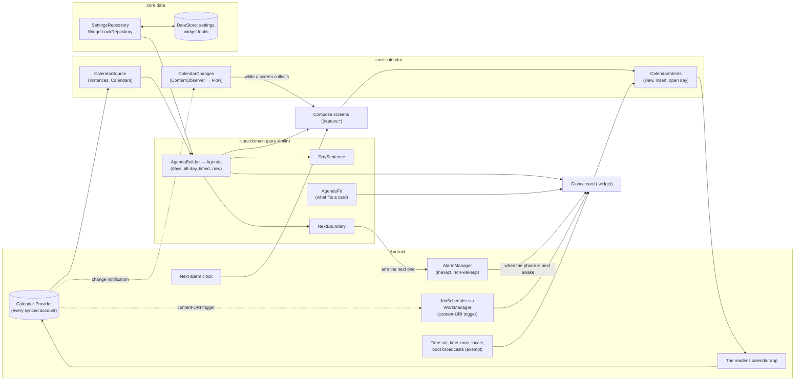

# Tempo — Technical Planning

> Companion to [VISION.md](VISION.md). This document defines the architecture, the design of the calendar engine, the widget, and the delivery phases.
> It is written to be read by humans and by Claude Code.
>
> Keep the phase checklists up to date: tick the boxes as work is merged, and record every decision and deviation with its reason in §15's log. How the log is written and archived is in How it is made, below.

---

## How it is made (2 Nov 2026)

- **This file** is the living plan: the architecture and the rules the code keeps (§1 to §10, §12 to §14: living, changed in place with the code, never archived), the phases still open (§11), what is open (§15, Open), and the log of the current period (§15, after Open). New decisions are written **at the end of the log**, one `###` section per intervention, with who asked and the date (and the step, where there is one), as always.
- **`docs/planning/NN-<period>.md`** are the closed periods of the log, from Phase 0 on, with the phases they closed, **frozen**: they are not edited. A decision that changes an old one is written here, naming the one it changes (the file, and the title or the entry's date).
- **`docs/planning/README.md`** is the index of every `##` and `###` heading of the archive, and of every dated entry of the log kept as a list until archive 01, with its line: a reference by name or by date in the code ("PLANNING.md §11 Phase 3", "§15, 9 Oct 2026") that is not in this file is found there. It is written by `python3 tools/planning_index.py`, never by hand, and changes only when archiving.
- **Archive** when the log passes ~80 KB (`sed -n '/^### Log since/,$p' PLANNING.md | wc -c`), or at a release, whichever first. A size and not a count of lines: this file writes a paragraph to a line. The log becomes the next archive file (the same header as the previous ones), and the phases of §11 that closed go with it (a closed phase's open box carried to Open); here an empty log stays with its start date, «Open» is reread, and the index script is run again.

## State

- **Released**: 1.1.0 (2 Nov 2026, `v1.1.0`). What came in after is in `CHANGELOG.md`'s `[Unreleased]` section.
- **Closed**: Phases 0 to 6 (the 1.0.0, 10 Oct 2026) and the 1.0.1 after them: their steps, their acceptance and their log are in `docs/planning/01-phases-0-8.md`. Phase 8, the 1.1.0 (30 Oct to 2 Nov 2026): its plan, its steps and the log from 2 Nov 2026 are in `docs/planning/02-phase-8.md`, the entries of its steps 8.0 to 8.7 in archive 01.
- **In progress**: nothing. Open, in §15: 8.4 («Join», on hold), 1.1's battery check on the phone, and two boxes carried from before.
- **Later, and optional**: Phase 7, Google Play (§11).

---

## 1. Tech stack

The family's stack, as Passo set it up (Passo ADR 0001), minus what Tempo has no use for.

| Concern | Choice |
|---|---|
| Language | Kotlin 2.4, compiled by AGP 9's built-in Kotlin, with the Compose compiler Gradle plugin |
| Build | Gradle 9.8 with Kotlin DSL, AGP 9.4; version catalog (`gradle/libs.versions.toml`); convention plugins in `build-logic/` |
| JDK | Java 21, `jvmTarget` 21, without a Gradle toolchain |
| SDK levels | `minSdk 34`, `targetSdk 37`, `compileSdk 37` (Passo's) |
| UI | Jetpack Compose, Material 3 in Chiaro's design language (its generated schemes, dynamic color on request), edge-to-edge |
| Widget | Jetpack Glance (`glance-appwidget` + `glance-material3`) 1.2.x, `SizeMode.Exact`, the system `TextClock` through `AndroidRemoteViews` |
| Architecture | MVVM with unidirectional data flow; coroutines and `Flow` |
| Dependency injection | Hilt |
| Calendar | The system Calendar Provider (`CalendarContract`) through the `ContentResolver`: no library |
| Persistence | DataStore (Preferences) for the settings and the widgets' looks. **No Room**: Tempo stores no event (§5) |
| Background | WorkManager (already brought by Glance, pinned as in Passo) for the calendar's content-URI trigger; `AlarmManager` inexact non-wakeup alarms for the boundaries (§7) |
| Navigation | Navigation 3, as Passo's shell |
| Time | `java.time`; Android's `DateFormat.getBestDateTimePattern` for the locale's own patterns |
| Testing | JUnit 4, Truth, Turbine, coroutines-test; Robolectric (the provider through a fake `ContentProvider`, receivers, Compose UI tests); Glance's unit test utilities |
| Quality | Android Lint (`checkDependencies`), ktlint through Spotless; Baseline Profiles later |
| CI | GitHub Actions: formatting, the forbidden-permission check on the merged manifest, unit tests and lint before the APKs. A release workflow on version tags builds the signed APK and publishes it to GitHub Releases |
| License | GPL-3.0. Every new dependency must have a GPL-3.0-compatible license (Apache-2.0, MIT, BSD) and the owner's approval |

Always pick the **latest stable** versions at setup time and record them in the version catalog. Avoid alpha versions unless a phase needs them and says why.

---

## 2. Project structure

```
tempo/
├── app/                    # Application, MainActivity, navigation, DI entry points
├── build-logic/            # Convention plugins (android-application, library, compose, feature, hilt, jvm)
├── core/
│   ├── model/              # Pure Kotlin data classes (no Android deps)
│   ├── domain/             # Pure Kotlin: the agenda, the day's sentence, the widget's fit, the next boundary
│   ├── data/               # DataStore: settings, widget looks; repositories exposing Flow
│   ├── calendar/           # The Calendar Provider's Android half: queries, change observer, intents
│   ├── designsystem/       # M3 theme, typography, shared components, icons
│   └── testing/            # test-only: the accessibility checks and the page walk the UI tests share
├── feature/
│   ├── today/              # the clock, the sentence, the agenda, the new-event button
│   ├── settings/           # settings, the calendars, about, credits
│   ├── onboarding/         # welcome, the calendar permission, the widget
│   └── guide/              # the guide, in Chiaro's shape (Phase 5)
├── widget/                 # the Glance card(s), the config screen, the refresh (job, alarm, receivers)
├── tools/                  # the launcher icon script
├── docs/                   # ADRs, screenshots
├── VISION.md
├── PLANNING.md
└── CLAUDE.md
```

Rules:

- `core:model` and `core:domain` are pure Kotlin/JVM modules. All business logic lives there and is unit-tested without Android.
- Feature modules depend on `core:*`, never on each other.
- `app` wires everything together.
- A module joins the build in the phase that brings its first code, not before (`feature:guide` in Phase 5).

---

## 3. Architecture overview



**One way in, one way out.** Events come in from the Calendar Provider only, read by `CalendarSource`. Changes go out through the calendar app only, opened by `CalendarIntents`. Tempo writes nothing but its own settings.

**The read path is computed, not stored.** A screen or a card asks for the instances of a time window and the calendars' metadata, and `:core:domain` turns them into an `Agenda`: days, each with its all-day row and its timed events, where "now" falls, what is under way, the sentence. Nothing is cached in a table; the provider answers a day's query in milliseconds.

**Live while visible.** Today collects `CalendarChanges` (a `ContentObserver` on the provider, registered only while collected) and a minute ticker, both tied to the page's lifecycle. With the page gone, nothing of Tempo runs.

**The widget is pushed, never polled** (§7): the calendar's content-URI trigger, the next boundary's inexact alarm, and the exempt time broadcasts each ask the card to recompose. Its clock is the system's `TextClock` and needs none of it.

---

## 4. The calendar engine (core design)

The riskiest part of the app: wrong days, missing occurrences and stale cards are what make readers drop agenda widgets. Build it first, with its tests, before any screen.

### 4.1 Reading the provider

- **Instances**, not Events: `CalendarContract.Instances.CONTENT_URI` with the window `[start, end)` in epoch millis appended (`Instances.CONTENT_URI.buildUpon()`, `ContentUris.appendId(begin)`, `appendId(end)`). The provider expands recurrences and applies exceptions; Tempo never parses an `RRULE`.
- **Projection** (only what is shown or decided on): `EVENT_ID`, `BEGIN`, `END`, `START_DAY`, `END_DAY`, `START_MINUTE`, `END_MINUTE`, `ALL_DAY`, `TITLE`, `EVENT_LOCATION`, `CALENDAR_ID`, `DISPLAY_COLOR` (the event's colour, or its calendar's), `STATUS`, `SELF_ATTENDEE_STATUS`, `EVENT_TIMEZONE`, `AVAILABILITY`, `IS_ORGANIZER` (so an invitation the reader has not answered is told from a meeting they set up, review of 30 Oct 2026).
- **Calendars**: `Calendars.CONTENT_URI` for `_ID`, `CALENDAR_DISPLAY_NAME`, `ACCOUNT_NAME`, `ACCOUNT_TYPE`, `CALENDAR_COLOR`, `VISIBLE`, `SYNC_EVENTS`, `IS_PRIMARY`. `VISIBLE = 0` (hidden in the calendar app) is hidden by default in Tempo too, and the reader's own choice in Tempo wins over it. `SYNC_EVENTS = 0` (a calendar the account lists but this phone does not sync: a colleague's, a country's holidays ticked off) is not on the phone: no switch in Settings, not counted, its events never shown, as the calendar apps list only the synced ones (`CalendarChoices.onPhone`, review of 30 Oct 2026).
- **The window**: from the start of today to the end of the horizon's last day, in the zone of the phone, widened by a day on each side so that all-day events (stored in UTC, §4.2) are never cut off by the window itself; the domain trims.
- **Selection in the domain, not in SQL**: hidden calendars, declined invitations and cancelled events are filtered by `AgendaBuilder`, in pure Kotlin, where they are tested. The query stays the same for every reader.
- **Threading**: queries run on `Dispatchers.IO`; a `SecurityException` (the permission revoked while the app runs) becomes a state, never a crash.

### 4.2 All-day events and time zones

- An all-day event is stored from **00:00 UTC** of its first day to 00:00 UTC of the day after its last (`END` exclusive). Its days are therefore read in **UTC** (`START_DAY`/`END_DAY` are Julian days computed by the provider; or `BEGIN`/`END` converted with `ZoneOffset.UTC`), never in the phone's zone. In the phone's zone, a one-day event at UTC−5 starts at 19:00 the day before.
- A timed event is placed by its `BEGIN`/`END` in the phone's **current** zone. `EVENT_TIMEZONE` is never used to place it; since step 8.5 it is said, as one note on Today's row, where it names a place and its offset at the event's start is not the phone's: "09:00 in Lisbon" ("09:00 ora di Lisbona"), the city as the locale's CLDR data writes it (`EventZone.differs`, `AgendaText.ownZone`). Never for an all-day event, for `UTC`, `GMT`, a bare offset or an `Etc/` zone, nor for a zone on the phone's clock at that moment (Paris beside Rome; London beside Lisbon, all year). The cards have no room for it.
- A time-zone change (travel) re-reads everything: the days move, the provider's own instances table is rebuilt by the provider itself.

### 4.3 Days, overlaps, multi-day events

- A timed event that crosses midnight belongs to every day it touches; on the second day it reads "until 01:30", on the first "from 23:00".
- A multi-day all-day event is in each day's all-day row with "day 2 of 5".
- Overlapping events are listed by start, then by end, then by title; the timeline never draws them side by side (one column, the phone's width).
- The event under way: `BEGIN <= now < END`. Past: `END <= now`. Next: the first with `BEGIN > now`.

### 4.4 What is not shown

- `STATUS = STATUS_CANCELED`: never.
- `SELF_ATTENDEE_STATUS = ATTENDEE_STATUS_DECLINED`: hidden unless the reader shows declined invitations.
- Calendars the reader hid in Tempo, or hidden in the calendar app and not shown in Tempo.
- Events with no title are shown as "(No title)", the calendar app's own convention.

### 4.5 Watching for changes

- **In the app**: `CalendarChanges` is a `callbackFlow` around a `ContentObserver` registered on `CalendarContract.CONTENT_URI` with descendants, unregistered when the collector stops. Changes are debounced (a sync writes many rows at once). Android refuses the observer without `READ_CALENDAR`, so the pages watch through `CalendarChanges.flow(restarts)`, started again at every reread: a permission granted from the page's card or the system's settings makes the page live at once (review of 30 Oct 2026).
- **For the widget**, two ways, the first fast and the second a safety net (9 Oct 2026, §15):
  - the provider's own `PROVIDER_CHANGED` broadcast on `content://com.android.calendar`, received in the manifest (`CalendarChangedReceiver`). It is not on Android 8's exemption list, but the AOSP provider sends it with `FLAG_RECEIVER_INCLUDE_BACKGROUND`, about a second after an app's edit and half a minute after a sync's, so a manifest receiver has it. The waiting trigger is replaced first, so the change is drawn once;
  - a WorkManager `OneTimeWorkRequest` with `Constraints.addContentUriTrigger(CalendarContract.CONTENT_URI, true)` (quiet for 3 s, at most 20 s late), tagged, one waiting at a time; each run arms the next *before* it repaints, so a change during the run is seen (content-URI triggers are one-shot by design). It costs nothing while nothing changes, and catches a maker's provider that does not send the broadcast.
  - Either stays until the cards are drawn (`TempoWidgets.repaintAll`, `WidgetRefresh.awaitDrawn`): Glance composes in a WorkManager worker started inside Tempo's process with no job bound, and a process left cached can be frozen with the card half drawn.

### 4.6 Edge cases (all need unit tests)

- An all-day event, one day and several days, in a phone zone west of UTC, east of UTC, and at UTC.
- A timed event crossing midnight; one crossing two midnights.
- A recurring event with an exception (one occurrence moved) and a deletion (one occurrence cancelled).
- The night daylight saving starts (the 02:00–03:00 hour does not exist) and ends (01:00–02:00 happens twice); an event in the repeated hour.
- The phone's zone changing between two reads (travel).
- A zero-length event (`BEGIN = END`): a moment, shown at its time.
- An event that started yesterday and ends tomorrow (timed): on today it is in the all-day row, "day 2 of 3"; its first date keeps it as "from 21:00", its last as "until 02:00" (decided in Phase 1, §15).
- Declined, tentative, cancelled; an event with no title; a calendar with no colour.
- Today empty, the horizon empty, every calendar hidden, no calendar at all.
- Midnight while the page is open: the day rolls over without a restart.
- The permission revoked while the app is open; granted from the system's settings while the app is in the background.

### 4.7 Handing over to the calendar app

`CalendarIntents` builds every intent, and says whether something can take it (`resolveActivity`, with `<queries>` in the manifest for Android 11+ package visibility):

| What | Intent |
|---|---|
| Open an event (one occurrence) | `ACTION_VIEW`, `ContentUris.withAppendedId(Events.CONTENT_URI, eventId)`, extras `EXTRA_EVENT_BEGIN_TIME` / `EXTRA_EVENT_END_TIME` = the instance's |
| New event | `ACTION_INSERT`, `Events.CONTENT_URI`, `EXTRA_EVENT_BEGIN_TIME` = the next half hour (or the free gap's start), `EXTRA_EVENT_END_TIME` = one hour later |
| Open the calendar at a day | `ACTION_VIEW`, `CalendarContract.CONTENT_URI/time/<millis>` |
| Edit an event | `ACTION_EDIT` on the event URI: only if Phase 1 measures it working on the owner's calendar apps (VISION, From the concept); otherwise `ACTION_VIEW` |

From the widget the same intents travel as `PendingIntent`s (immutable). A "No app can open this" state replaces a button that would do nothing.

---

## 5. Data model

Tempo has no database. The Calendar Provider is the only truth for events; Tempo keeps the reader's choices.

### `:core:model` (pure)

- `CalendarInfo(id, name, accountName, accountType, color, visibleInProvider, isPrimary, syncsEvents)`
- `EventInstance(eventId, calendarId, title, location, begin: Instant, end: Instant, allDay, color, status, selfStatus, availability, timeZone, isOrganizer)`, with `awaitsAnswer` (invited, and not by themselves): as stored; an all-day event's dates are derived in the domain (`allDayDates()`, UTC), never stored beside it
- `EventStatus`, `AttendeeStatus`, `Availability`, `CalendarPermission`
- `Agenda(now, today, days, underWay, next)`, `AgendaDay(date, allDay: List<AllDayEntry>, timed: List<TimedEntry>, free: List<FreeGap>)`, `AllDayEntry(event, dayNumber, dayCount)`, `TimedEntry(event, startsOnDate, endsOnDate, state)`, `FreeGap(start, end)`. The day's sentence is computed from an `AgendaDay` by `DaySentence` (Phase 3), not stored in it
- `UserSettings`, `WidgetLook` (below)

### DataStore (Preferences), file `settings`

| Key | Default | Meaning |
|---|---|---|
| `theme`, `palette`, `font`, `dynamic_color` | system, VIVID, GOOGLE_SANS, false | The family's appearance |
| `clock_format` | SYSTEM | `ClockFormat` |
| `date_style` | LONG | `DateStyle` |
| `horizon_days` | 7 (a week; owner, §15) | Days shown: 1, 2, 7 or 14 (two weeks, step 8.6) |
| `calendar_choices` | empty | The calendars the reader turned on or off in Tempo (a string set, one `CalendarChoice` per line, URL-encoded fields), each kept as `id` **and** `account_type/account_name/display name`, so a restore that renews the ids can still match them (`CalendarChoices`, §15) |
| `show_declined` | false | Declined invitations |
| `show_all_day` | true | All-day events |
| `show_next_alarm` | true | The next alarm line |
| `show_calendar_button` | true | Today's button that opens the calendar app at today (§15, 9 Oct 2026) |
| `second_zone` | none | The second clock's city, as a time-zone id ("America/New_York"; ICU's canonical name, "Asia/Calcutta", which `java.time` knows too). An id this phone's time-zone data does not know reads as none (step 8.5) |
| `onboarding_completed` | false | |
| `today_tip_seen` | false | Today's first tip ("How to read the dial") dismissed or followed to the guide (step 8.6) |
| `asked_calendar_permission` | false | Whether the permission was ever asked: what tells "askable" from "denied for good" (§15) |

### DataStore, file `widgets` (not backed up)

One `WidgetLook` per `appWidgetId`: show clock, clock format, show date, date style, header action, event action, card ground (light, dark, system, one of six colours), opacity, show all-day, show the days ahead, show the second clock (off by default, step 8.5), show «In words»'s note (on by default; off, the event alone: §15, 5 Nov 2026). Removed in `onDeleted`.

### Backup

`data_extraction_rules.xml`: `files/datastore/settings.preferences_pb` only (Passo's ADR 0007 rule: an allowlist, decided). The widgets' file stays out: widget ids are renewed by a restore.

---

## 6. Derived views (`core:domain`)

- **`AgendaBuilder`**: instances + calendars + settings + now + zone → `Agenda`. Applies §4.2–§4.4. Pure, the most tested class of the app.
- **`DaySentence`**: the day in one sentence, from the agenda alone: the count of what is left, the next event and when, the free time before it, the end of the day ("Nothing left today; tomorrow starts at 9"). Returns a structure (kind + values), never a string: the words are resources, in both languages, with plurals (`:feature:today` and `:widget` format it).
- **`FreeTime`**: the gaps between a date's busy timed events (overlaps merged; free-availability and declined events do not take the time; all-day ones neither), and on today the time from now to the next busy one. Never the evening after the last event or the morning before the first, which are not "free time" any more than the night is (§15). Every gap feeds the sentence; the first gap of an hour or more still ahead today is also a row of the timeline (owner, §15, 7 and 30 Oct 2026).
- **`NextBoundary`**: the next moment the agenda changes by itself: the nearest `BEGIN` or `END` after now, or the next midnight, whichever is first; with an «In words» card placed, also the moment one of today's events comes onto the dial's face (`DialArcs.comesOnTheFace`, review of 30 Oct 2026; today's only since §15, 5 Nov 2026). The widget arms its alarm on it.
- **`EventZone`** and **`SecondZone`** (step 8.5): whether an event's own zone reads another clock than the phone's at its start, and which zone the second clock shows (none where it would repeat the phone's own) and on which day there. The cities' names are the presentation's (`ZoneCities`, `:core:designsystem`, from ICU).
- **`AgendaSections`**: the agenda's days as Today lays them out: today, tomorrow in full, the days after it compact, and every run of empty days folded into one row (§15, 9 Oct 2026).
- **`AgendaFit`** (pure arithmetic, as Passo's `GlanceLayout`): given a card's granted size in dp, the header's choice and the text sizes measured in the system face, how many event rows fit, which form the card takes, and what the "N more" line says. Pinned by tests at the family's reference grants (one row ≈ 85 dp tall, two ≈ 189; widths 2 cells ≈ 159 dp, 3 ≈ 250, 4 ≈ 340).
- **Calendar colours are data, not roles.** They are chosen in the calendar app with no thought for Tempo's grounds, so they mark an event (a dot, a bar at the start of its row, a quiet arc on Today's dial) and never colour its text or its ground. A mark keeps a 3:1 contrast with its ground by stepping its lightness when it must (`markColor`), and a mark drawn quieter fades only as far as that ratio allows (`markAlpha`): pure functions with their tests.

---

## 7. Widget (Glance)

Two cards in v1, the family's pair (owner, §15): «Agenda» (`AgendaWidget`, the concept's) and «In words» (`WordsWidget`, Chiaro's «In parole», Passo's «In words»). The same size spec, the same settings screen, the same refresh. The family's card (Passo's ADR 0005, from Chiaro): its corner, insets, grounds, Chiaro's six colours, opacity, and Chiaro's ink rule.

### Configuration

- `SizeMode.Exact`: every form is read off the size the launcher really granted. Glance does the work the concept gave to `onAppWidgetOptionsChanged`, and recomposes on every resize.
- Default placement 4×2 (`targetCellWidth` 4, `targetCellHeight` 2), minimum one cell, `resizeMode="horizontal|vertical"`, **no maximum** (Passo's ADR 0005: Launcher3 turns a dp maximum into the smallest cell count across its grids). Each form has a layout for any grant (`AgendaFit`, `WordsFit`, `:core:domain`; ADR 0003).
- `updatePeriodMillis = 0`. `configure` is the per-widget settings screen, `reconfigurable|configuration_optional`.
- `widgetCategory="home_screen"` in v1; `keyguard` is a later idea.

| Form | When | Content |
|---|---|---|
| CLOCK | one cell, or a row too narrow for a list beside the clock (two cells) | The time, as large as the cell holds; the date under it where it still reads (else none) |
| LINE | one row, three cells and up | The time and, under it at 16 sp (Passo's facts, «In words»'s line on top), the date (shortened before it is shrunk) on the leading side; the next events beside them, and "N more" |
| AGENDA | two rows and up | The header (clock and date at 16 sp, each optional; the second clock at the far edge of the date's line where both fit whole, or in the date's place under a clock without one), then the events that fit, then "N more today" |
| SIDE | two rows and up, four cells, where a header on top would leave fewer than five rows (the default 4×2) | The clock and the date (over two even lines if need be: "Wednesday, / October 7") in a column on the leading side, the second clock under the date where it is on and fits ("New York 04:20"), the rest of the day in a few words under them ("4 left today", "until 19:30"); the events beside them |

With the clock and the date both hidden, the card is its list alone, on any grant. A date's all-day events share one row ("All day · Design Week, Anna's birthday"), so two holidays never push out what happens next. A row sets its time as a range where the title keeps 120 dp, its start alone where it keeps 72, else over the title. The time column is set by the rows the card shows, the event under way as "→ 11:00" where "Until 11:00" would widen it for every title, and an all-day label more than an em wider than the timed rows' times (Italian's "Tutto il giorno") stands over its titles across the list instead (`AgendaFit.timeColumn`, ADR 0003 decision 13).

**The rest of the day in a few words** (8.2, ADR 0003 decision 12): under the date in «Agenda»'s side column, at the label step in the secondary ink, how many timed events are left today, the one under way among them, and when the last one ends ("4 left today" / "until 19:30", "Ancora 4 oggi" / "fino alle 19:30"; `CardSummary`), each line where it fits whole; nothing once today's timed events are over. Counts and clock times the card is redrawn at anyway, so they never go stale. It stands where the next alarm was planned: the alarm's change did not reach a card in the background reliably on the owner's phone, so the alarm stays on Today alone (§15, 30 Oct 2026, Phase 8.2).

| «In words» form | When | Content |
|---|---|---|
| CELL | one cell wide | The dial, the family's circle (the cell's shorter side less 8 dp each side, as Passo's ring; §15, 4 Nov 2026); under it the focus's time ("11:00") where the cell is taller than wide. Without the dial, that time bold in its place, the title under it |
| ROW | one row | Passo's row: the dial, Passo's ring (44 to 56 dp, keeping the words beside it 84 dp; §15, 4 Nov 2026), drawn where the words keep 72 dp; the title (20 sp, Chiaro's sentence) over when ("Until 11:00", "15:00 – 15:45", "Tomorrow · 9:00 – 9:30", 16 sp, Passo's facts); the date at the far edge over two lines ("Wednesday / 7 October") where the words keep 120 dp. A narrow row sets the words at 16 and 14 sp, a long title over two lines |
| TALL | two rows and up | Passo's tall card: the dial in the top trailing corner, the family's circle for the card's size, whatever the day says (the height left over a budgeted band of words, up to 45% of the card's inner height and width, never held under 104 dp; Passo's ring at the same size: §15, 4 Nov 2026, "at every size") with the date beside it, or on its own line over the title where the dial leaves it no column (two cells wide, three rows high); with «The day's note» off in the card's settings, the event alone (its title on one line, its time) under a dial the size of Passo's ring without its sentence, the date where it fits without shrinking it (§15, 5 Nov 2026), and the second clock under the date where the band beside the dial holds it (without the dial, on top under the date); the title (22 sp, down to 18 to stay on one line), when, the day's note hanging from the bottom leading corner. Under them, where two more lines fit once the dial has its comfort (72 dp), the next one or two events as rows ("13:00  Lunch with Giulia", 13 sp, the time quiet and the title strong; 8.3), the note keeping its count only where they leave some out; else, on a card four cells wide with a line to spare, the rest of the day as a line of times ("Then 13:00 · 15:00 · 18:30") in place of the note's count |

**The dial** (owner, 8 Oct 2026; `DialArcs`, `WidgetDial.kt`, ADR 0003): a clock face where Passo's card has its ring. The hands are the system's `AnalogClock`, drawn by the launcher and moved by the system like the `TextClock`; the face under them is a bitmap Tempo paints at each redraw: the ring's track, what is left of today as arcs (today only, owner, §15, 5 Nov 2026: a later day's events are in the words and the list, never on the face), the focus among them in the accent from its start to its end, the rest quieter, four quarter dots. The arcs change only where an event starts or ends, or comes onto the face, the boundaries the card is redrawn at (the last one since the review of 30 Oct 2026, where an «In words» card is placed, for today's events), so the hour hand walks into an arc, through it and out of it with no work by Tempo. A face shows twelve hours: the window opens now (or at the start of the event under way, six hours back at most) and closes eleven and a half hours later, so no arc ever meets the hand from behind; what lies beyond it is left off, never wrapped, and an event of today that reaches past it (only early in the day) is cut there, its arc fading out at the cut end, as at a start cut six hours back (`DialArc.cutAtEnd`, `cutAtStart`, `DialFade`; owner, §15, 11 Nov 2026). An event of today that runs past midnight is drawn whole. The samples paint the hands into the face at their moment.

The focus is the event under way, else the next one today, else (with the days ahead) the first one after today under its day's name, else "Free" (`WordsDay`). The note says times and counts, never minutes from now (§15): "Then 2 more today.", "Free until then; one more after it.", "Nothing left today.", or a free day's all-day events.

### Rendering

- **No scrolling container**: a Glance `Column`, never `LazyColumn` (a `ListView` underneath). Glance drops the eleventh child of a container silently: events go in groups of at most five, the header and the footer counted.
- **The second clock** (step 8.5) is one more `TextClock`, its pattern the city as a quoted literal before the card's time pattern ("'New York' HH:mm"), its zone set with `setTimeZone`: the system moves it as the first, at no cost, across both midnights. It says no day ("· tomorrow" is Today's): a `TextClock` cannot tell the phone's date from the city's, and a word written in would be wrong between the two midnights. At the label step (13 sp), in the secondary ink, in the face of the card's date; its touch is the header's. Measured by `AgendaFit` and `WordsFit` (`secondEm`), drawn where it fits whole, else not at all; never on a row or a cell.
- **The clock and the date are a `TextClock`** in a small XML layout, placed in the card with Glance's `AndroidRemoteViews`; `format12Hour`/`format24Hour` set per widget (`RemoteViews.setCharSequence`), and with both set to the same pattern when the reader forced one. It is drawn by the launcher, updated by the system every minute, and costs the app nothing. Its text size and ink are set like the card's other text.
- Inks resolved against the ground the card really has (`widgetInk`, Chiaro's rule, as in Passo), never left to the launcher's day/night resolution.
- An event row: the calendar's mark, the time ("10:00–11:00", or "All day"), the title on one line, ellipsised; the event under way in the strong ink with "ends 11:00"; past events are not on the card at all (the card is the rest of the day).
- Previews: a static `previewLayout`, and generated previews on Android 15+ (`providePreview`) from a sample day, once per version.

### Taps

- Header (the clock and the date): Tempo's Today (the default), the calendar app at today, or the phone's clock app (owner, §15), per widget.
- Event: the event's occurrence in the calendar app (the default, as on Today), or Tempo's Today, per widget.
- "N more today", the rest of the card: Tempo's Today.
- No permission: Tempo, where Today (or the first run) asks for it.
- A door that is not on the phone (no calendar app, no clock app) falls back to Tempo, and the settings screen does not offer it.

### Update strategy (battery-aware)

- **Calendar changed**: the provider's broadcast, else the content-URI-triggered work (§4.5), updates every card and stays until they are drawn; the work arms the next one as it starts.
- **A boundary**: after every render the card arms one `AlarmManager.set(RTC, NextBoundary)` (inexact, **non-wakeup**): if the phone is asleep it is delivered when the phone next wakes, which is when someone can see the card. No `SCHEDULE_EXACT_ALARM`, no `RTC_WAKEUP`.
- **Clock, zone, language**: `TIME_SET`, `TIMEZONE_CHANGED`, `LOCALE_CHANGED`, exempt from the implicit-broadcast limits, received in the manifest.
- **Boot and update**: the system sends the card its update after a boot and after an app update; the alarm and the work are armed again from it.
- **Settings changed** in the app or the card's own screen: an immediate update.
- Nothing else. No periodic work, no polling, no foreground service.

---

## 8. Notifications and system surfaces

- **No notification channel in v1**, and so no `POST_NOTIFICATIONS` (VISION, System surfaces).
- **Launcher shortcut** (dynamic, `NewEventShortcut`: a static one names its package, and the debug build's is another): "New event", the `ACTION_INSERT` of §4.7 (owner, §15). Published again when its words are not the app's any more (the reader changed the app's language, review of 30 Oct 2026).
- **Pin request**: onboarding and Settings offer "Add the widget to the home screen" through `AppWidgetManager.requestPinAppWidget`, where the launcher supports it.

---

## 9. Battery rules (non-negotiable)

1. No service, foreground or background. Tempo runs only when a screen of it is visible, when a card is being drawn, or when the calendar changed.
2. No wakelocks of the app's own (WorkManager holds its own while its work runs, as in Chiaro and Passo).
3. No exact alarms, no wake-up alarms, no `REQUEST_IGNORE_BATTERY_OPTIMIZATIONS`, no periodic workers.
4. Nothing runs on a timer while the screen is off. The minute ticker lives in the page's lifecycle (`repeatOnLifecycle(STARTED)`), the observer in the collector's.
5. The widget's clock is the system's `TextClock`: never a repaint per minute by the app.
6. A phase that touches the refresh ends with a check: `adb shell dumpsys alarm | grep tempo` (one non-wakeup alarm at most), `adb shell dumpsys jobscheduler | grep tempo` (one content-triggered job), `dumpsys batterystats --charged com.callbackdev.tempo`, Doze (`dumpsys deviceidle force-idle`).

---

## 10. Permissions and manifest

| Permission / element | Type | Why |
|---|---|---|
| `READ_CALENDAR` | Runtime | Read the Calendar Provider (Phase 1, declared by `:core:calendar`) |
| `<queries>` for `ACTION_VIEW`/`ACTION_INSERT` on calendar URIs | Manifest | Lets Android 11+ show Tempo the calendar app, to know whether a button can work. Not a permission |
| `RECEIVE_BOOT_COMPLETED`, `WAKE_LOCK`, `ACCESS_NETWORK_STATE`, `FOREGROUND_SERVICE` | Normal | Brought by WorkManager, which Glance runs its sessions on and the calendar trigger uses, as in Chiaro and Passo. Without `INTERNET` nothing can leave the phone. Tempo's own code uses none of them. Reviewed in Phase 4 against the merged manifest: the same set as Phase 0's, nothing added by the widgets (the boundary alarm is `AlarmManager.set(RTC)`, which needs no permission); kept as WorkManager declares them, as in the sisters |
| `<queries>` for `AlarmClock.ACTION_SHOW_ALARMS` | Manifest | Lets Tempo find the phone's clock app (`ClockApp`, declared by `:core:calendar` since 8.1): Today's alarm line and a card whose time opens it (Phase 4). Not a permission; Tempo opens the app's front door and never sets an alarm |
| `android:allowBackup="true"` + `dataExtractionRules` | Manifest | The settings file only (§5) |

**Forbidden:** `INTERNET`, `ACCESS_*_LOCATION`, `REQUEST_IGNORE_BATTERY_OPTIMIZATIONS`, `SCHEDULE_EXACT_ALARM`, `USE_EXACT_ALARM`, `WRITE_CALENDAR`, `READ_CONTACTS`, `WRITE_CONTACTS`, `HIGH_SAMPLING_RATE_SENSORS`, `BODY_SENSORS*`.

`checkForbiddenPermissions` (build-logic, `ForbiddenPermissionPatterns`) checks every variant's merged manifest, is wired to `check`, and runs in CI and in the release workflow. A library that adds one is removed or patched with `tools:node="remove"`.

---

## 11. Delivery phases

Each phase ends with a merged PR, green CI and its acceptance criteria met. Phases 1 and 4 need **testing on a physical device** with real accounts: an emulator's calendar has no sync and no second calendar app.

**Phases 0 to 6, and after 1.0: closed.** The foundations, the calendar engine, Settings, Today and the first run, the widgets, the guide and the accessibility pass, the 1.0.0 and the 1.0.1 (7 to 10 Oct 2026): their steps and acceptance are in `docs/planning/01-phases-0-8.md`, §11, where the index (`docs/planning/README.md`) finds each phase by its title. Phase 5's one open box, the Baseline Profile, is in §15's Open list.

**Phase 8, the 1.1: closed.** The review of 30 Oct 2026 and the 1.1.0 (30 Oct to 2 Nov 2026): its plan and its steps 8.0 to 8.8 are in `docs/planning/02-phase-8.md`, §11. Its step 8.4 («Join», on hold) and 8.8's battery check are boxes in §15's Open.

### Phase 7 — Google Play (optional, later)

- [ ] As Passo's Phase 9: the same key, the store listing, the data safety form ("no data collected, no data shared").

**For the sisters** (not Tempo's work; written here so their sessions find it): Passo takes Tempo's filled `StatusCard` button (§15, 7 Oct 2026), its first-run and Settings "Add to the home screen" (`requestPinAppWidget`), the picker's generated previews and a Widgets group in Settings; Passo's `FilterChip`s (8 dp) against its own "chips are fully round" rule is its call; Chiaro takes the generated previews. The family decides together whether to adopt Chiaro's segmented groups, and makes the Material 3 Expressive pass when `material3` 1.5 is stable.

---

## 12. Testing strategy

- **Pure Kotlin first.** `AgendaBuilder`, `DaySentence`, `FreeTime`, `NextBoundary`, `AgendaFit` and the colour mark are tested on the JVM with fixed instants and zones, every §4.6 case named in a test.
- **The provider under Robolectric.** A fake provider registered for `com.android.calendar` returns cursors built from fixtures, so `CalendarSource` is tested with the real `ContentResolver` path.
- **Screens from states.** Compose UI tests draw a screen from a state, never from a database, with `assertAccessible()` and `walkPage()` (`:core:testing`), at twice the text size and on an open foldable; their screenshots land in each module's `build/screenshots` and are looked at.
- **The widget's forms.** Glance's test utilities for content; a gallery test that draws every form at the reference grants.
- **On a device**, for what only a device can say: real accounts and sync, the calendar apps' handling of the intents, the launcher's grants, the alarm's delivery.

---

## 13. Working with Claude Code

`CLAUDE.md` holds the operating rules (commands, modules, invariants, design, signing). The workflow, as in the family:

- Work one phase at a time, from its section in §11.
- Write the domain test first for anything that decides a day, a boundary or a fit.
- Tick the boxes as work lands; record every decision and deviation, with its reason, in §15, as a `###` section at the end of its log (and as an ADR in `docs/adr/` when it is architectural). The closed periods of the log are archived, frozen, in `docs/planning/` (How it is made, at the top).
- Run `spotlessApply`, `test`, `:app:lintDebug` and `:app:checkForbiddenPermissions` before pushing.

---

## 14. Risks and mitigations

| Risk | Mitigation |
|---|---|
| All-day events on the wrong day | Read in UTC (§4.2); tests in zones west, east and at UTC |
| A calendar app that ignores an intent | `resolveActivity` before drawing a button; VIEW over EDIT (§4.7); measured in Phase 1 |
| A card that is stale after a change | The content-URI trigger re-enqueued after each run; on return to the app, the observer; measured in Phase 4 |
| A finished event lingering on the card | The non-wakeup alarm at the boundary; the card says times, so a minute's delay never misleads |
| Launchers that grant odd sizes | `SizeMode.Exact` and a form for every grant, no maximum (Passo's ADR 0005) |
| Glance's eleventh-child limit | Events in groups of five, a test that counts children |
| Work-profile calendars invisible | Said in the guide: install Tempo in the work profile too |
| Calendar colours unreadable on a card | Marks only, never text; lightness stepped to 3:1 (§6) |
| OEM calendar providers with gaps (no `DISPLAY_COLOR`, odd `VISIBLE`) | Defensive reading with defaults; tested with columns missing |
| WorkManager's permissions in the merged manifest | Reviewed in Phase 4; the forbidden list guards what matters |

---

## 15. Decisions log and open questions

### Open

What is still to decide or to do, in one place, besides the steps of the phases in §11 (which keep their boxes there): a box opens here, with the reference to the log entry it comes from, and closes here, with the one that closes it. A new question is written here and asked before it is built.

- [ ] **«In words» two rows high: may the words rise beside the dial?** (30 Oct 2026, step 8.3.) The tall card budgets its height as if the dial took the card's whole width, so on the three- and four-by-two the leading side under the date, beside the dial, stays empty (about 65 dp of 161 on the four-by-two at 10:20), and the next events do not fit under the words. The words hang from the bottom; they could rise beside the dial wherever each line beside it is narrower than the room the dial leaves (on the four-by-two at 10:20 about 215 dp: the title and its time beside the dial, the note and the next two events under it, the dial kept at its 73.75 dp, the family's circle since 4 Nov 2026). Options: (a) as now, the rows on three rows and up; (b) the words rise beside the dial, the two-row cards listing the next events where their lines fit beside it. The two-by-two gains nothing either way: beside its 52.75 dp dial (the tall circle since 4 Nov 2026; it was 63) the room is 66 dp, the date's. Asked of the owner; not built.
- [ ] **Baseline Profile, if start-up measures slow** (Phase 5's one open box, carried from archive 01, §11, Phase 5; §1's "Baseline Profiles later"). The log records no measure of start-up; the work opens when one finds it slow.
- [ ] **«Join», on hold** (step 8.4; owner, 30 Oct 2026: "not a priority; I want to weigh it again in the future"). A video call's link on Today's event under way or about to start, opened by a button; nothing of it is built. Its plan, to start from: `docs/planning/02-phase-8.md`, §11, Phase 8, step 8.4.
- [x] **The new icon on the phone** (§15, 9 Nov 2026, «The new icon: the day's page and the clock»): the launcher icon in the phone's own mask, the themed icon, the «New event» shortcut. Done by the owner on 9 Nov 2026 (§15, «The new icon checked on the phone»).
- [x] **The «New event» shortcut as an adaptive icon, on the phone** (§15, 9 Nov 2026, «The «New event» shortcut, an adaptive icon»): long press on the icon, in the phone's own mask and with the themed icons on. Done by the owner on 9 Nov 2026 (§15, «The adaptive shortcut checked on the phone, and Tetto in the family»).
- [ ] **Today's review on the phone** (§15, 10 Nov 2026, «Today reviewed: one clock, one "now", one ground»; and 11 Nov 2026, «The dial: a cut arc fades, and the face stays while today has events»): the page in both dresses and both themes, early morning (the face with its ring empty, a long event fading at 12:25), morning and evening (the dial there and gone), the «In words» card early in the day, the day markers on the 12-hour clock, the button's icon over the last rows, TalkBack on the all-day events and the button.
- [ ] **«In words» four by two: a strip of the day under a one-row header?** (§15, 14 Nov 2026, «The family's ring card».) Passo's ring card draws its hours under a one-row header on a wide card, Tetto's the cap's days or other caps; Tempo's keeps its tall form, the next events as rows. Options: (a) as now; (b) a header like a row (dial, title over its time, the date at the far edge) and under it the day's events as blocks on a 24-hour line, the event's calendar as a mark, the titles lost. Asked of the owner; not built.
- [ ] **1.1's battery check on the phone** (step 8.8's open box; §15, 2 Nov 2026, "1.1.0 released", in archive 02). §9.6's check with «In words» placed: still one non-wakeup alarm of Tempo's at most, about two boundaries an event a day plus the moments events come onto the dial; written in `docs/device-checks/widget-refresh.md`.

Reread on 2 Nov 2026, at archive 02: four boxes open, the question on the two-row «In words» (asked of the owner on 30 Oct 2026), Phase 5's Baseline Profile (carried from archive 01), 8.4's «Join» (on hold) and 1.1's battery check (both carried from archive 02); the phases' open steps are in §11 (Phase 7, optional). No proposal undecided.

---

### Log since 2 Nov 2026, after archive 02

### «In words» and Passo's «At a glance»: one circle at one size (owner, 4 Nov 2026)

**Where it comes from.** The owner, with Tempo's «In words» and Passo's «At a glance» side by side on the phone, two by two: "make the circles of the two cards uniform, so that at the same size of card and the same content they are the same size; leave the circles' resizing as it is, but at the same size and text the circles must match. Now with no events the clock is larger than with events to show. If the two circles are the same it is very nice to look at. Two by two, as in the screenshots." (The owner's screenshots did not reach the session; the gallery's were drawn and measured instead.)

**What was measured** (the reference two-by-two, 159 × 189 dp, the default text size). Passo's ring took the height its words left (the number, the sentence over two lines, the goal: 108.24 dp of 161), 52.75 dp, and grew where the sentence was shorter (73.75 dp for one line, 95 for none). «In words»'s dial grew to the date beside it (63 dp) or to what its note left (60.5 dp under a note over two lines); on a wider two-by-two a free day's dial grew to the date's limit while a busy day's stayed where its words held it (at 175 dp wide, 79 dp against 60.5): the jump the owner saw, and never the ring's size.

**What changed.**

1. **The tall circle** (`WordsFit.tallCircle`; in Passo `tallCircle` in `GlanceLayout.kt`, the same arithmetic and constants). Under three cells wide, the circle in a tall card's top trailing corner is the height the card's inside leaves over a budgeted band of words: a 34 sp line and three 16 sp lines at 1.32 em (108.24 dp at the default size, the band Passo's usual words fill), rounded down to a quarter, never under 44 dp (the row's floor, and Passo's). Budgeted, never measured: the day's words do not move it. On the reference two-by-two both cards draw 52.75 dp, a free day and a busy one, a long sentence and a short one; at 115% and 130% the band grows and both stand at 44 dp; resized taller, both grow alike, while neither card's own limit holds them (below).
2. **What stays each card's own.** The dial keeps its limits (the date's 56 dp beside it, the ceiling of step 8.3), Passo's ring its own (104 dp, the card's width): the two match wherever neither binds, which on a card two cells wide is up to about 199 dp tall, the two-by-two on every grid measured. A two-by-three keeps its 63 dp dial, held by the date, and Passo's ring its 104 dp. From three cells wide nothing changes: Passo draws its panel there (the ring at 56 dp in the header's row), and «In words»'s dial grows with the room its words leave (step 8.3, 78.5 dp on the three- and four-by-two).
3. **«In words»'s words are what they were.** The room the circle gives up under the dial's comfort stays empty: the two-by-two keeps its note's count and lists no row ("Free until then; one more after it." at 14:20, not "Free until then." over "18:30  Swimming le…"). The tall dial still starts at 48 dp, or at the circle where that is smaller (a large text size), where it would have been dropped.
4. Passo's side, written in its own PLANNING: the band is its usual words, and where the reader hid the sentence, the number and the goal (95 dp on the two-by-two, as before).

Tests: `WordsTest` (the circle at the reference height and text sizes; one dial through the day at 159, 175 and 200 dp wide; the floor at 130% with the time kept; the words kept; three cells wide unchanged; the two-by-two's pin, 52.75 dp where it was 63, and the two-by-three's, 63). `WidgetFitTest` finds nothing cut at every grant and text size. The README's widget picture redrawn: the two-by-two's dial is smaller, nothing else moves.

### The family's circle at every size (owner, 4 Nov 2026)

**Where it comes from.** The owner, after the entry above: "not only two by two: you must check every size; I wrote it badly before". Then, asked about the two cases where the cards stand in different compositions: two cells wide and three rows high, "Tempo grows" (the dial to the ring's 104 dp, the date on a line over the title); three and four cells wide, "Passo's ring grows" (one size per card for both, the hours' bars as they were).

**What was measured** (both galleries at every reference grant: «In words» at 10:20 and on a free day, «At a glance» with the hours and without; dp, after the entry above):

| | 1×1, 1×2, 1×3 | 2×1 | 3×1, 4×1 | 2×2 | 2×3 | 3×2 | 4×2 | 3×3 | 4×3 |
|---|---|---|---|---|---|---|---|---|---|
| «In words», busy / free | 69 | 47 | 56 | 52.75 | 63 | 78.5 / 101 | 82.5 / 101 | 104 | 119.25 |
| «At a glance», hours / none | 69 | 44 | 56 | 52.75 | 104 | 56 / 74 | 56 / 74 | 56 / 104 | 56 / 104 |

**What changed.**

1. **The family's circle**, three functions, the same arithmetic in both apps (`WordsFit.cellCircle`, `rowCircle`, `tallCircle`; Passo's `dotRingSize`, `rowRingSize`, `tallCircle`). One cell: the shorter side less 8 dp each side, 36 to 104 dp. One row: the height inside the snug insets, the words beside it keeping 84 dp, 44 to 56 dp. Two rows and up: the height left over a budgeted band of words, never measured (a 34 sp line and three 16 sp lines at 1.32 em under three cells wide; two from three cells, where a sentence that takes two lines on two cells takes one), between 44 dp and step 8.3's ceiling (104 dp, or 45% of the inner side) or the inner width, rounded down to a quarter. At the reference grants: 69 dp on one cell; 44, 56, 56 on a row two, three, four cells wide; 52.75, 73.75, 73.75 two rows high; 104, 104, 119.25 three rows high. Measured again on both galleries: the same at every grant, with events or without, with the hours or without.
2. **«In words»'s dial is the circle, whatever the day says**: a free day's no longer grows (101 dp on the three- and four-by-two). It yields only where the title's first line and its time would not fit under it (a large text size), never under 44 dp. On a row two cells wide 44 dp (it was 47). One cell: the time under the dial only where it fits under the cell's circle, which is never made smaller for it (the reference cells keep their 69 dp and their time). Two cells wide and three rows high: the dial at 104 dp (it was 63, held by the date), the date on its own line over the title ("Wed 7 Oct", one line), the second clock under it; wherever the dial leaves its 56 dp column the date stays beside it, as on every other reference grant. What follows the note (the title's second line, the rows, the line of times) still comes where it fits with the dial at its 72 dp comfort, so each card keeps the words it held: the two-by-three its note and two rows, the four-by-two its line of times, the two-by-two its note's count. At 130% a four-by-three's dial keeps its 119.25 dp and its two rows go, where before its dial gave them its room.
3. Passo's side, in its own PLANNING: the panel's ring is the circle (73.75 dp on the three- and four-by-two, from 56; 104 and 119.25 on three rows), the bars as they were; on the four-by-three the sentence stands under the number, beside the ring.

Tests: `WordsTest` (the family's circle at the reference grants; one dial through the day at five widths and four heights; the date over the title on the two-by-three, with its note, its rows and the second clock; the words kept on the two-by-two; the dial's side at every reference grant). `WidgetFitTest` finds nothing cut at every grant and text size.

### The owner's two-by-two keeps its title's second line (owner, 5 Nov 2026)

**Where it comes from.** The owner, with two screenshots of the phone, before the family's circle (4 Nov, 21:19: "Prenotare / cambio gom…" over two lines) and after it (5 Nov, 08:26: "Prenotare ca…" on one): "the change is very good, but could Tempo show the event in the same room as before, for example on the two-by-two? Without changing the circle's size, and without touching the work just done."

**Measured** on the screenshots (1,080 px wide): the cards 438 × 509 px, both circles 191 px after and the dial 181 before, so 2.33 px a dp: the owner's two-by-two is about 188 × 218 dp at the default text size, its circle 81.75 dp (the dial grew to 78 before). Under it, 190 dp inside: the title's first line 30.04, its time 22.12, the gap 8, the note 22.16, and 26 dp left where the title's second line was counted at 30.04.

**What changed** (the circle as it was):

1. **A Text's later lines are counted as they are drawn** (`linesHeight`): its first line at 1.32 em and the rounding pixel, each further one at 1.2 em, the face's ascent and descent, as a `TextClock`'s line is already counted. A Text's font padding is its first line's top and its last line's bottom, never paid between two lines: Roboto's second line takes 1.17 em. On the tall card: the title's second line, and a note over two lines or three.
2. **The air under the tall dial is 4 dp** (it was 8). With the title's own leading over its capitals (0.35 em, 7.7 dp at 22 sp), the dial stands about 11.6 dp over the title's capitals, as the ring of «At a glance» over its number (11.7).

Together they give the owner's two-by-two its title's second line, its time and its note, with 3.6 dp to spare. The reference grants show what they showed (a two-row card still budgets what follows its note at the dial's 72 dp comfort), and the README's picture is drawn byte for byte as committed.

Tests: `WordsTest` (the owner's two-by-two: the circle at 81.75 dp, a title too long for one line over two, its time, its note, the date beside the dial), `WidgetFitTest` (the owner's grant and a title too long for one line added to its cards: nothing cut at 100, 115 and 130%), the gallery's `widget-words-owners.png`.

### «In words» kept to the event: «The day's note» (owner, 5 Nov 2026)

**Where it comes from.** The owner, in the same message: "in Passo, when I hide the day's sentence the circle grows, and that's just right. I'd like a similar setting on Tempo's widget, so the event's description is terser and the circle can grow to the same size as Passo's: a still greater uniformity a reader could choose when setting the widgets up on the home screen. Evaluate it well." Weighed and asked, three answers: off, the card hides the note and what follows it, and says the event's title on one line and its time; where the larger dial leaves the date no room beside it or over the title, the circle keeps its size and the date goes; and Passo's panel (three and four cells wide, with the hours) takes the larger ring too when its sentence is hidden, so the two match there as well.

**What it is.**

1. **A switch on «In words»'s settings, «The day's note» / «La nota del giorno»**, in the content group, on by default (`WidgetLook.showNote`, the card's own, in the `widgets` file). Its line says what it shows and what turning it off does. «Agenda» has none.
2. **Off, a tall card says the event alone**: its title on one line (a title too long for one line even at 18 sp is set at 18, to say more of it before its ellipsis) and its time; no note, no next events as rows, no line of times, no title's second line. One cell and one row are as they were: they never showed the note.
3. **The dial takes the band they leave** (`WordsFit.tallCircle(note = false)`, `EVENT_WORDS_BAND`): a figure's line and one line of text, 66 dp at the default text size, the band of Passo's ring without its sentence (the number and the goal), at every width. At the reference grants: 95 dp two rows high (the two-by-two, the three- and four-by-two), 104 three rows high on two and three cells, 119.25 on four; the owner's two-by-two (188 × 218 dp) 104, where the note's band gives 81.75. A free day's dial is a busy day's, as with the note.
4. **The date never shrinks it**: beside the dial where its 56 dp column is left, else on its own line over the title where it fits under the circle, else it goes. On the owner's two-by-two it stands over the title ("Wed, 7 Oct"); on the reference two-by-two (159 × 189 dp) the 95 dp dial leaves it 24 dp beside and not enough height over the title, and it goes; on the three- and four-by-two it stays beside the dial.
5. Passo's side, in its own PLANNING: its panel's ring follows its sentence's switch as its tall card's does.

Tests: `WordsTest` (the event's band at the reference grants and the owner's; one dial through the day at every size; the title on one line at 18 sp, the time, nothing after; the date over the title on the owner's two-by-two, gone on the reference one, beside the dial on three cells), `WidgetFitTest` (the card kept to the event, and with a long title, at every grant and text size: nothing cut), `WidgetLookStoreTest` (the switch kept per card, on by default), `WidgetConfigScreenTest` (the switch on «In words»'s page, none on «Agenda»'s), the gallery's `widget-words-owners.png`.

### The dial shows today only (owner, 5 Nov 2026)

**Where it comes from.** The owner, with a screenshot of Today at 22:37: "if there's an event the day after, its bar on the clock shows only partly (the event lasts 10 hours, but only part of it shows, because it seems only the next 24 hours are drawn), and it isn't very intuitive. It would be better if the clock showed only the same day's events, and whole. What do you honestly think?" The day had nothing left; tomorrow had one event, 08:00 to 18:00.

**What was wrong.** The face carried the next eleven and a half hours (§7, owner, 8 Oct 2026; ADR 0003, decision 9), and the review of 30 Oct 2026 woke an evening's card when tomorrow's first event came onto it. At 22:37 the window closed at 10:07: tomorrow's arc ran from 8 to 10 o'clock, a fifth of the event, and sat just behind the hand, where an arc reads as just over. Beside "Nothing in the calendar today" the face said the opposite of the sentence over it. Two faults in one arc: a face has no date, so another day's hours read as today's; and the cut arc said the event ended at 10:07.

**Weighed.** (a) Keep the window, never cut an arc (draw it whole or not at all): tomorrow's one-hour 08:00 would still sit behind the hand at night. (b) The owner's: today's events only. It agrees with the sentence and the list, which name tomorrow under its own name, and the arc is cut only where a twelve-hour face cannot hold an event of today: early in the day, one that ends more than eleven and a half hours after now (at 07:00, 13:00 to 20:00 would cross the hand), as before and rare. (b), as the owner asked.

**What it is.**

1. **`DialArcs` draws today's events not yet over** (`DialArcs.today`, `agenda.days.first()`), the focus among them when it is today's. A later day's event is never drawn, the focus included: where «In words»'s words name tomorrow's first event, its face is empty, as the day is. `DialArcs.of` loses its `showDaysAhead`: the card's switch still decides its words, no longer its face. An event of today running past midnight is drawn whole (it is today's).
2. **The window and the cut are as they were** (eleven and a half hours, six back for the event under way), measured on the wall clock; the DST tests now cross the jump within one date.
3. **`NextBoundary` with the dial counts today's events only** coming onto the face: an evening's card is no longer woken for tomorrow morning's (one alarm fewer a night; §9).
4. **Words**: Today's dial description ("with what is left of today on its ring"), its tip and the guide's paragraph (another day's events are in the list, not on the face), in both languages; `README.md`, `VISION.md` (Today, the dial; «In words»), `CHANGELOG.md` [Unreleased]. ADR 0003's decision 9 ("the rest of the next twelve hours") is changed by this entry for which events the window holds; the window itself stands.

Tests: `WordsTest` (tomorrow never on the face, the focus included; an event of today past midnight whole; the early cut; the DST nights within one date), `NextBoundaryTest` (tomorrow's first event no longer a boundary at night; today's evening event still comes onto the face), `TodayScreenTest` (the dial's description).

### The new icon: the day's page and the clock (owner, 9 Nov 2026)

**Where it comes from.** The owner asked for the four apps' icons to be redrawn from scratch as
one series: icons that say the app and recall what it does, full frame in Android's style, clean
and readable when small, flat (at most a shade of one colour, the light from the same side for
all), bright colours but not too much, one palette for the series. The proposals were drawn on a
board (three symbols per app, two grounds, the home-screen check, the grid); the owner chose the
series, asked for a margin between the drawing and the badge's edge (the first board let a symbol
reach the edge), and, with the margins in, saw Tempo's drawing a little off to the left and asked
for it to be centred better.

**What it is.** The ring and its clock face (ADR 0002, point 6; archive 01, «The launcher mark»,
«The launcher ring, azure to cobalt» and «The family's icons, made one suite», which this entry
changes) give way to **the day's page and the clock**: on the app's coral (`FF8E74 · F0604A ·
D3432F`), a white agenda page with three lines of the day, and in front of it at the lower right
an amber clock (`FFD36A · FDB528`) with its hands cut white, a band of the ground between them.
The family's rules: the app's colour as the ground, a white symbol with one amber accent, every
shape a ramp from its light tone at the upper left, no shadow, the whole symbol within 28 units of
the centre (a 56 dp circle on the 72 that show: 8 dp of air in a round mask, and no mask reaches
it). **Centred by its weight**: centred by its box, the drawing's weight (the white page) stood
2.3 units left of the centre, which is what the owner saw; it now stands 1.6 units right by its
box and 0.6 left by its weight, between the two (`FIT_SHIFT`).

**What changed.** `tools/draw_launcher_icon.py` is rewritten and writes three layers: the ground
is a drawing (`ic_launcher_background.xml`) where it was the colour `#F7F4EE`, so
`values/colors.xml`, which held only that colour, is gone and `ic_launcher.xml` points at the
drawing; the themed icon cuts the page's lines and the clock's hands out of their shapes. Asked in
the same review, the icons inside the app: Tempo has no notification, so no status-bar icon; the
«New event» shortcut (`ic_shortcut_new_event`) is its page and plus in white on the coral; the
guide and the first run show no app icon. The README's badges take the coral's deep tone,
`D3432F`, as they took the ring's. CLAUDE.md and ADR 0002 (point 6) say it.

**Checked.** The XML the script writes, drawn and compared pixel by pixel with the approved
drawing: 0.6% of the badge's pixels differ, all at the edges (the antialiasing).

### The new icon checked on the phone (owner, 9 Nov 2026)

The owner merged the icon's PR and checked the APK on the phone ("Ho mergiato anche la PR 149 e
anche le PR degli altri repo. Ho verificato gli APK."; then "segna le caselle"). The box in §15's
Open list is ticked; nothing else changes.

### The «New event» shortcut, an adaptive icon (owner, 9 Nov 2026)

**Where it comes from.** Seeing the shortcuts of Tempo and Passo on the phone, the owner found a
circle with white around it ("ora vedo un cerchio e intorno bianco"), then asked for them to be
adaptive ("Fai adattive per Saldo e anche gli altri due repo"). The shortcut drawn as a coral
disc («The new icon: the day's page and the clock», above, which this entry changes) kept its
shape only under a round mask: under any other the launcher shrank it onto a white plate, as it
does with any icon that is not adaptive.

**What it is.** `ic_shortcut_new_event` is now an `<adaptive-icon>`: the launcher icon's ground
(`ic_launcher_background`, written by `tools/draw_launcher_icon.py`) under the page and plus in
white (`ic_shortcut_new_event_foreground`, its 24 units at 55% of the 72 that show, the share it
had on the disc), the glyph again as the themed layer. `NewEventShortcut` loads it by its
resource as before. The family's rule for the launcher's shortcuts is now the white glyph on the
app's colour, in the launcher's own shape.

**Checked.** The layers drawn in a round, a rounded-square and a squircle mask and as the themed
icon; `spotlessCheck`, `:app:checkForbiddenPermissions`, `:app:assembleDebug`, `:app:lintDebug`.
On the phone: the Open list.

### The adaptive shortcut checked on the phone, and Tetto in the family (owner, 9 Nov 2026)

The owner checked the adaptive shortcut on the phone ("Ho fatto tutti i test sul telefono ed è
tutto ok. Puoi chiudere tutte le caselle."); the box in §15's Open list is ticked. Asked in the
same message ("Hai allineato anche i documenti con il riferimento alla nuova app di famiglia
"Tetto" nei vari repo?"): Tetto (budget) is the family's fifth app, so the README's «The family»,
CLAUDE.md's opening and «The family in the code», and VISION's opening and its readers who want a
matching set of widgets name it beside Chiaro, Passo and Saldo. VISION's naming table («Consistent
with Chiaro, Passo and Saldo») is the 7 Oct 2026 decision and stays as it was written.

### Today reviewed: one clock, one "now", one ground (owner, 10 Nov 2026)

**Where it comes from.** The owner asked for a graphic review of the main screen ("Trasforma in
app premium da PlayStore. Review grafico della schermata principale. Niente rumore, solo valore
aggiunto."). The review was drawn on a canvas beside the README's two pictures of Today, each
change named, with the three that reverse earlier decisions set apart; the owner approved all of
it ("Approvo tutte le tue scelte e i punti che cambiano le decisioni già prese. Implementa.").
The rule under every change: one thing says one thing once.

**What changed, and what it changes.**

- **One clock.** The figures are regular, no longer bold (`heroNumber`, −0.03em), and the page's
  face is drawn finer than the card's (`DayDial`: ring 0.058 of its side, hands 0.036 and 0.026;
  `DialGeometry` still gives the card its own and both their lengths). In bold beside a ring as
  heavy, the hero was two clocks of one weight. This changes 9 Oct 2026's "the «In words» card's
  dial" (archive 01): the same face, not the same weight. The guide's example follows, being the
  same composable; the widgets are untouched.
- **No face with nothing on it** (reverses "the face works without the calendar, its ring just
  empty", 9 Oct 2026, archive 01). The dial is drawn while today has an arc for it (`heroArcs`);
  in the evening, on an empty day and in every state without an agenda the figures stand alone.
  It is the house rule, "a section with nothing to say is not drawn", applied to the hero. The
  first day's tip explains the dial, so it waits for a day that shows one.
- **The sentence, then the alarm.** The alarm line and the second clock stood between the time
  and the sentence; they are under the sentence now. The sentence is `headlineSmall`, its first
  clause in ink and medium, the rest quieter (`AgendaText.sentenceText`, `SentenceText`: the
  clause before the count, or before the semicolon where today's clause ends and tomorrow's
  starts). The words are unchanged.
- **"Now" once** (changes `Timeline`, `:core:domain`). An event under way was said by the "now"
  line, its ground, its bar and its words. `Timeline` gives the line only while nothing is under
  way; the event under way is "now" itself, on the page's one ground (`surfaceContainer`, the
  group's 24 dp corner), with a finer bar. The accent on the page now means now and nothing else:
  the free row's plus is quiet.
- **No other ground** (reverses the day cards of 9 Oct 2026 and the all-day chips, archive 01).
  A day ahead is its name, its summary under it and its rows, under a hairline (`DayAhead`); an
  all-day event is its calendar's dot and its title (`AllDayMark`), still a touch of 48 dp. A day
  on a card with chips inside it was three grounds deep. Every row keeps one edge (20 dp) and one
  column for titles: the free row, the "earlier" row and a later day's dot stand where the bar
  does.
- **Times.** A row's start sets its day marker small and quiet on the 12-hour clock (the locale's
  own text, order and space); the times' column is 68 dp there, from 80. The free row writes no
  time: it starts where the row above ends, and TalkBack is still told.
- **The button is its icon** (reverses "a label at the top, its icon alone once scrolled",
  step 8.6). The label covered the last rows of the first screen for a button learnt the first
  day; its description is unchanged.
- **No glow.** The hero's gradient is gone, on a phone and across the two panes (ADR 0004,
  decision 6, amended there).

**Not changed.** The engine, the sentence's words, the widgets, the two dresses, the settings.
No string was added; the guide's Today section says the page as it is now, in both languages.

**Checked.** `TimelineTest` (the line with and without an event under way), `TodayScreenTest`
(the face there and gone, the order of the hero, the line at noon, the button, the tip waiting
for the dial, both panes), every page walked at twice the text size, in the dark, on a foldable
and a tablet, the screenshots looked at; the README's three pictures of Today redrawn. On the
phone: the Open list.

### Today on the owner's phone: broken lines, the chevron, the status bar (owner, 10 Nov 2026)

**Where it comes from.** The owner's screenshot of the reviewed page, in Italian and in the dark,
scrolled to the days ahead ("Controlla bene gli a capo involontari e le frasi spezzate male, ad
esempio la riga "Da giovedì 12...". Anche il triangolino in quella riga è allineato/posizionato
male rispetto alle altre righe. Analizza la schermata e vedi se c'è altro da sistemare."). It
follows «Today reviewed», above, and corrects what that entry built.

- **A day's name and its chevron.** "Da giovedì 12 novembre a sabato 14 novembre" took two lines
  and left "novembre" alone on the second, and the chevron, a neighbour of the text in a row, went
  to the page's far side. The chevron is now set in the line, after the name's last word
  (`DayAhead`, inline content), and the name breaks balanced.
- **"Tutto il giorno" in the times' column** broke in two on every all-day row of a later day
  (56 dp on the 24-hour clock). A later day's all-day events are drawn as today's and tomorrow's,
  a dot and a title (`AllDayRow`); the day's summary already says they are all-day, and TalkBack
  still hears it. Their title takes two lines before it is cut ("Carlos Pineda Perez -
  complean…").
- **"fino alle 06:30" in the same column**, for an event begun the day before, broke the same
  way (found reading the code, not in the screenshot): it is a note under the title now, and the
  column is empty there (`CompactRow`, now for timed events only; its title takes two lines).
- **The page under the status bar.** Scrolled, the sentence went up behind the system's clock and
  icons and was read through them: with the glow gone nothing parted the two. The lists end under
  the status bar (`statusBarsPadding` on the list, and on both panes); the reveal's arithmetic no
  longer counts the bar.

**Checked.** `TodayScreenTest`: the days ahead in Italian (no "Tutto il giorno" as a text, the
run's name whole, the screenshot looked at), every walk again. The README's pictures redrawn.

### Today's vertical rhythm, and the sentence's size (owner, 10 Nov 2026)

**Where it comes from.** The owner, with the page right on the phone ("Ora va bene."), asked
whether the rows' vertical spacing is right or room can be recovered within Material 3's
guidance, keeping the page premium, and to check the sizes of the clock and the sentence.

**What was measured** (411 dp wide, the tests' phone). The rows are already at or under
Material's list heights and cannot give more without losing the 48 dp touch: a one-line row
(all-day events, "earlier", free, a later day's event) is 48 dp where Material's is 56; a two-line
event is 61 dp where Material's is 72; the event under way keeps 14 dp inside its ground. What
could be recovered was between the blocks and in the sentence.

**What changed.**

- **The sentence is `titleLarge` again (22/28), regular, its first clause medium and in ink.**
  «Today reviewed» (above) had set it at `headlineSmall` (24/32): with the first clause told
  apart by weight and ink it does not need the size, and a long sentence in Italian took four
  lines, 128 dp of the first screen; it takes three or four of 28 now, and most days two.
- **The clock stays at 80 sp, regular**: 3.6 times the sentence, the one large thing on the page;
  it already shrinks to fit beside the dial and is capped at 104 dp for a large text size.
- **Gaps**: the sentence 12 dp under the clock's row (16); nothing added under it before the
  alarm (4 dp less); the hero keeps 16 dp under the alarm line only where that line is a door (its
  touch must stand clear of the all-day events'), 8 dp otherwise; a day ahead starts 8 dp under the
  rows before it (12).

About 20 dp recovered on the first screen on a usual day (measured: the event under way
stands 16 dp higher, the days ahead 20), more on a long sentence; one more row of tomorrow is in
sight.

**Checked.** `TodayScreenTest` whole (touch targets at every walk), the screenshots looked at; the
README's pictures redrawn.

### The dial: a cut arc fades, and the face stays while today has events (owner, 11 Nov 2026)

**Where it comes from.** The owner, at 00:55 on the phone, with today 10:00 to 22:00 («Ordinare
regalo») and 16:00 to 17:00: the ring drew 10 o'clock to 12:25 in the accent and nothing of the
visit. Asked whether the window could run from now to midnight, so that the day's events are
drawn whole, and at what cost; and whether the face could always be drawn, its ring empty.

**Weighed.** From now to midnight is up to 23 hours on a face of twelve: before noon an hour is
two places at once, and the 16:00 visit would sit at 4 o'clock, three hours ahead of the hand, read
as 04:00; the twelve-hour event would close the ring and meet the hand, read as now. These are
the faults the window was made against (§7; «The dial shows today only», 5 Nov 2026). After
12:30 the window already reaches midnight, as it carries today's events only: the change would
have touched the morning alone, where it cannot work. No battery cost either way (the arcs are
computed at redraws that happen anyway; the window's own boundary, `comesOnTheFace`, would have
gone). A 24-hour face (the card's hands are the system's `AnalogClock`, twelve hours only: the
app and the card would be two clocks) and two rings (too much for a cell) were set aside. The
owner chose (A), the window kept and its cut said, and the new rule for the face.

**What changed.**

1. **A cut arc fades out at the cut end** (`DialArc.cutAtStart`, `cutAtEnd`; `DialFade.stops`,
   pure and shared by `DayDial` and `WidgetDial`). Over at most 45 degrees (an hour and a half),
   and at most 80% of the arc between its fades, so a short one keeps some ink. The end is cut
   where the window closes first (early in the day), the start where the event under way began
   more than six hours back: both say the event goes on, where the arc ended as if it did. The
   gradient is a sweep gradient, the face turned so that it runs along the arc in one piece.
2. **The face stays while today has a timed event left**, even when none is on its ring yet
   (`heroArcs`: null, no face; empty, a face with an empty ring). This changes 10 Nov 2026's «No
   face with nothing on it» («Today reviewed» above): the face was drawn while it had an arc, so
   with only an afternoon event it was missing until the event came onto it (at 04:31 for a
   16:00), and the page changed shape for no change in the day, saying "nothing" beside an agenda
   with something in it. Once the day is done, and in every state without an agenda, the time
   stands alone, as it did. The first day's tip still waits for an arc to explain.
3. **Words**: the empty face says why to a screen reader (`today_dial_later`: "today's next
   event is more than eleven hours away and not yet on its ring"); the guide's paragraph on the
   dial says the ring's hours, the fade and the empty morning; VISION (Today, the dial),
   `CHANGELOG.md` [Unreleased]. The «In words» card already kept its face with nothing on it;
   only the fade reaches it.

**Checked.** `WordsTest` (the owner's morning: 10:00 to 22:00 at 00:55 cut at its end, at 17:00
at its start, an event drawn whole cut at neither; the early cut and the night the clocks go back
now cut at the end; `DialFade`'s stops), `TodayScreenTest` (the face with an empty ring at 02:00
and its description; the cut arc at 00:55, screenshots looked at; the tip waits for an arc). On
the phone: the Open list.

### The first run, reviewed with the family's (owner, 12 Nov 2026)

**Asked.** A review of Tempo's, Tetto's and Saldo's first runs, Passo's as the model: are their
words true to the app as it is today, and are their look, layout, type and motion one?

**Found.** The frame was already Passo's (18 Oct 2026, archive 02): the same page, centred in the
room above the buttons, the same type steps (`displaySmall`, `titleMedium`, `headlineMedium`,
`bodyLarge`), the same 300 ms slide and fade, the 100 ms fade under reduced motion. What
differed was in the words.

**What changed.**

1. **The buttons speak as Passo's**: «Get started» / «Iniziamo» on the welcome (was «Start» /
   «Inizia»), «Continue» / «Continua» (was «Next» / «Avanti»), and the quiet way past «Later» /
   «Più tardi» (was «Not now» / «Non ora»). Tetto and Saldo take the same three.
2. **The step in Italian is «Passaggio 1 di 3»** (was «Passo 1 di 3»): Passo's own word, and
   «Passo» is also a sister's name, which TalkBack would read on every heading.
3. **The battery promise said "never on a timer" and "when your calendar changes"**: true of the
   app, but a widget also redraws when an event starts or ends (§7, the boundary alarm). It now
   says so: «Tempo works while you look, and a widget only when your calendar changes or an event
   starts or ends», with "nothing on a timer" as the guide's battery chapter says it.

The other words were checked against the app and hold: the calendar's page (read-only, `READ_CALENDAR`
alone, allowed later from Today's card or from Settings), the two widgets and their system clock,
the card placed or added by hand.

**Checked.** `OnboardingScreenTest` (the calendar's page moves on with «Continue»);
`onboarding.png` regenerated (its button reads «Get started») and looked at; the README's alt text
follows. `CHANGELOG.md` [Unreleased].

### The first run's lines balanced, in the four apps (owner, 12 Nov 2026)

**Asked.** After the review above, the owner: if a word alone at the end of a line should be
fixed in Passo too, it is fixed in all four repositories. It should: the first run's texts are
centred and short, where «…niente da / sincronizzare.» or «…accesso / a internet.» reads as a
slip; the budget app already broke them balanced.

**What changed.** `:core:designsystem` gains `balanced()` (`LineBreak.Heading`: lines of about
one width, never a word alone on the last), and every centred text of the first run takes it: the
titles, the sentence, the promises, the bodies, the line under the calendar's button, the widget
page's notes. Only the first run: the rest of the app keeps its breaks until a review of its own
looks at it screen by screen.

**Checked.** The onboarding's tests and their screenshots (Italian, twice the text size);
`onboarding.png` regenerated and looked at.

### The family's ring card: «In words» in the four apps (owner, 14 Nov 2026)

The owner asked for the four «In words» cards to be one family at every size, on one home screen,
with Passo's ring card as the model of layout, drawing and type (Passo's «At a glance» was renamed
«In words» for it), and, for Tempo, the one cell as the dial alone, "so it is fully the same as the
other apps at 1×1". Drawn first on a canvas the owner approved, then built. Tempo's part:

- **One cell is the dial alone** (`WordsFit.cellPlan`): no time under it any more, at any height;
  the hands say the time and the arc the event, as Passo's cell is the ring and its count, Tetto's
  the ring and its figure. Without the dial, the cell keeps the time large in its place. The
  settings' line for the form says so.
- **The ring weighs as the family's**: `DialGeometry.STROKE` 0.085 → 0.11 of the side (only the
  card reads it; Today's face keeps its own stroke), the quarter dots moved in to 0.335 so they
  stay inside the heavier ring (shared with Today's face, whose dots move in a little too:
  `today.png` and `today-tablet.png` regenerated for them).
- **The words' sizes are the family's**: a row's title at the scale's `TITLE` (22 sp, from 20), the
  size a word hero takes on every ring card; the note is the card's sentence, the family's: 16 sp
  Medium in the strong ink, two lines at most (from 13 sp Regular, quiet, three). The line of
  times keeps a list's size (`THEN_SP`, 13 sp).
- **The hero before the sentence** on a tall card: a long title's second line is given before the
  note, as a ring card's sentence yields to its hero. On the owner's two-by-two a title of two
  lines now leaves its note out; a title of one line keeps it (`WordsTest`).
- **Not done, on purpose: a strip on a wide card.** The canvas drew Tempo's four-by-two with a
  strip of the day's events under a one-row header, as Passo draws its hours. Tempo's tall card
  already lists the next events as rows (or their times) where the strip would stand, with their
  titles, which a strip of blocks would lose: it stays, and the question is in «Open».

Checked: `:core:domain` and `:widget` tests, the gallery looked at, spotless; README `widgets.png`
regenerated and looked at.
